# Review scope

**Draft for owner review. Structure matters; style is provisional.** This is the
Stitch-based UI documentation pilot and gameplay extension, not an approved final
interface or a working Android app. Confirmed branding: **Async Tabletop Wizards**;
subtitle: **Specialized tabletop simulator for asynchronous wizardry** (D-292).

Review editions: [PDF download](review.pdf) · [Markdown source](review.md).

**Cumulative owner direction:** [feedback and explicit supersessions](feedback.md).
Later rounds retain earlier decisions unless the owner explicitly changes them.
This full document is republished at the same browser-refresh URL after changes.
The D-292/D-293 cumulative revisions below are confirmed direction;
remaining geometry/style proposals are not silently approved by this round.

Both **portrait and landscape are required** (D-290). Each screen below has a
412 × 892 portrait capture and an 892 × 412 landscape capture. These are logical
pixel/dp-like design viewports, not physical screen pixels or a promise about
every Android device. The landscape image is a real rendering of the responsive
design at the short, wide viewport—not a rotated or stretched portrait image.

The packet covers account entry, navigation, games/invitations, contacts, saved
decks, import and lobby preparation, plus the **D-291 gameplay extension**:
live table, fixed Hand, central Stack/combat, paused/running history, armed
historical continuation and the explicit Redo route. G00 and U01 retain the
original pilot's empty board for provenance, not as the current gameplay design.
Reveal trays, full card/zone menus, gameplay-specific inspectors, chat and result
ending overlays still need visual state completion; D08 adds a deck-context
inspection reference and P04 adds the separate active-delete confirmation.

## Reading the mockups

- **Icon + text button (D-293 default):** a meaningful icon with a short action
  label, such as “Ready” or “Accept.” A leading icon is not an unlabeled icon button.
- **Icon button:** Back arrow or password-visibility eye. The proposed normal
  target is at least 48 × 48 logical pixels, with an accessible name.
- **Label/status:** descriptive text such as “Ready,” “Invitation pending,” or a
  card count. A checkmark complements text rather than replacing it with color.
- **Field:** an explicitly labeled text input, search input or multiline pasted
  list. Password contents are not silently trimmed or normalized.
- **Thumbnail:** an abstract placeholder with a card-name fallback. No production
  card artwork was requested for this pilot. D-293 deck rows put a small art
  thumbnail immediately after quantity; press it or the row for full inspection.
- **Muted action:** unavailable, with a visible reason. It is not a future feature
  hidden behind a paywall or an instruction to bypass a failed requirement.
- **Scroll:** long lists and forms scroll within their content panel. Main actions
  must remain reachable in both orientations; an initial viewport is not the
  entire possible list. On-screen keyboard, large-text and split-screen variants
  still need their own later visual checks.

**Fullscreen (D-292):** no system status/navigation strip or dedicated app-title
bar. Necessary hamburger, Back, phase/history and other actions remain compact
in-screen controls, not branding chrome. Ordinary labels, game-state feedback and
errors are not forbidden “status bars.” Review targets remain roughly 16 px outer
margins, 12 px gaps and 48 px controls, without reserving fake system-bar space.
Native cutouts, temporary OS bar reveal, keyboard and accessibility still need
safe placement/verification; these are not implemented Android claims.
**D-293 authentication exception:** no top Back arrow on A01–A04. In-form navigation
and Android native Back suffice. Necessary authenticated Back still exists.
**Button density:** almost always show an appropriate icon, plus text when there
is space. Tight gameplay actions use icon-only controls with accessible names;
mode/phase and numerical game-state values must remain identifiable. Top-level
Menu/Games categories are text; their indented entries and Logout have icons.

**Important:** these are static mockups. Their behavior is specified in the notes,
not demonstrated by functioning buttons. An incidental label/decoration in a
generated image does not authorize a feature that contradicts those notes.

## Navigation overview

```text
Sign in ↔ Create account
   └─ Forgot password → email link → New password → Sign in
Hamburger navigation (persistent on landscape non-gameplay screens)
   ├─ Menu → main menu (Games / Manage decks / Contacts)
    │   ├─ Manage decks → deck inspector → Edit → rename / cover / import / delete
    │   │              └─ bottom Import deck → resolve → save new
   │   └─ Contacts → username search → Add contact → Invite
   ├─ Games → games browser (Games first, Invitations afterward)
   │   └─ each current game → its table or lobby, according to lifecycle state
   │       ├─ In play → G01 live table ↔ H01/H02 history
   │       └─ Setup → choose/prepare deck → Ready
   └─ Logout (fixed footer outside scroll area) → signed-out entry
Games browser → Accept invitation → same lobby
              └─ New game → Contacts → Invite → waiting lobby
Lobby → both Ready → G01 live table
Game-row long press → setup Cancel / active Delete → extra active-delete confirmation
Deck Edit → Import decklist → Overwrite (default) / additive Merge → resolve → save
History → Continue playing from here → H03 armed intent
    ├─ Cancel / Return to live → no shared change
    └─ first successful mutation → active continuation
```

Back leaves a screen; it is not a game cancellation, Ready withdrawal, gameplay
Undo or publication step. Rotation preserves the current screen and surviving
in-process input/selection; it does not repeat a request or submit an unfinished
form. Saved decks, contacts and games synchronize across devices, but unfinished
forms and personal navigation are not automatically cross-device shared state.

## Layout choices being proposed

The following remain **UI proposals**, not new behavior approvals: Contacts'
“Invite” placement, list/grid arrangements outside the confirmed D-292 navigation,
authentication forms other than A01's selected same-card composition,
two-column landscape panels, import review/save routing,
cover-selection confirmation, destructive-action dialogs and the read-only
reconnect escape. “Random” is selected in the example lobby state; these images
do not choose a universal initial starter default or retention policy.

For gameplay, the owner selects a trial own Hand hovering above the fixed bottom
controls, central Stack/combat lanes, hold Undo for Redo and pause-on-drag history.
Green bands and orientation-specific left/middle special-zone controls follow
the owner's layout brief. Opponent top Hand, life placement, phase/mode shapes,
camera geometry and colors remain proposals. See G01–G03 and H01–H03; agreement
to try a layout is not approval of final sizes or a passed UI gate.

Existing rules are applied without asking for approval again: no guest/social
login, contact approval, full saved-deck builder, score archive, host Start,
extra Send, online-presence requirement, automatic opening draw, in-game
Sideboard or in-app notification mute controls.

## Source of behavior

The primary repository source is
`docs/design/03-contracts/accounts-decks-and-lobby.md`. The Android experience
contract and technical notification profile add platform/recovery constraints.
Gameplay additionally follows `board-and-controls.md`, `history-and-undo.md`,
`history-grouping.md`, `combat-stack-and-projections.md` and the clarified
`../gameplay-screen-proposal.md`. These are source anchors, not extra required
reading to understand the packet's interaction notes.
These source references are repository documents, not extra pages required to
read the hosted packet. Decision references below identify already agreed
behavior; the particular control geometry remains proposed.

## Suggested review

Refer to a screen ID and orientation, for example “L04 landscape: make the
sideboard narrower.” Review the hierarchy, approximate space allocation,
icon-versus-text choices, visibility of actions and the state transitions.
Colors, fonts and borders remain provisional; the app name/subtitle are confirmed.

::: {.screen-section}
## A01 — Sign in

::: {.screen-pair}
::: {.portrait}
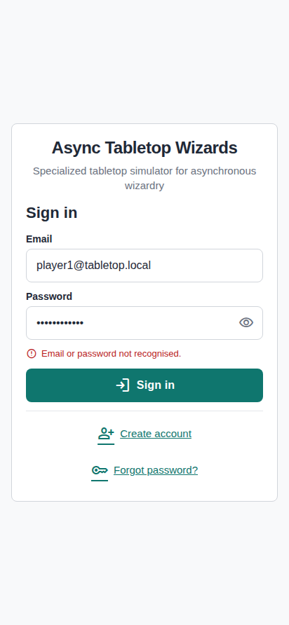
:::
::: {.landscape}
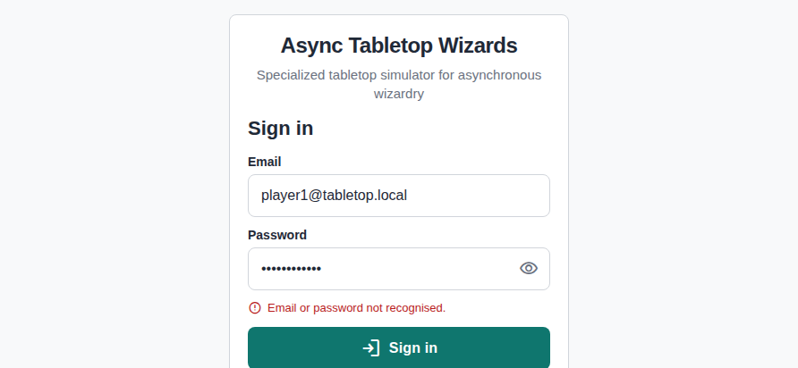
:::
:::

**Layout (confirmed D-292):** both orientations center the **same bounded login
card**, including app name/subtitle, without a landscape intro/form split. The
short landscape viewport scrolls this unchanged card rather than shrinking targets
or switching composition. Email and
Password are text fields; the eye is an icon button. Sign in, Create account and
Forgot password are labeled actions. The image deliberately includes an example
credential error; a clean initial form omits that message.

**Interaction:** Sign in submits credentials. Failure keeps inputs available for
correction; success opens the main menu or resumes the same-account return
context. A valid existing login skips this screen across ordinary restarts and
inactivity. No guest entry, alternate social provider or routine session expiry.
Password visibility is personal UI only. Back does not sign another device out.

**Basis:** D-188, D-197, D-217, D-249, D-268, D-289, D-292.
:::

::: {.screen-section}
## A02 — Create account

::: {.screen-pair}
::: {.portrait}

:::
::: {.landscape}
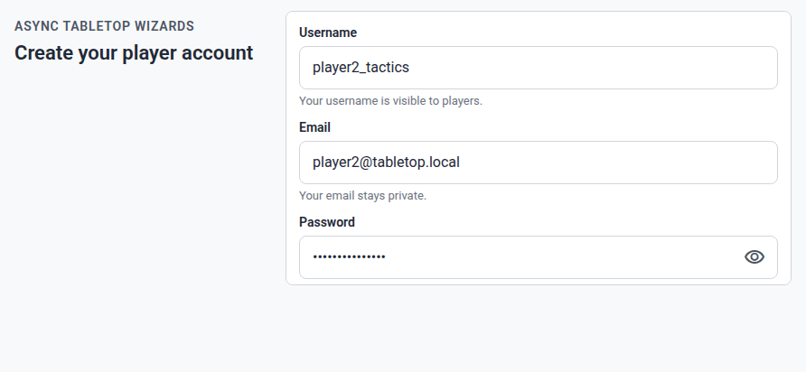
:::
:::

**Layout:** Username, Email and Password are fields. The password eye is an icon;
Create account and Sign in are text actions. Landscape uses the width for an
intro/form split and allows the form panel to scroll, not smaller touch targets.

**Interaction:** registration uses these three credentials; username is public
player identity while email is private. Invalid input/network failure stays on
this form with a specific inline explanation and preserved editable input.
The proposed successful route returns to A01 with a success notice and known
email populated; it does not invent an email-verification gate. No confirmation
password, social login or profile editor is required by this draft. Password
whitespace/Unicode handling stays consistent with sign-in and reset.

**Basis:** D-197, D-249; success navigation and exact feedback are UI proposals.
:::

::: {.screen-section}
## A02b — Registration: lower form

::: {.screen-pair}
::: {.portrait}
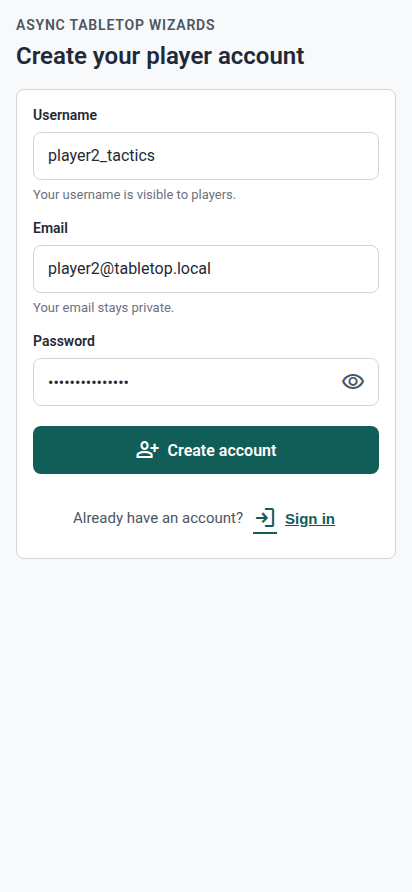
:::
::: {.landscape}
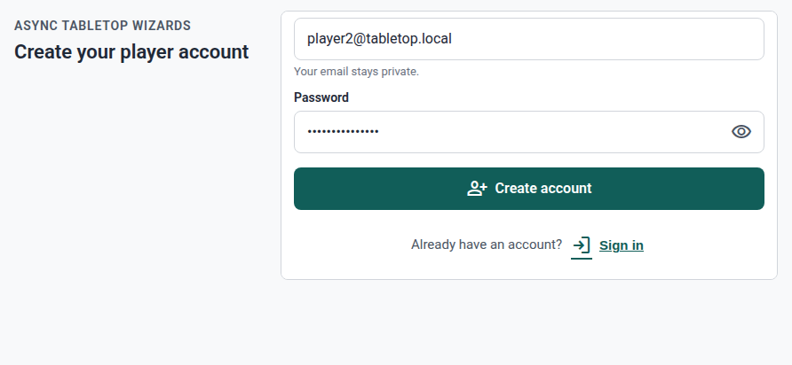
:::
:::

**Same screen, different scroll position:** the short landscape form panel is
scrolled to its bottom to expose Create account and the Sign in link at full
touch size. The portrait form fits already, so that capture is unchanged. This
is not a separate registration step, new server state or submission. It makes
the landscape scrolling cost visible rather than hiding it in the tap budget.
:::

::: {.screen-section}
## A03 — Password reset email

::: {.screen-pair}
::: {.portrait}
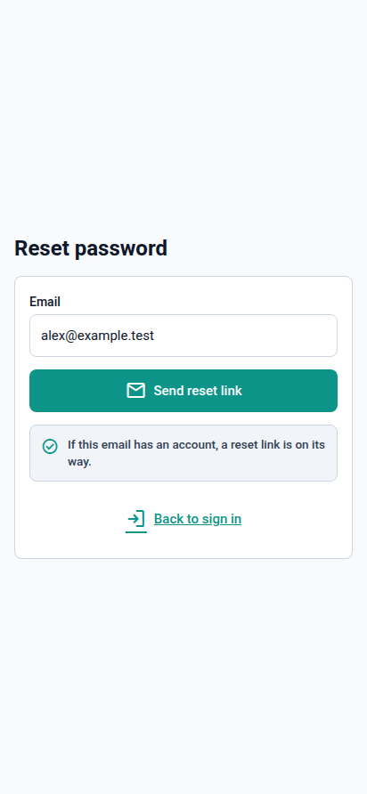
:::
::: {.landscape}
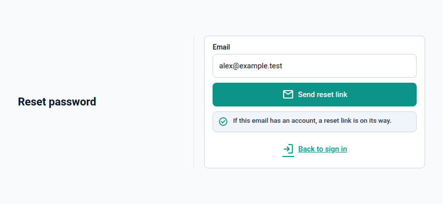
:::
:::

**Layout:** one Email field, Send reset link text button, neutral submitted-state
notice and Back to sign in. The initial state uses the same structure without
the submitted notice. No session/sign-in explanation on the screen (D-292).
The sample email is synthetic, not account data.

**Interaction:** request an email reset link without revealing whether that
address is registered. A delivery/request failure keeps the address editable and
shows a retryable inline error; it does not claim the password changed. Merely
requesting or opening a reset link does not revoke sessions. The successful
email-link flow continues at A04, not an invented six-digit-code screen.

**Basis:** D-197, D-279; neutral response follows the authentication profile.
:::

::: {.screen-section}
## A04 — Set a new password

::: {.screen-pair}
::: {.portrait}
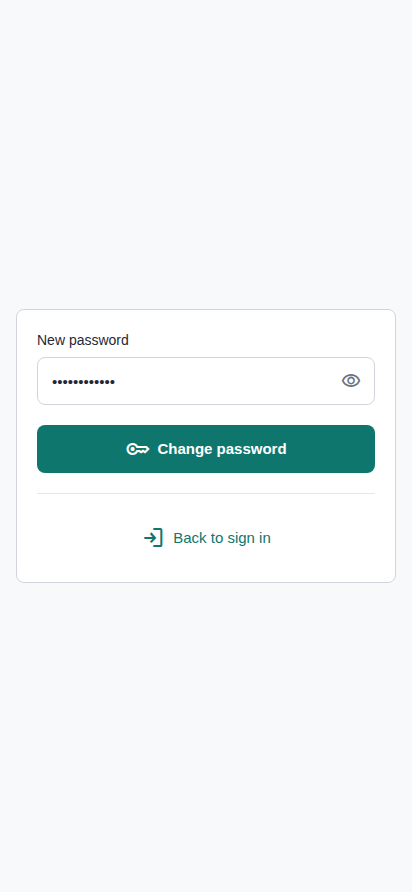
:::
::: {.landscape}
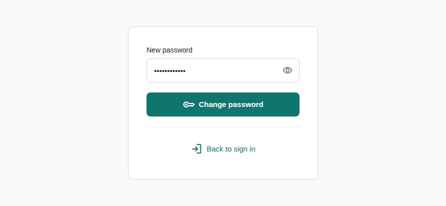
:::
:::

**Layout:** New password is a field; its eye is an icon button. Change password
is a text button. The valid reset-link state is shown. Email and username are
not additional editable account settings here. Remove session/sign-in explanations
and generic reassurance copy from the screen (D-292); the behavior below remains.
The compact form is centered without an empty landscape explanation panel.

**Interaction:** successful reset changes the password and revokes existing
sessions for new requests, then returns to Sign in with a success notice. An
expired/invalid/already-used link instead shows a non-actionable error and a
Request another link route to A03; it does not submit a reset or revoke sessions.
Do not silently trim password contents. Already-authorized/in-flight requests
may still finish normally; the UI must not promise recall of those operations.

**Basis:** D-197, D-249, D-279, D-289. Alternate link/error state is described here
but not separately pictured in this pilot.
:::

::: {.screen-section}
## N01 — Main menu

::: {.screen-pair}
::: {.portrait}
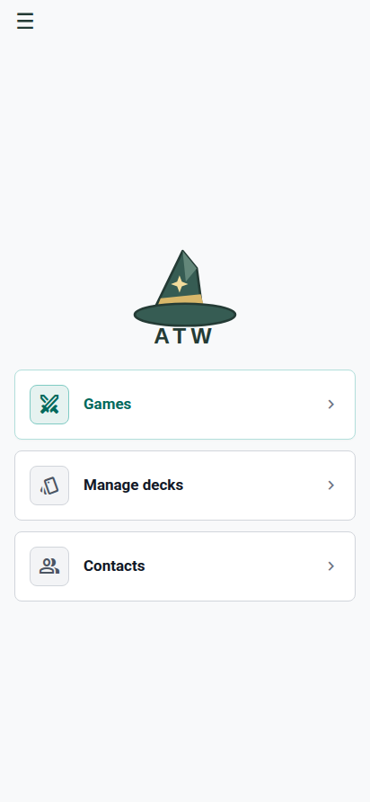
:::
::: {.landscape}
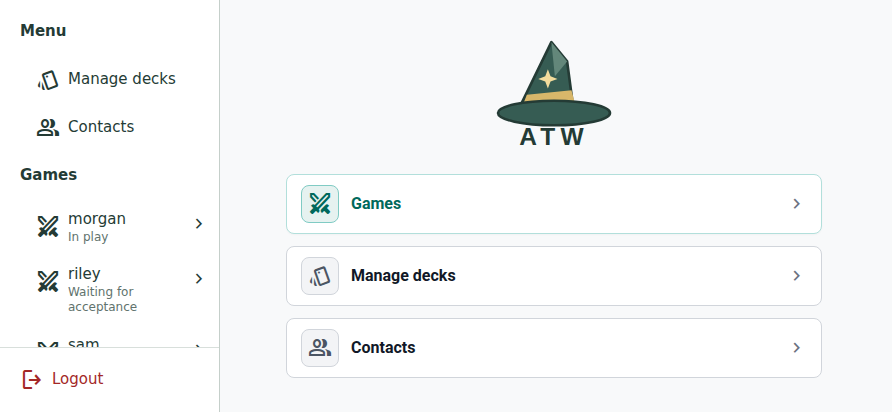
:::
:::

**Layout (D-292/D-293):** an **ATW** logo sits above Games, Manage decks and Contacts.
The pictured wizard hat is a provisional motif, not final approved logo artwork.
Destinations are large icon-plus-text
destinations, without explanatory subtitles/marketing text. No notification-settings
or direct Logout link in main-menu content. Landscape includes the shared persistent
navigation; portrait uses the hamburger. See N02 for its open state.

**Interaction:** Games opens P01; Manage decks opens D01; Contacts opens P02.
Logout from the navigation footer immediately clears this device's login and private downloads, returning
to A01 without deleting server games/decks or logging out independent devices.
Remote revocation is best effort. This proposed layout does not add a routine
logout confirmation or expose account-email data in shared player lists.

**Basis:** D-188, D-196, D-218, D-220, D-241, D-282, D-289, D-292.
:::

::: {.screen-section}
## N02 — Shared Menu / Games navigation

::: {.screen-pair}
::: {.portrait}
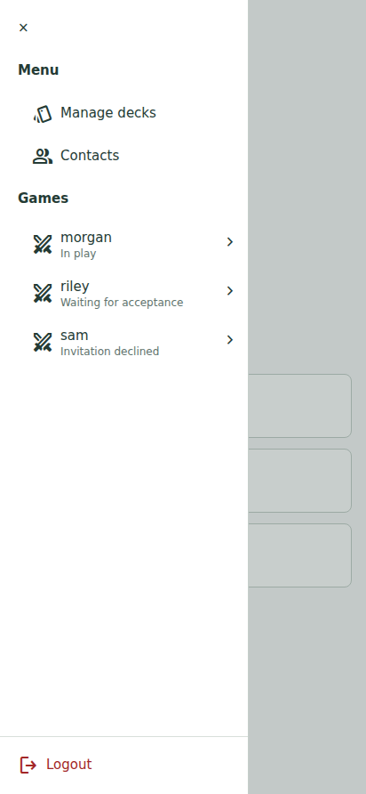
:::
::: {.landscape}
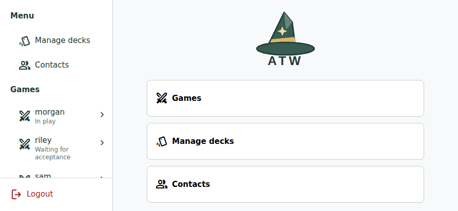
:::
:::

**Confirmed structure (D-292):** Menu and Games are clickable top-level
destinations, not expand-only headers. Menu opens N01; its indented subitems are
Manage decks and Contacts only. Games opens P01; its indented list contains each
current game, including waiting/preparation states, not a separate Lobbies category.
Task screens needing a selected deck/game stay in their contextual routes.
**D-293:** indented destinations/game entries and fixed Logout each have an
appropriate icon; corresponding main-menu options use the same symbols. Menu and
Games top-level categories remain text. Game entries omit “With”; a chevron opens
the current context. Long press/accessibility actions use P03/P04's lifecycle rules.

**Scrolling:** the category/subitem/game area scrolls independently; Logout stays
in a fixed non-scrolling bottom footer. Portrait hamburger opens this drawer;
Close, Back or tapping outside dismisses it without a shared change. Landscape
non-gameplay screens always show the navigation alongside content. Gameplay in
either orientation keeps it collapsed until the hamburger is used; it must not
permanently reduce the landscape board. A modal temporarily blocks background
navigation until dismissed. Rotation retains the current destination and unfinished
input while switching navigation presentation, not issuing another request.

**State:** game rows open that same game's current table or lobby. Setup → play,
return-to-lobby, acceptance and cancellation update the same listing under existing
server lifecycle rules; no duplicated “lobby versus game” identity. Incoming invites
not yet accepted remain in P01's Invitations section, not playable own-game rows.
Example usernames/status labels are synthetic; row geometry remains reviewable.

**Provenance:** locally composed inert design derivative, not a new Stitch screen
or working navigation. The surrounding screenshots apply the same shared shell.
:::

::: {.screen-section}
## P01 — Games and invitations

::: {.screen-pair}
::: {.portrait}
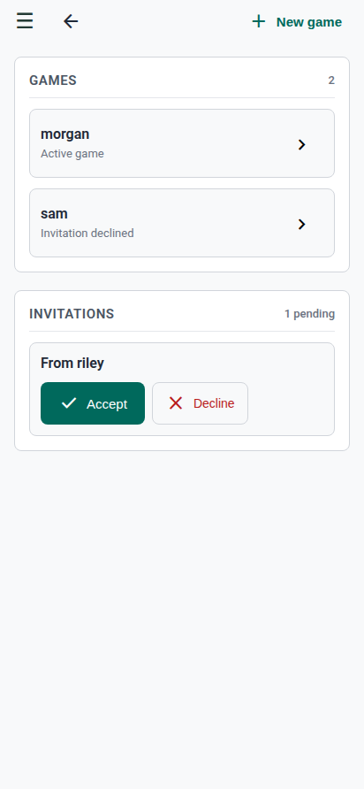
:::
::: {.landscape}
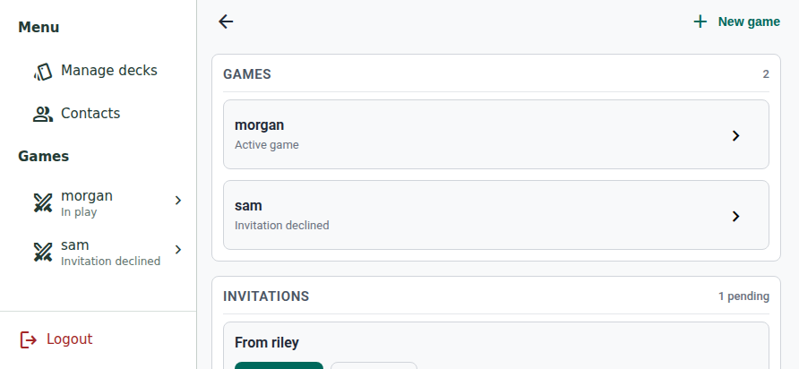
:::
:::

**Layout (D-292):** one Games list contains in-play and setup/lobby states;
Invitations follows it, not before or as a separate left-hand first column.
Accept/Decline and New game use icons + labels. Game names omit “With”/“Game with”;
Open is just a right chevron. Necessary lifecycle
status labels distinguish rows without inventing a structural Lobbies category.
The same order applies in landscape, beside persistent navigation; lists scroll.

**Interaction:** Accept enters the exact existing lobby as L02, without Ready or
an immediate start. Decline retains the inviter's lobby/preparation/Ready.
Reinvite is **inside** that lobby, not a Games-row action, and never creates a
replacement game. Long press/accessibility opens P03's context menu; active Delete
requires P04's extra confirmation and removes the shared game for both players.
Invitations do not expire
automatically; cancelling a game removes its invitation and current listing.
Open active game reaches G01; a setup row opens its existing lobby. New game opens P02. An empty list
would show “No current games” with New game, not a finished-game archive.

**Basis:** D-188, D-195, D-208, D-209, D-214, D-287, D-292. Empty/loading states are not
separate mockups yet; no unread/read, presence or result statistics are implied.
:::

::: {.screen-section}
## P03 — Long-press game context

::: {.screen-pair}
::: {.portrait}
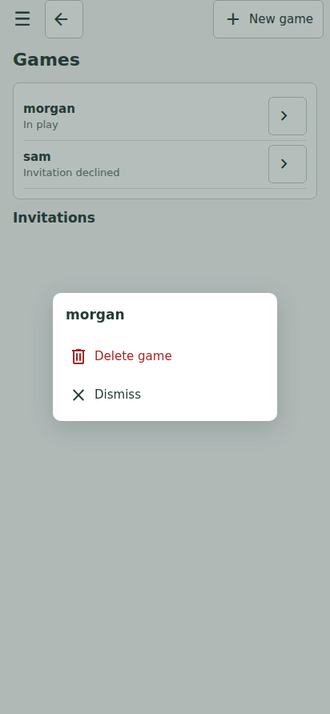
:::
::: {.landscape}
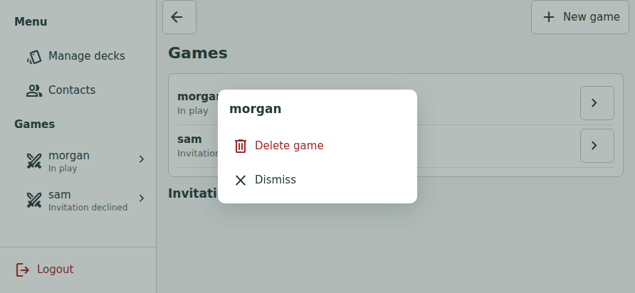
:::
:::

**Confirmed (D-293):** long press a Games or navigation game row; do not also open
it. Active play offers icon + **Delete game**; setup instead offers icon + **Cancel
game**, retaining the existing L06 cancellation route. Dismiss/native Back/outside
tap leaves the game unchanged. No Reinvite in the list/context menu: open the
existing lobby for it. Equivalent explicit native accessibility actions are required.
Choosing active Delete only opens P04; the hold/menu choice alone sends no deletion.
:::

::: {.screen-section}
## P04 — Confirm active shared-game deletion

::: {.screen-pair}
::: {.portrait}
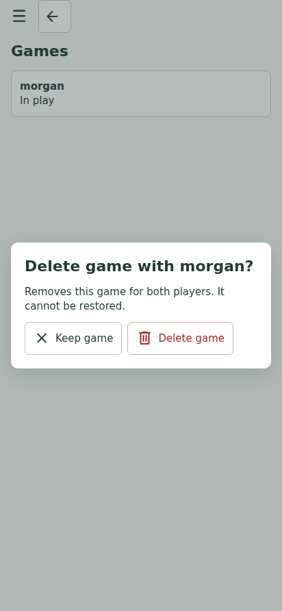
:::
::: {.landscape}
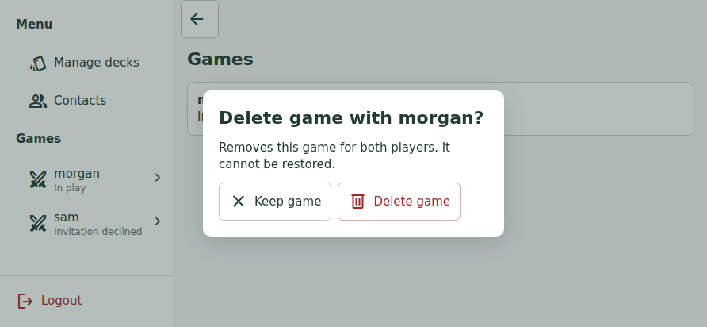
:::
:::

**Owner clarification:** active games also have Delete, with this **extra dialog**;
confirmed removal is for **both players**, not hide-for-me. Keep game/native Back
sends nothing. Confirm requests deletion of the captured game and active incarnation
through the server. Success removes listings/access for both and leaves for Games;
there is no result, reusable lobby, Undo or restore. This is separate from normal
cooperative result suggestion/acceptance. A stale confirmation after return/fresh
start fails rather than deleting a different incarnation. Retry recovers the same
outcome; a timeout is not proof of success. No instant disconnected-device erasure
or permanent server/backup destruction is promised. Scope warning is essential
decision copy, **not** an expendable tutorial paragraph.
:::

::: {.screen-section}
## P02 — Contacts and new game

::: {.screen-pair}
::: {.portrait}
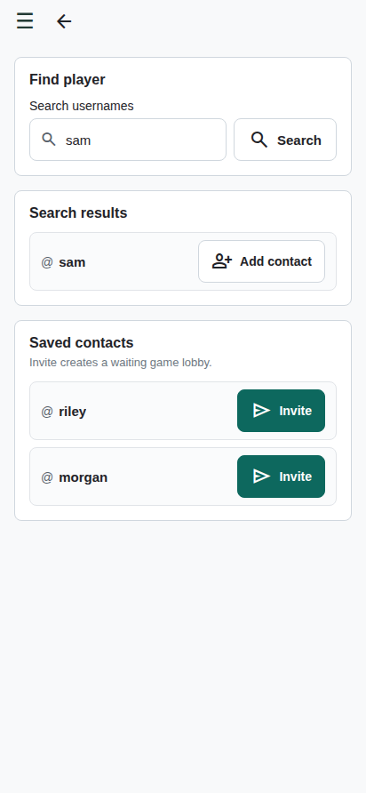
:::
::: {.landscape}
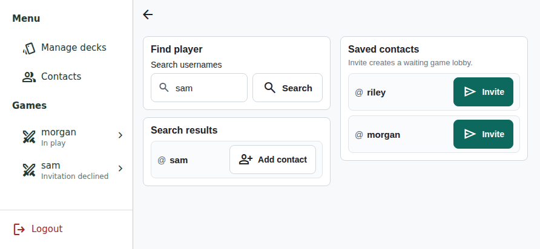
:::
:::

**Layout:** Search usernames is a field; search magnifier is a supporting icon.
Search, Add contact and Invite are labeled text actions. Saved contacts and
search results remain separate. No email addresses or online-status dots.

**Interaction:** Search produces explicit username matches; Add contact saves a
contact directly with no friend-request approval. A newly saved contact gets
Invite in the contact list. Invite creates a game plus its first invitation and
opens L01. There is no extra confirmation/selection wizard or automatic recipient
acceptance. No results uses an inline “No matching usernames” notice, not a
missing-user substitution. Removing contacts is not invented by this pilot.

**Basis:** D-195, D-196, D-197, D-218. Exact search matching is not settled by
these example names or the placement of the Search button.
:::

::: {.screen-section}
## D01 — Saved decks

::: {.screen-pair}
::: {.portrait}
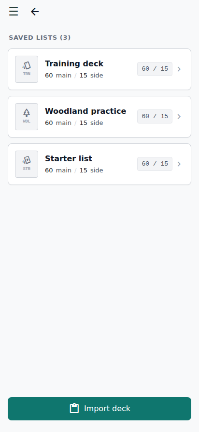
:::
::: {.landscape}
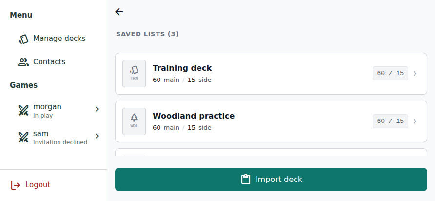
:::
:::

**Layout:** named deck rows/cards use cover placeholders and descriptive
mainboard/sideboard counts. Import deck is a labeled text action with a supporting
icon **fixed at the bottom**, below the scrolling list, not above it (D-293).
Opening a deck goes to D02. An empty collection keeps Import deck visible.

**Interaction:** collection names/lists/covers synchronize between the account's
devices. Saved card-list changes happen through import, not individual quantity
editors or a deck-builder search. No Export, legality badge, restore bin,
win-rate statistics or gameplay Undo for collection deletion. Missing artwork
uses the deck/card text fallback and does not prevent import or deck selection.

**Basis:** D-189, D-198, D-199, D-218, D-221, D-241, D-271.
:::

::: {.screen-section}
## D02 — Saved deck details

::: {.screen-pair}
::: {.portrait}
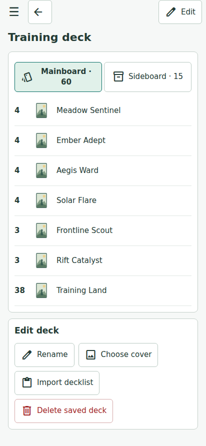
:::
::: {.landscape}
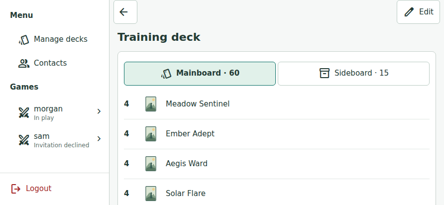
:::
:::

**Layout (D-293):** quantity → small art thumbnail → card name; a thumbnail/row
press opens D08 full inspection. The small visible art has a full-size touch target.
Mainboard/Sideboard tabs choose the read-only saved section, not in-game zones.
The capture shows **Edit expanded** with Rename, Choose cover, Import decklist
and Delete saved deck, all icon + label. This is not a quantity editor/card builder.

**Interaction:** proposed Rename opens a small name-field dialog with Save name
and Cancel; it cannot change card quantities. Choose cover opens D05. **Edit →
Import decklist** opens D07 bound to this deck; Delete opens D06.
Saving or deleting this collection entry never rewrites copies already selected
in a lobby/game. Card names and counts in the mockup are illustrative synthetic
data, not a real valid import or a required deck-size rule.

**Basis:** D-189, D-199, D-221. Rename's edit state is described but not separately
pictured; naming/duplicate policies are not inferred from the example.
:::

::: {.screen-section}
## D03 — Import with unresolved names

::: {.screen-pair}
::: {.portrait}
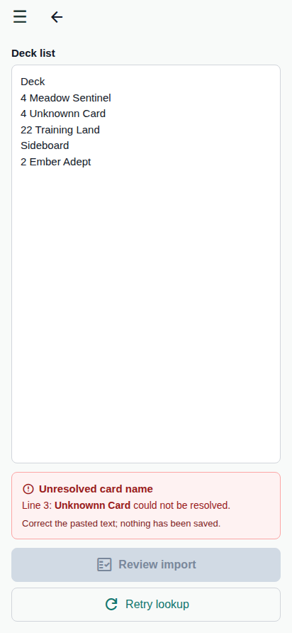
:::
::: {.landscape}
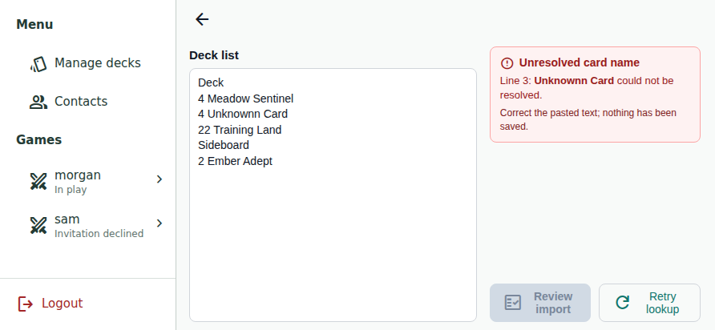
:::
:::

**Layout:** Deck list is a multiline text field, not a card builder. The error
identifies the unresolved line. Review import is unavailable while entries are
unresolved. Landscape uses an input/issues split; input and feedback must both
remain reachable rather than squeezing the text area into a one-line field.

**Interaction:** accept ordinary quantity/name lists, common optional printing
suffixes and supported mainboard/sideboard separators. Correct the pasted text
or retry lookup; never silently choose an ambiguous card or save a partial list.
Nothing replaces a saved deck on lookup/transport failure. When all entries
resolve, Review import advances to D04. Art downloading and obtaining the newest
entire catalog are not save prerequisites. No separate Send/definition-upload UI.

**Basis:** D-198, D-271, D-289. The misspelled synthetic entry deliberately models
an error; these fake card names do not claim compatibility with a live catalog.
D04 uses a separate complete sample, not the computed count of this short list.
:::

::: {.screen-section}
## D04 — Resolved new import and save

::: {.screen-pair}
::: {.portrait}
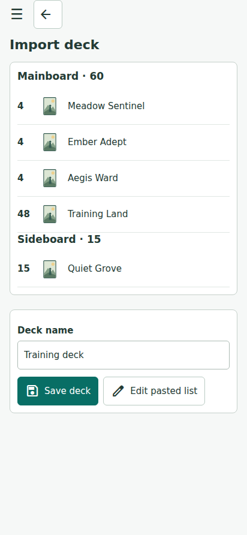
:::
::: {.landscape}
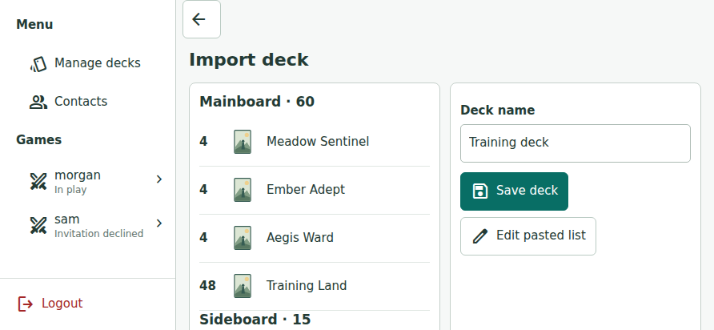
:::
:::

**Layout (D-293):** section counts and read-only art/name/quantity preview accompany
a Deck name field. This **new-import** route has no Save-new/Replace selector or
existing-deck picker. Save deck and Edit pasted list use icons + labels.
Cover selection is optional later metadata, not a forced extra import step.

**Interaction:** Save deck creates a distinct saved entry. Existing-deck updates
instead start at D02 Edit → D07 Import decklist, with Overwrite/Merge toggle.
Neither route changes a lobby/game's selected copy. Save
requires fully resolved definitions and atomic server acceptance; failure retains
the previous valid saved deck and editable input. Success returns to D02 (or the
calling lobby deck picker when import was launched there). This ordinary form
save is not a gameplay Send gate or proof of format legality.

**Basis:** D-198, D-199, D-221, D-271, D-289. The two-step input/review presentation
is proposed and can be simplified during owner review.
:::

::: {.screen-section}
## D04b — Import review: save controls

::: {.screen-pair}
::: {.portrait}
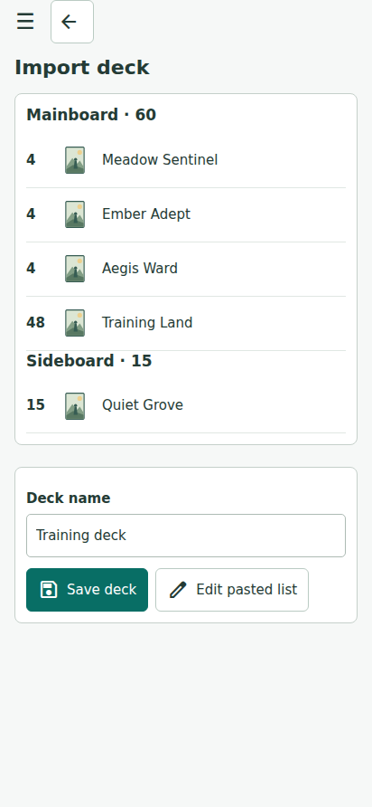
:::
::: {.landscape}
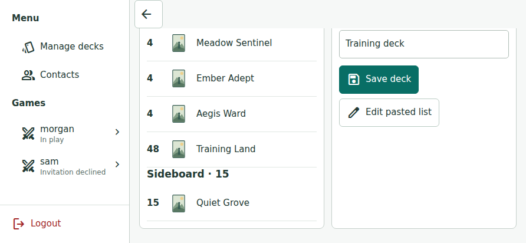
:::
:::

**Same screen, bottom scroll position:** retain this continuation to check D04's
actions after content scrolling; short content may already fit. There is no generic
replacement selector. Existing-deck import is D07, not a required extra new-import
step or Send/upload action. No target shrinks to fit.
:::

::: {.screen-section}
## D07 — Edit → Import decklist

::: {.screen-pair}
::: {.portrait}
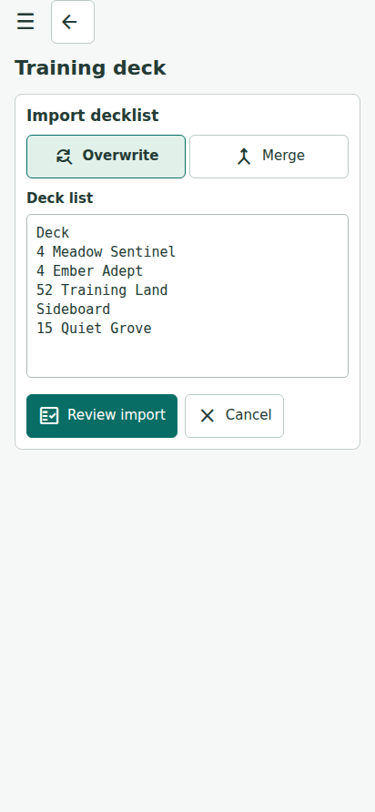
:::
::: {.landscape}
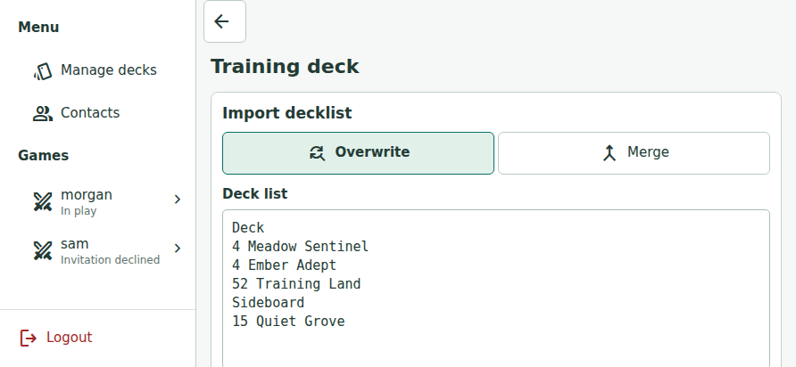
:::
:::

**Confirmed (D-293):** reach this through D02 **Edit → Import decklist**. The deck
target is already known and named; there is no generic “replace which deck?” picker.
A fresh invocation defaults to **Overwrite**. **Merge adds quantities** within each
section: existing 4 + imported 2 = 6, untouched cards remain, new cards are added.
Mainboard and Sideboard stay separate. An omitted sideboard becomes empty on
Overwrite and stays intact on Merge. These rules follow the owner's additive
answer, not a maximum-count/set-union interpretation.

Review import resolves every entry before showing the resulting list and Save deck.
That contextual review retains the target/mode and previews the **result**, not just
the incoming delta. Invalid input/failure leaves the prior saved deck unchanged;
server serialization/dedup prevents double Merge on retry. Save updates only this
collection entry; selected lobby/game copies survive. Cancel/Back leaves without
saving. Mode explanation belongs in these notes/accessibility help, not a permanent
paragraph beside an otherwise self-explanatory toggle. Resolution/save error and
Merge-result previews are described, not separately captured in this round.
:::

::: {.screen-section}
## D08 — Full card/art inspection

::: {.screen-pair}
::: {.portrait}
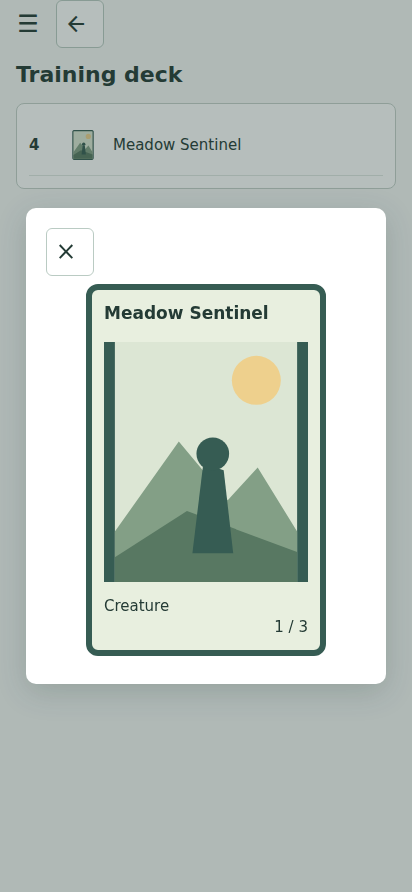
:::
::: {.landscape}
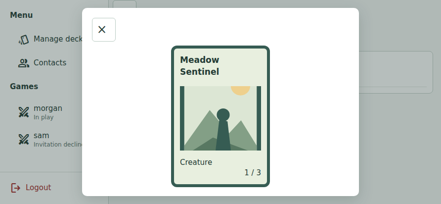
:::
:::

**Confirmed direction (D-293):** press the art thumbnail immediately after quantity,
or the card row, to open full inspection with the same card/art presentation used
during gameplay. Close/native Back dismisses without changing the deck, preparation
or history. Thumbnail art is visually small but its independent target remains
48 × 48; a row action provides a larger alternative. Synthetic locally authored
art stands in for lazy provider artwork; missing art falls back to card name/text
without blocking inspection, import or Ready. This is a presentation reference,
not an approved card-face style, full gesture implementation or permission to
ignore gameplay hidden-face/disclosure rules. Full card text, faces, image failure,
zoom/large-text and gameplay-specific states still need their own visual checks.
:::

::: {.screen-section}
## D05 — Choose a deck cover

::: {.screen-pair}
::: {.portrait}
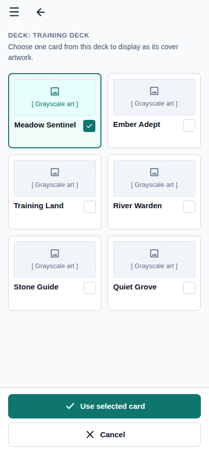
:::
::: {.landscape}
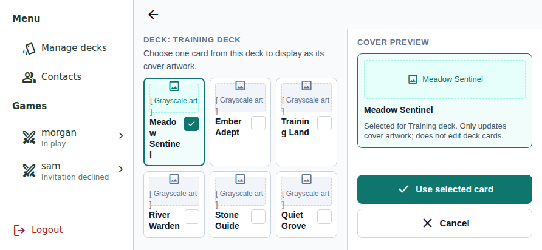
:::
:::

**Layout:** card-name tiles are selectable thumbnails, not card-edit controls.
The selected tile has an outline/check plus text. Use selected card confirms the
metadata choice; Cancel/Back leaves it unchanged. Landscape uses the short width
efficiently while allowing the grid to scroll.

**Interaction:** select one card already in this deck as its cover. No image
upload, crop tool, outside-catalog cover choice or mutation of that card. Text
fallback remains available while art is absent. The small selection/confirmation
step is a reviewable UI proposal, not a new game-action confirmation requirement.
Cover fallback after a later re-import is not decided by these example tiles.

**Basis:** D-199, D-271.
:::

::: {.screen-section}
## D06 — Delete a saved deck

::: {.screen-pair}
::: {.portrait}
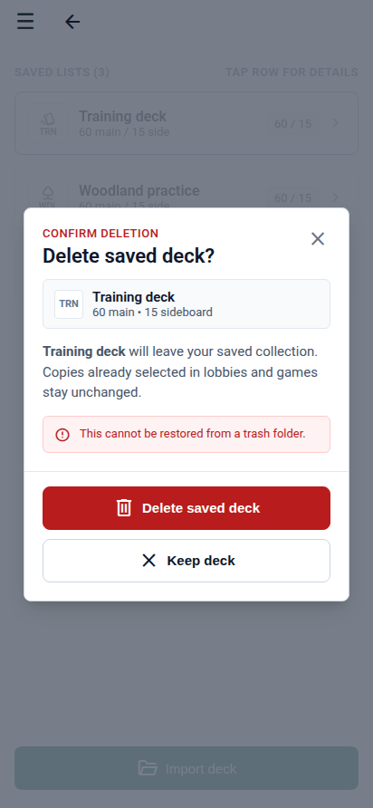
:::
::: {.landscape}
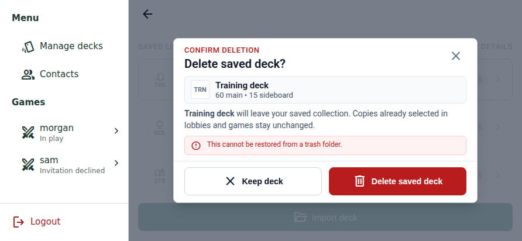
:::
:::

**Layout:** a bounded modal over the collection, with Keep deck and Delete saved
deck as text buttons. The destructive button is distinguished by wording as well
as styling. Background rows are not interactive while the modal is open.

**Interaction:** Keep deck/Back cancels this dialog without deleting anything.
Delete saved deck requests collection deletion and returns to D01 after success.
Selected game/lobby copies survive. No trash folder, gameplay Undo or misleading
“Undo deletion” snackbar is offered. A failed deletion reports its actual failure
without optimistically claiming permanent success. This one destructive-data
confirmation is a proposal, not a universal confirm-every-action policy.

**Basis:** D-221, D-241; exact confirmation presentation is UI design work.
:::

::: {.screen-section}
## L01 — Retained inviter lobby after decline

::: {.screen-pair}
::: {.portrait}
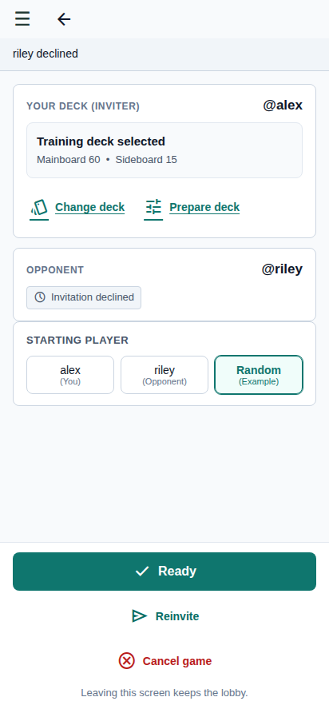
:::
::: {.landscape}
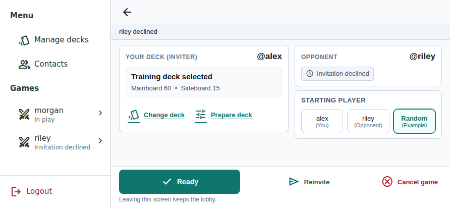
:::
:::

**Layout:** own deck/preparation, recipient invitation status, starter choice and
Ready are distinct. Ready is enabled because this example has an own selected
deck, even though riley has not accepted. D-293 now pictures the retained **declined**
state with Reinvite inside this same lobby. The pending variant omits Reinvite
and says Invitation pending; it is not a separate game. Cancel game is separate from Back.
Random is an illustrative selected value, not an approved universal default.

**Interaction:** Change deck opens L03; Prepare deck opens L04. Ready can persist
before acceptance. The opponent's later acceptance opens this same lobby without
resetting the inviter's preparation or Ready. Decline retains it and permits
Reinvite through the existing-lobby path. Cancel game removes this pending invite
and its game; merely leaving the screen does neither. No host Start or expiry.

**Basis:** D-195, D-201, D-204–D-209, D-287.
:::

::: {.screen-section}
## L02 — Accepted lobby before own deck selection

::: {.screen-pair}
::: {.portrait}
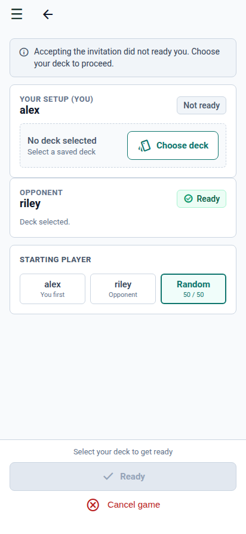
:::
::: {.landscape}
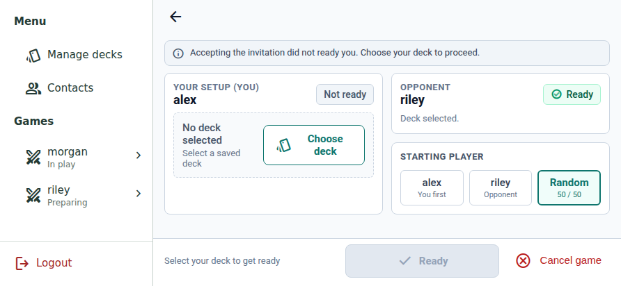
:::
:::

**Layout:** Choose deck is the own-side primary action. Opponent Ready is an
explicit status with text/checkmark, not permission to start for them. Own Ready
is disabled with the visible reason “Select your deck.” Starter offers either
participant or Random; it is not a pre-start reroll.

**Interaction:** Accepting P01 did not select a deck, Ready or immediately start.
Select an existing saved deck through L03; no legality or size check is added.
After selection, Prepare deck and enabled Ready use L01/L05's layout with accepted
opponent status. Changes to own deck/preparation/starter clear only the changing
player's Ready. Late lobby edits after the game starts fail normally; the screen
must move to the actual active game rather than reopening the lobby.

**Basis:** D-190, D-191, D-195, D-201, D-204, D-205, D-274.
:::

::: {.screen-section}
## L03 — Select a game-local deck copy

::: {.screen-pair}
::: {.portrait}
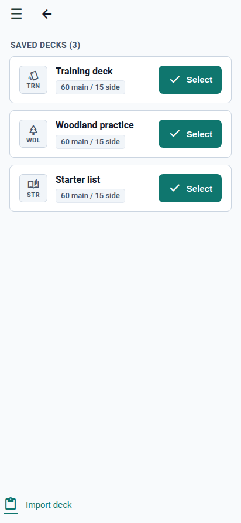
:::
::: {.landscape}
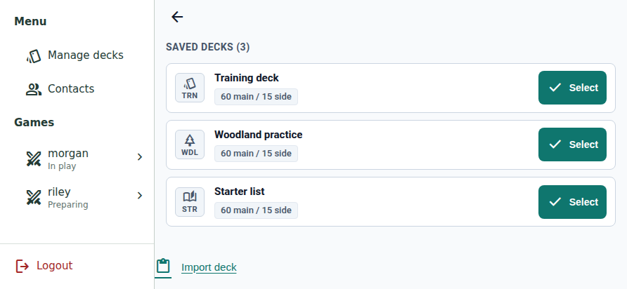
:::
:::

**Layout:** saved deck name, cover fallback and descriptive counts accompany each
Select text action. Import deck is a secondary escape when the collection lacks
the desired deck, not a required detour for normal selection.

**Interaction:** Select creates/replaces this game's prepared copy and returns
directly to its lobby. It clears own Ready without affecting the opponent's.
It does not edit the saved source, auto-ready or require another Send/confirmation.
Deleting/editing the source later leaves this copy intact. Back cancels the picker
without changing selection. An empty collection uses the same Import route;
there is no automatic blank deck or silent substitute.

**Basis:** D-189, D-191, D-199, D-205, D-221.
:::

::: {.screen-section}
## L04 — Prepare mainboard and sideboard

::: {.screen-pair}
::: {.portrait}
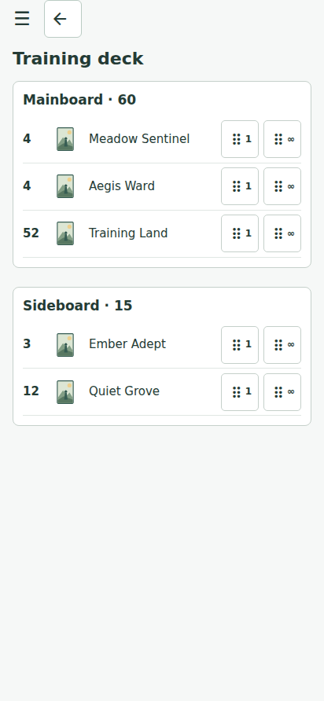
:::
::: {.landscape}
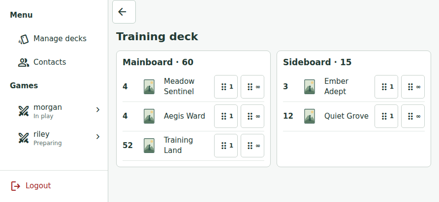
:::
:::

**Layout (D-293):** Mainboard and Sideboard are separate drop-target panels.
Every quantity/art/name row has **two separate drag handles**: grip + **1** for one
copy, grip + **∞** for all copies. These are drag origins, not Move buttons or a
select-row-then-transfer step. Portrait stacks the panels; landscape uses columns;
long content scrolls without shrinking the 48 px targets. Exact handle art is provisional.

**Interaction:** drag the appropriate handle to the other panel in either direction,
without one-for-one or legal-size enforcement. All captures the row's concrete
copies at drag start, not later arrivals. Cancel/outside drop sends nothing; a
successful drop emits ordinary per-card preparation requests, not per-frame writes
or a new atomic bulk transaction. Show actual partial outcomes under normal guards.
Native accessibility provides equivalent one/all actions without persistent Move
buttons. Press the thumbnail/row instead to inspect, never to transfer. Completed transfers
automatically synchronize, clear only own Ready and leave the saved deck alone.
No Save preparation/Done-to-send is required. Back simply returns to the lobby.
On entering actual play, no Sideboard view/edit/move path exists. The shown
handle glyphs/drag feedback remain visual proposals, not a change to transfer scope.

**Basis:** D-189, D-191, D-202, D-203, D-259.
:::

::: {.screen-section}
## L05 — Own Ready accepted

::: {.screen-pair}
::: {.portrait}
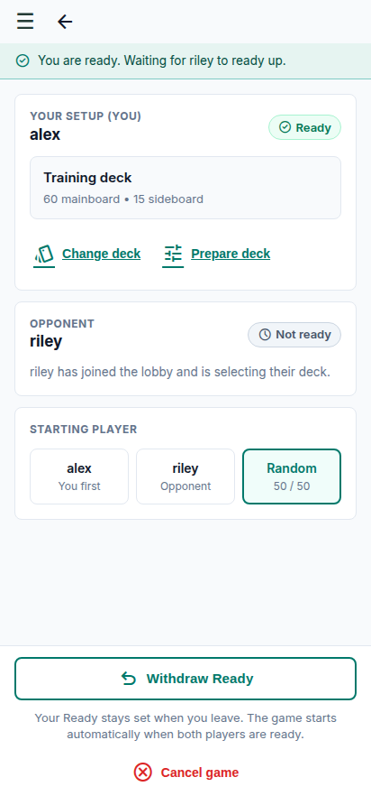
:::
::: {.landscape}
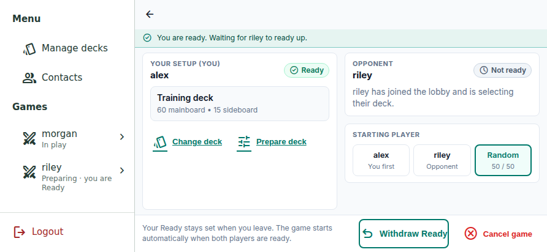
:::
:::

**Layout:** own Ready is a textual status/checkmark. Withdraw Ready is an explicit
action; Change deck/Prepare deck remain discoverable. No host Start button or
both-online indicator. Cancel game remains separate and applies only before start.

**Interaction:** Ready persists after leaving/disconnection; it is not a liveness
lease. The second accepted Ready starts once, even while the first player is away.
Start shuffles both Libraries, sets life to 20, resolves a selected Random starter
and begins turn 1 at Untap, with **no automatic opening draw**. The extended packet
then uses G01 (G00 is the original placeholder). On returning after an accepted game ending, restore last prepared
decks, clear both Ready and use this lobby structure in its not-ready state;
both must ready again. Back alone never withdraws Ready or cancels the game.

**Basis:** D-190, D-200, D-204, D-205, D-213, D-274.
:::

::: {.screen-section}
## L06 — Cancel an unstarted game

::: {.screen-pair}
::: {.portrait}
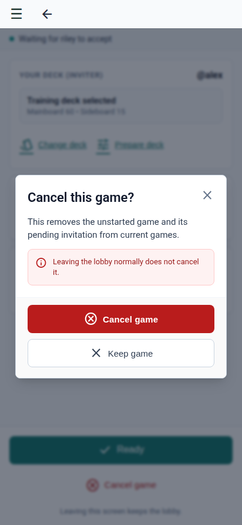
:::
::: {.landscape}

:::
:::

**Layout:** proposed confirmation with Keep game / Cancel game text buttons. The
dimmed background is a lobby, not a live game. Back/close keeps the game.

**Interaction:** either participant can request cancellation before start without
the other player's approval. It removes the current listing and pending invite;
there is no trash/restore UI. Leaving the screen is different and preserves the
lobby/Ready. If start already won the normal server ordering race, do not cancel
or reset that started play; show the current game. Reinvitation must not revive
a cancelled lobby. This dialog is not the gameplay result-suggestion/acceptance
flow, which is intentionally excluded from the pilot.

**Basis:** D-205–D-209, D-241, D-287. The extra cancellation confirmation is a
reviewable UI proposal, not approval of an extra gameplay-ending confirmation.
:::

::: {.screen-section}
## G00 — Gameplay intentionally omitted

::: {.screen-pair}
::: {.portrait}

:::
::: {.landscape}

:::
:::

**Layout:** only a shell, Back and a clearly labeled empty content area. This
gives the non-gameplay navigation a destination and demonstrates two orientations.
It does not settle how much space the real board, hand, history or controls get.

**Interaction:** the original non-gameplay pilot terminated active-game Open and
automatic start transitions here; the D-291 extension now uses G01. Start remains automatic on both Ready;
there is no Start control here. Back returns to current games, not a shared game
Undo, game cancellation or result suggestion. No Sideboard is shown during play.

**Scope:** this placeholder is retained only for the original pilot's provenance.
The live/history/combat/Stack direction is now pictured below; full card/reveal/
inspection/chat/result overlays and expanded branch navigation remain unpictured.
:::

::: {.screen-section}
## U01 — Reconnecting and downloaded read-only review

::: {.screen-pair}
::: {.portrait}

:::
::: {.landscape}

:::
:::

**Layout:** Reconnecting is a status dialog over the same deliberately empty
area. Review downloaded data and Back to games are text navigation actions.
This proposes a clear way out of the blocking dialog without enabling mutations.

**Interaction:** shared actions stay blocked while disconnected, including Undo,
Ready, branch activation and new inspection requiring exposure logging. Downloaded
read-only navigation remains available. This does not create offline actions or
a manual-resend/recovery-center workflow. Same-process reconnect automatically
recovers actual already-sent outcomes with original identities. Process restart
instead syncs server state and may lose uncommitted local work. Unknown outcome
is not rejection; the UI must not invite duplicate submission as a fresh action.

**Basis:** D-182, D-215, D-216, D-241, D-246, D-252, D-278. The exact dialog escape
and wording are UI proposals. This original capture still omits the board;
the same blocking/read-only rule applies over the new gameplay layouts.
:::

::: {.screen-section}
## G01 — Live table and fixed hand

::: {.screen-pair}
::: {.portrait}

:::
::: {.landscape}

:::
:::

**Layout:** own battlefield below, opponent above, reflected top/bottom while
retaining x positions. Each has an outer darker one-row band and inner lighter
two-row band. These are **one generic battlefield per player**, not new land/
creature zones or type restrictions. All faces point toward the viewer; only
ordinary tapped cards rotate. Empty slots/rows are visual framing, not a capacity
limit. The camera can pan beyond occupied columns by a still-unspecified margin.

**Fixed versus movable:** the owner's Hand hovers below the land band and above
bottom controls, independent of board panning. The proposed opponent Hand is a
covered top row. Both players' Library/Graveyard/Exile counts and proposed life
grouping occupy the central strip in portrait, a **left** sidebar in landscape.
The board camera alone pans/zooms; fixed docks do not become shared placement.
Small abstract thumbnails stand in for zoomable cards, not legible full-size faces.
Dense states may need vertical navigation; readable minimum card/peek targets and
expanded Hand geometry still need device/gesture review.

**Controls:** bottom-left tap Undo / hold Redo; bottom-center contextual actions;
bottom-right current mode. The proposed mode square opens explicit Normal /
Select / Ping choices. Select toggles membership editing without clearing the
selection when turned off; Ping consumes its taps. Phase tap opens the existing
tracking picker, not an automatic game action. History opens personal review.
Overflow exposes Redo, Chat and full Game actions; a generic Actions affordance
does not invent a phase shortcut or remove the full per-card action paths.

**Gestures:** normal single tap opens captured-scope card Actions; double tap
performs one selection-aware tap/untap. Hold inspects; drag moves the captured
card/selection. Empty-space drag selects; two-finger pan/pinch navigates. These
are documented interactions, **not functioning gestures in these static files**.
Own/opponent hidden-face rules remain unchanged. No in-game Sideboard, Send,
presence, turn lock or inferred card rules.

**Basis:** D-267/D-281, D-259 and D-291; board/inspection contracts. Life placement,
top Hand and control shapes remain review proposals.
:::

::: {.screen-section}
## G02 — Live combat and populated Stack

::: {.screen-pair}
::: {.portrait}

:::
::: {.landscape}

:::
:::

**Layout:** Stack and combat occupy distinct central lanes between battlefields.
Combat uses blockers above attackers in visible pairs; dashed occurrences denote
projections whose real sources remain in their green battlefield positions.
Stack distinguishes an actual card from an independent effect projection. They
are not ordinary three-card visual piles and do not share that capacity limit.

**Actions:** during Declare attackers with a selection, offer Declare + tap /
Without tap. The first composes occurrence entry and individual source taps;
the second preserves source orientation. The center quick-action strip can scroll
horizontally without moving Undo/mode controls. Full constituent paths remain
available outside the quick window. Neither rendering this state nor entering a
phase declares attackers, closes combat, resolves Stack or calculates damage.

Combat persists until explicit closure, including when empty. Ordinary phase
advancement does not close it. Moving a source out of Battlefield cleans up its
combat occurrences, not its independent Stack effects. Card-directed edits through
live projections affect the real source; occurrence removal is separate. Dense
combat may need board navigation rather than smaller fixed controls. Empty/open,
many-pair and frozen-token-effect visuals remain further review states.

**Basis:** D-112–D-158, D-176, D-242/D-253 and D-291.
:::

::: {.screen-section}
## H01 — Historical review paused at an exact event

::: {.screen-pair}
::: {.portrait}

:::
::: {.landscape}

:::
:::

**Layout:** the table/Hand show the selected historical boundary. Live editing
chrome is replaced with Previous / Play / Next at the bottom, and the path
timeline immediately above. The exact X marker can lie inside a playback group.
Diagonal branch stubs indicate retained alternatives, not a full expanded tree.
Off-path navigation needs a further branch-selection view; a stub is not itself
permission to activate, archive or delete anything.

**Interaction:** Previous/Next navigate groups; timeline drag selects individual
mutation boundaries and updates the board during the drag. Board animation uses
the displayed-to-selected endpoint, not a compulsory queue of every passed node.
Phase is read-only; gameplay edits, Undo/Redo, quick actions and mode input are
hidden. Permitted local inspection/navigation remains, but a hidden-information
request is not silently issued by browsing. Sync continues while paused, with
normal deleted-cursor ancestor fallback.

**Continue playing from here** is distinct from Play. It arms intent at the exact
selected event and exposes gameplay controls (H03), without creating a fork.
Back to live uses the existing catch-up/changed-path traversal toward the shared
continuation, not an unexplained snapshot jump; viewing a branch does not activate
it. Offline review never enables this gameplay continuation route.

**Basis:** D-177/D-179, D-238/D-245, D-277 and D-291.
:::

::: {.screen-section}
## H02 — Grouped playback running

::: {.screen-pair}
::: {.portrait}

:::
::: {.landscape}

:::
:::

**Interaction:** Pause stops personal playback, not server sync. Touching/dragging
the timeline **pauses first, then scrubs** exact events. Continue playing from here
also pauses at the selected concrete boundary and arms intent; it is not the
transport Play action. Each playback group animates its net start-to-end board
change; separate groups remain staged even if downloaded together.

**Returning:** backgrounded games with unpresented updates enter this playback
flow from the last presented/reviewed context. Changed paths retain the specified
common-ancestor rollback before catch-up. Reaching the shared live boundary
returns to live; an expected own confirmation alone does not manufacture a replay.
No autoplay preference, speed default, finished-game archive or animation timing
is chosen by this mockup.

**Basis:** D-177/D-277 and D-291. Historical no-edit chrome matches H01.
:::

::: {.screen-section}
## H03 — Historical continuation armed before first action

::: {.screen-pair}
::: {.portrait}

:::
::: {.landscape}

:::
:::

**State:** “Continuing from A · no action yet” distinguishes the displayed past
from ordinary live following. This is an armed personal intent, not a third
authoritative game state. The old future remains retained and active until a
successful explicit continuation mutation creates/activates the new line.
Cancel / Return to live before that action only leaves personal intent; there is
no empty branch to delete. Failure/no-change likewise does not create one.

**Undo clarification:** old `A → B → C`, new `A → X → Y`: eligible latest-own Undo
may remove Y and then X, including the first action immediately after the fork.
It leaves the current boundary at A without automatically returning to B→C.
The fork point A cannot be undone/crossed while it actually has multiple retained
child continuations. Recompute eligibility after each accepted Undo: removing the
last action of a new line does not leave a permanent “was once a fork” lock, but
the remaining linear future still participates in ordinary replay checks.
Author, revealing-action, dependency, replay-work and later-fork checks still
apply. This addresses accidental branch creation using the **existing rule**;
it is not unconditional cancellation of any action or recall of a sent request.

Undo availability/target remains based on shared current history, not the
personal historical cursor. When a server accepts a locally withdrawn request
later, its accepted effect still arrives normally. Exact banner wording and
return/Cancel placement are proposals; the intent and server boundary are not.

**Basis:** D-179, D-224/D-233/D-245, D-258/D-277 and D-291.
:::

::: {.screen-section}
## G03 — Explicit Redo and mode chooser routes

::: {.screen-pair}
::: {.portrait}

:::
::: {.landscape}

:::
:::

**Redo arbitration:** tap Undo invokes Undo only; recognizing a hold invokes Redo
only. No Undo on press-down, no Undo on release after a hold and no automatic
repeat is selected here. The controls menu exposes labeled Redo and native
accessibility must provide an equivalent explicit action, without requiring a
timed hold. Both routes use the same server-authoritative per-player game stack,
eligibility and retry rules. Exact hold interval/feedback is still UI work.

**Menus:** overflow is a proposed route to Chat and Game actions, not a newly
invented settings suite. Game actions must retain existing tracking, random,
token, combat and ending paths; this packet does not yet picture their complete
menus or editors. The separate bottom-right mode square opens Normal / Select /
Ping, rather than silently cycling modes. It does not open this overflow menu.
Choice-sheet layout remains unpictured; normal/Select/Ping tap semantics are
already specified. Close/Back dismisses without a shared edit.

**Basis:** D-235/D-259, D-267/D-281 and D-291. No claim that an incidental
enabled/disabled color proves the complete eligibility computation.
:::

# Copy audit — suggested further deletions

**All 34 pictured states, both orientations, audited this round.** This table is
owner-review advice, **not a new approval list for already confirmed outcomes**.
“Suggest” items are deliberately **not all removed** from the mockups yet. Existing
F06/F13/F15 and the confirmed route changes already remove the obvious superseded
mode descriptions, “With” prefixes and gameplay button tutorials; behavior remains
in the specification notes. No blanket deletion of labels, errors or lifecycle state.

| Screen(s) | Suggested deletion / shortening | Keep / reason |
| --- | --- | --- |
| A01 | No additional explanation deletion suggested. | Exact selected brand/subtitle, field labels and credential error are intentional. |
| A02 / A02b | Delete “Create your player account”, “Your username is visible to players”, “Your email stays private”, and “Already have an account?”. Keep just Sign in link. | Username/Email/Password labels, validation and submit action. Privacy policy stays in specs; no repeated on-form tutorial needed. |
| A03 | No further helper paragraph to remove. | Neutral submitted reset outcome avoids account-existence disclosure; it is necessary feedback, not instruction. |
| A04 | No further explanation to remove. | New password label, eye, submit and Sign in route; invalid-link outcomes still required. |
| N01 / N02 | No additional text deletion suggested after F09/F13. | Logo, destinations, fixed Logout and compact meaningful game statuses. No icon tutorial. |
| P01 / P03 | Shorten “Active game” to “In play”; remove “pending” next to an Invitations count when all shown invites are pending. | Opponent names, actual declined/setup/play state and Accept/Decline labels. P03 Dismiss is an action, not instruction. |
| P04 | **Do not delete** the short both-players/no-restore warning. | Essential scope information before a newly added destructive shared action. |
| P02 | Delete “Invite creates a waiting game lobby.” Consider deleting redundant “Find player” heading above Search usernames. | Search field label, result/contact headings and empty/error feedback. |
| D01 | Delete duplicated right-side “60 / 15” pills when the same main/side counts are already beside the deck name. | One labeled count pair, deck name/cover and bottom Import. |
| D02 | No further helper deletion in revised composition. Old saved-copy-isolation banner is no longer pictured; keep that rule in notes. | Name, section/count tabs, Edit actions, quantities and art. Expanded Edit heading identifies the shown menu state. |
| D03 | Delete “Correct the pasted text; nothing has been saved.” if the unresolved-line error remains specific. | Line number/name and “could not be resolved”; unavailable Review import remains clear. Transport failure still needs its actual error. |
| D04 / D04b | Old “All imported entries resolved to definitions”, save-mode descriptions and saved-copy banner are removed with the superseded mode selector. No further deletion suggested. | Section counts, name field, result preview and Save/Edit actions. |
| D07 | No paragraph explaining Overwrite/Merge on the screen. None is pictured. | Deck target, mode labels/selection, Deck list label and validation. Semantic help remains available non-permanently/accessibly. |
| D08 | No instructional text to delete. | Card name/art/text and Close; do not remove card content as if it were UI filler. |
| D05 | Delete “Choose one card from this deck to display as its cover artwork” and “Selected for Training deck. Only updates cover artwork; does not edit deck cards.” Remove “[ Grayscale art ]” placeholder captions from eventual real-art cells. | Deck identity, selection mark, card names, preview and confirmation. The bracketed text is mockup provenance, not app copy. |
| D06 | Delete “Tap row for details” behind the modal and duplicated deck-count pills. Shorten the no-trash warning to “Cannot be restored.” | Keep concise selected-copy survival scope in this destructive dialog, unlike a permanent banner on every details screen. |
| L01 | Delete “Leaving this screen keeps the lobby”; remove parenthetical “(Inviter)”, “(Opponent)” and “(Example)” where identity/state already conveys them. | Opponent identity, actual decline/pending state, selected deck/counts, starter/Ready/Reinvite. No presence pulse should imply online status. |
| L02 | Delete “Accepting the invitation did not ready you. Choose your deck to proceed” and redundant “Select a saved deck” below No deck selected. Remove redundant starter captions “You first / Opponent / 50 / 50”. | Choose deck and a concise disabled-Ready reason. The false “deck … locked for this match” claim is corrected now, not preserved as a policy or pending suggestion. |
| L03 | No explanatory paragraphs to remove. | Deck name/counts, Select, bottom Import and Back. |
| L04 | Old “Any … size”, selected-row target notes and automatic-sync banner are absent in the new drag composition. No new drag tutorial paragraph suggested. | Mainboard/Sideboard and counts; distinct 1/all handle markers, art/name/quantity. |
| L05 | Delete “riley has joined the lobby and is selecting their deck” and the full footer “Your Ready stays set … both players are ready.” Shorten “You are ready. Waiting for riley to ready up” to “Waiting for riley”. Remove redundant starter captions. | Own Ready/check, opponent Not ready, Withdraw Ready and setup controls. |
| L06 | Delete “Leaving the lobby normally does not cancel it” plus the background leaving-lobby helper. | Dialog must still say it removes the unstarted game and pending invitation. Keep/Cancel names stay explicit. |
| G00 | Replace multiple pilot-only explanatory lines with one “Gameplay omitted — historical pilot” label, or move provenance outside the phone frame. | This is intentionally historical, not an app onboarding screen. Do not pretend it is the current live board. |
| U01 | Delete duplicate “Connection lost” under Reconnecting and “Previously sent actions will recover automatically”. | Keep concise read-only/disconnected restriction and actual recovery/escape actions; never claim an unknown request failed. |
| G01 / G02 | Delete “Fixed above controls”, “covered” after covered Hand, “outer / 1 row” and “inner / 2 rows”; they explain the diagram, not state. | Hand counts/identity, phase, selection count, life, zone counts, Stack/combat roles and projection distinction. Undo/hold tutorial is already visually replaced by F15's icon; Redo remains explicit in G03/accessibility. |
| H01 / H02 | Delete “Read-only at event”, “Drag: exact event” / “Drag to pause + scrub” and the same row-count diagram labels. | Paused/Playing, exact selected boundary/branch context, transport state and distinct Continue/Return actions. Timeline gesture behavior stays in notes, not permanent helper text. |
| H03 | Delete “Fixed above controls” and diagram row counts; shorten “Continuing from A · no action yet” to “Continuing from A”. | The historical-intent banner must remain distinct from live play; do not remove A, Cancel or Return routes. |
| G03 | Delete “Hold Undo for Redo, or choose Redo here. Ordinary eligibility applies.” and inherited diagram labels. | Explicit labeled Redo/Chat/Game actions menu entries and actual availability feedback; menu has room for icon + text. |

No layout-driven explanation deletion here changes the server rules, retry/Ready
semantics or accessibility help. If accepted later, apply the named suggestions as
a new cumulative feedback round and recapture/rebuild the full same-URL packet.

# Whole-journey interaction budgets

These are draft counts for the proposed route, not measured Android tests. A
“tap” means one explicit activation; typing/pasting, scrolling and keyboard
dismissal are additional interaction cost, not hidden zero-cost steps.

| Starting state → goal | Proposed route and explicit activations | Additional work |
| --- | --- | --- |
| Main menu → existing active game | Games → Open: **2 taps**, or a visible landscape navigation game row: **1 tap**. | Portrait drawer → game: **2 taps**; list scrolling if needed. |
| Main menu → accept a visible invite | Games → Accept: **2 taps**, arriving in the same lobby, not Ready. | Invitations follows Games; scrolling if needed. |
| Main menu → invite a saved contact | Contacts → Invite: **2 taps**, arriving in waiting lobby. | Contact-list scrolling if needed. |
| Main menu → search, add and invite | Contacts → Search field → Search → Add contact → Invite: **5 taps**. | Type username; keyboard/scroll cost may add taps. |
| Main menu → save a new imported list | Manage decks → Import → list field → Review import → name field → Save deck: **6 taps**. | Paste/type list and name; correction/keyboard/scroll cost. |
| Accepted lobby without a deck → Ready | Choose deck → Select → Ready: **3 taps**. | Deck-list scrolling if needed. No legality/size confirmation. |
| Preparation open → transfer one/all copies | Drag one/all handle → other panel: **1 drag**. | Scrolling/auto-scroll may be needed; native accessibility equivalent. No Move button or Send step. |
| Existing deck → update card list | Edit → Import decklist → list field → Review import → Save deck: **5 taps**. | Paste/type; default Overwrite, optional Merge toggle adds 1 tap. No target picker. |
| Games row → delete active game | Long press → Delete game → confirm Delete game: **1 hold + 2 taps**. | Confirmation explicitly says both players; dismissing sends nothing. |
| Ready lobby → leave without withdrawing | Back: **1 tap**. | No cancellation or publication prompt. |
| Saved-deck details → delete collection entry | Delete saved deck → confirm deletion: **2 taps**. | Copies selected in games survive. |
| Live → exact history → armed continuation | History → drag timeline → Continue playing from here: **2 taps + 1 drag**. | If playback is running, dragging itself pauses before scrubbing; no separate Pause tap. First gameplay mutation is additional and alone creates/activates continuation. |
| Live → eligible Redo | Hold Undo: **1 hold**, or overflow → Redo: **2 taps**. | No earlier Undo emitted; hold timing/native accessibility still need validation. |

The import review split, cover confirmation and cancellation dialog are intentional
pilot proposals whose interaction cost should be reviewed, not silently declared
optimal. Reaching a visible button may require scrolling in short landscape or
with a keyboard; the later large-text/keyboard review must count that cost too.

# Coverage and limits

**Pictured:** 32 primary screen/state drafts (27 original Stitch-derived states,
some locally recomposed, plus N02/P03/P04/D07/D08) and two scrolled continuations,
all in both orientations: **68 captures**. These include the shared navigation,
inline sign-in error, submitted reset request, unresolved import, two import save
modes in contextual D07 (Overwrite selected), collection-deletion modal, declined
inviter lobby with Reinvite, game context/active-delete confirmation, full card
inspection, no-own-deck
lobby, preparation, accepted Ready, cancellation modal and reconnect dialog,
plus six gameplay states: live, populated Stack/combat, paused exact history,
running playback, armed continuation and explicit Redo menu.

**Described but not separately pictured:** clean authentication forms, network
and field errors, invalid reset link, empty/loading/search-no-results lists,
rename field editor, import lookup-in-progress/save failure, Merge-selected preview,
returned-lobby not-ready state and successful reconnect. These still need visual
state completion before claiming that every non-gameplay state is designed.
Gameplay expansions still needed include Hand expansion, phase/mode choice sheets,
card/zone action menus, gameplay-specific inspector/disclosure states (D08 now
pictures the shared card-inspection presentation in a deck context), shared View/Reveal trays, dense/empty
combat variants, branch selection/return/archive views, chat/comments and ending
dialogs, plus selected/conflict/reconnect/large-text/gesture variants over the real
board. Static examples do not settle all camera bounds, hit regions or timings.

**Not claimed:** final visual style, full keyboard/large-text/tablet/foldable
coverage, touch/accessibility usability validation, live Android behavior,
exhaustive state/concurrency testing or a passed UI/review gate. Platform
notification permission dialogs/settings belong to Android; this revision removes
their old main-menu shortcut, not OS authority or notification behavior. No custom
mute/settings screen or replacement shortcut is invented.

Behavior and UI discrepancies found during review are documentation/design work,
not permission to add features or start application implementation.

# Provenance and review artifacts

The layouts were requested from Google Stitch in the private design project
**6617750535460836476** on 2026-10-21. Static HTML exports, generation briefs and
the screen manifest are retained with this packet. Each responsive source is
captured at both fixed viewports; no portrait screenshot is stretched to make a
landscape image. Review captures, not Stitch's default large canvas preview,
are the images embedded here.

**D-292 owner revision:** all sources/captures now apply the cumulative
[feedback](feedback.md): fullscreen, current branding, same-card sign-in,
reset-copy removal, shared Menu/Games navigation and combined games-before-invites
browser. N02 is an additional locally composed state; these revisions were made
to local inert derivatives, not claimed as new cloud edits. Historical generation
briefs/raw sources are retained unchanged as provenance, not current instructions.

**D-293 owner revision:** auth top-Back removal, provisional local ATW hat logo,
matching icons, bare game names/chevrons, contextual reinvite/long-press/shared
deletion, bottom new-import/contextual Overwrite–Merge, drag preparation and art
inspection. D02/D04/L04 use new local compositions; their prior derivatives and raw
cloud exports are retained as provenance. P03/P04/D07/D08 are four new local states,
not Stitch generations. The full-screen copy audit above distinguishes suggested
future deletions from this round's confirmed removals. All earlier feedback persists
except explicitly recorded supersessions. No new cloud or application work claimed.

See [generation briefs](generation-briefs.md) and [source manifest](manifest.json).
The exported HTML is design material with executable interactions removed, not
production frontend/application scaffolding. Any documented normalization or
repair of generated presentation is recorded in the manifest/build notes rather
than silently attributed to Stitch.

**Gameplay source distinction:** six new designs exist in the same Stitch project.
Their raw `.stitch.html.txt` outputs are retained, but the packet captures
**substantially locally recomposed inert derivatives**, not pixel-identical cloud
exports. The derivatives harmonize G01's gray/teal abstract-card vocabulary across
all six states, fit both battlefield halves into the sparse initial framing,
restore clipped history controls, separate fixed docks from the board camera and
remove invented Pass/concession/Declare Action wording. H01/H02 use a sparse
closed-combat historical boundary; G02 illustrates populated combat separately.
The repaired reference HTML/CSS was then sent back to Stitch's edit operation,
creating **six corrected editable cloud revisions** in the same project. Initial
and revised raw outputs and their resource IDs are retained in the manifest; a
cloud revision does not prove pixel identity with the local derivative. Use this
packet for the checked portrait/landscape comparison, and Stitch for the editable
originals/revisions; neither is an approved implementation or final geometry.

Review repairs included removing Stitch-invented 60/15-card size restrictions
from lobby/preparation wording, describing definition resolution rather than
catalog authenticity, restoring a clipped landscape Back target and widening a
landscape reset form that had accidentally retained its portrait width limit.
The minimum-target normalization also makes some short landscape panels scroll;
it must not be mistaken for a completed native accessibility review.

The [UI draft index](README.md) explains rebuild and private hosting. HTML and
PDF are compiled from this same Markdown and use the same embedded image files.
Review progress is not a separate source of game behavior.
