# Review scope

**Draft for owner review. Structure matters; style is provisional.** This is the
Stitch-based UI documentation pilot and gameplay extension, not an approved final
interface or a working Android app. Confirmed branding: **Async Tabletop Wizards**;
subtitle: **Specialized tabletop simulator for asynchronous wizardry** (D-292).

Review editions: [PDF download](review.pdf) · [Markdown source](review.md).

**Cumulative owner direction:** [feedback and explicit supersessions](feedback.md).
Later rounds retain earlier decisions unless the owner explicitly changes them.
This full document is republished at the same browser-refresh URL after changes.
The D-292–D-299 cumulative revisions below are confirmed direction;
remaining geometry/style proposals are not silently approved by this round.

Both **portrait and landscape are required** (D-290). Each screen below has a
412 × 892 portrait capture and an 892 × 412 landscape capture. These are logical
pixel/dp-like design viewports, not physical screen pixels or a promise about
every Android device. The landscape image is a real rendering of the responsive
design at the short, wide viewport—not a rotated or stretched portrait image.

The packet covers account entry, navigation, games/invitations, contacts, saved
decks, import and lobby preparation, plus the **D-291 gameplay extension**:
live table, fixed Hand, responsive Stack/combat, paused/running history, armed
historical continuation and the explicit Redo route. D-294 removes obsolete G00
from the current packet and replaces U01's empty backdrop with a real table.
G04–G08 add card/owner/player actions, token/ping/reveal examples and signed
player-value drag previews (G08b is the negative-preview continuation).
G09/G10 and H04/H05 add game chat, overflowing hands and centered timeline endpoints.
G11/G12 and revised H06 add the phase picker, explicit Table actions and compact
group-tree navigation. G13 adds a short action-name tooltip; the confusing H07
archive/return proposal is withdrawn, with provenance retained. The catalogs below show every current
situational quick action and the card/phase icon legends, not just sample glyphs.
Full zone menus, gameplay-specific inspectors and result-ending overlays
still need completion; D08 is a deck-context inspection reference and P04 the
separate active-delete confirmation.

## Reading the mockups

- **Icon + text button (D-293 default):** a meaningful icon with a short action
  label, such as “Ready” or “Accept.” A leading icon is not an unlabeled icon button.
- **Icon button:** contextual Close/Exit or password-visibility eye; no app Back/home
  arrows. The proposed normal
  target is at least 48 × 48 logical pixels, with an accessible name.
- **Label/status:** descriptive text such as “Ready,” “Invitation pending,” or a
  card count. A checkmark complements text rather than replacing it with color.
- **Field:** an explicitly labeled text input, search input or multiline pasted
  list. Password contents are not silently trimmed or normalized.
- **Thumbnail:** an abstract placeholder with a card-name fallback. No production
  card artwork was requested for this pilot. D-293 deck rows put a small art
  thumbnail immediately after quantity; press it or the row for full inspection.
- **Muted action:** unavailable, with a visible reason. It is not a future feature
  hidden behind a paywall or an instruction to bypass a failed requirement.
- **Scroll:** long lists and forms scroll within their content panel. Main actions
  must remain reachable in both orientations; an initial viewport is not the
  entire possible list. On-screen keyboard, large-text and split-screen variants
  still need their own later visual checks.

**Fullscreen (D-292):** no system status/navigation strip or dedicated app-title
bar. Necessary hamburger, contextual exit, phase/history and other actions remain compact
in-screen controls, not branding chrome. Ordinary labels, game-state feedback and
errors are not forbidden “status bars.” Review targets remain roughly 16 px outer
margins, 12 px gaps and 48 px controls, without reserving fake system-bar space.
Native cutouts, temporary OS bar reveal, keyboard and accessibility still need
safe placement/verification; these are not implemented Android claims.
**D-294:** no app Back/home arrow **anywhere**, superseding the authentication-only
rule. “Back” below always means Android native Back, not an app arrow. Titled
screens share one hamburger/title row (landscape persistent navigation replaces
hamburger); titles never disappear in landscape. Import/editor **Exit without
saving** is at its far right. Dialog X is top-right. Related button pairs fill
their row equally, 50/50. Compact preparation **1 / ∞** markers are 24 px wide,
an explicit exception to the earlier 48 px-wide handle draft, with native accessible
alternatives and no overlapping invented touch regions; ordinary buttons stay 48 px.
**Button density:** almost always show an appropriate icon, plus text when there
is space. Tight gameplay actions use icon-only controls with accessible names;
mode/phase and numerical game-state values must remain identifiable. Top-level
Menu/Games categories are text; their indented entries and Logout have icons.

**Important:** these are static mockups. Their behavior is specified in the notes,
not demonstrated by functioning buttons. An incidental label/decoration in a
generated image does not authorize a feature that contradicts those notes.

## Navigation overview

```text
Sign in ↔ Create account
   └─ Forgot password → email link → New password → Sign in
Hamburger navigation (persistent on landscape non-gameplay screens)
   ├─ Menu → main menu (Games / Manage decks / Contacts)
    │   ├─ Manage decks → deck inspector → Edit → rename / cover / import / delete
    │   │              └─ bottom Import deck → resolve → save new
   │   └─ Contacts → username search → Add contact → Invite
   ├─ Games → games browser (Games first, Invitations afterward)
   │   └─ each current game → its table or lobby, according to lifecycle state
   │       ├─ In play → G01 live table ↔ H01/H02 history
   │       └─ Setup → choose/prepare deck → Ready
   └─ Logout (fixed footer outside scroll area) → signed-out entry
Games browser → Accept invitation → same lobby
              └─ New game → Contacts → Invite → name game → Create & invite → lobby
Lobby → both Ready → G01 live table
Game-row long press → setup Cancel / active Delete → extra active-delete confirmation
Deck Edit → Import decklist → Overwrite (default) / additive Merge → resolve → save
History → Continue playing from here → H03 armed intent
    ├─ Cancel / Return to live → no shared change
    └─ first successful mutation → active continuation
```

Back leaves a screen; it is not a game cancellation, Ready withdrawal, gameplay
Undo or publication step. Rotation preserves the current screen and surviving
in-process input/selection; it does not repeat a request or submit an unfinished
form. Saved decks, contacts and games synchronize across devices, but unfinished
forms and personal navigation are not automatically cross-device shared state.

## Layout choices being proposed

The following remain **UI proposals**, not new behavior approvals: Contacts'
“Invite” placement, list/grid arrangements outside the confirmed D-292 navigation,
authentication forms other than A01's selected same-card composition,
two-column landscape panels, import review/save routing,
cover-selection confirmation and remaining destructive-action geometry.
D-295 selects a games-list-only reconnect escape. “Random” is selected in the example lobby state; these images
do not choose a universal initial starter default or retention policy.

For gameplay, the owner selects a trial own Hand hovering above the fixed bottom
controls in portrait, sharing the quick-action row in landscape (D-297), responsive
Stack/combat, hold Undo for Redo and pause-on-drag history.
Own green/opponent red bands, colored life squares and orientation-specific
left/middle special-zone controls follow the cumulative direction. Covered opponent
Hand in the landscape top control row, exact life placement, phase/mode shapes and
camera geometry remain proposals.
See G01–G06 and H01–H03; agreement
to try a layout is not approval of final sizes or a passed UI gate.

Existing rules are applied without asking for approval again: no guest/social
login, contact approval, full saved-deck builder, score archive, host Start,
extra Send, online-presence requirement, automatic opening draw, in-game
Sideboard or in-app notification mute controls.

## Source of behavior

The primary repository source is
`docs/design/03-contracts/accounts-decks-and-lobby.md`. The Android experience
contract and technical notification profile add platform/recovery constraints.
Gameplay additionally follows `board-and-controls.md`, `history-and-undo.md`,
`history-grouping.md`, `combat-stack-and-projections.md` and the clarified
`../gameplay-screen-proposal.md`. These are source anchors, not extra required
reading to understand the packet's interaction notes.
These source references are repository documents, not extra pages required to
read the hosted packet. Decision references below identify already agreed
behavior; the particular control geometry remains proposed.

## Suggested review

Refer to a screen ID and orientation, for example “L04 landscape: make the
sideboard narrower.” Review the hierarchy, approximate space allocation,
icon-versus-text choices, visibility of actions and the state transitions.
Colors, fonts and borders remain provisional; the app name/subtitle are confirmed.

::: {.screen-section}
## A01 — Sign in

::: {.screen-pair}
::: {.portrait}

:::
::: {.landscape}

:::
:::

**Layout (confirmed D-292):** both orientations center the **same bounded login
card**, including ATW logo (D-297) and app name/subtitle, without a landscape intro/form split. The
short landscape viewport scrolls this unchanged card rather than shrinking targets
or switching composition. Email and
Password are text fields; the eye is an icon button. Sign in, Create account and
Forgot password are labeled actions. The image deliberately includes an example
credential error; a clean initial form omits that message.

**Interaction:** Sign in submits credentials. Failure keeps inputs available for
correction; success opens the main menu or resumes the same-account return
context. A valid existing login skips this screen across ordinary restarts and
inactivity. No guest entry, alternate social provider or routine session expiry.
Password visibility is personal UI only. Back does not sign another device out.

**Basis:** D-188, D-197, D-217, D-249, D-268, D-289, D-292.
:::

::: {.screen-section}
## A02 — Create account

::: {.screen-pair}
::: {.portrait}

:::
::: {.landscape}

:::
:::

**Layout:** Username, Email and Password are fields. The password eye is an icon;
Create account and Sign in are text actions. Landscape uses the width for an
intro/form split and allows the form panel to scroll, not smaller touch targets.

**Interaction:** registration uses these three credentials; username is public
player identity while email is private. Invalid input/network failure stays on
this form with a specific inline explanation and preserved editable input.
The proposed successful route returns to A01 with a success notice and known
email populated; it does not invent an email-verification gate. No confirmation
password, social login or profile editor is required by this draft. Password
whitespace/Unicode handling stays consistent with sign-in and reset.

**Basis:** D-197, D-249; success navigation and exact feedback are UI proposals.
:::

::: {.screen-section}
## A02b — Registration: lower form

::: {.screen-pair}
::: {.portrait}

:::
::: {.landscape}

:::
:::

**Same screen, different scroll position:** the short landscape form panel is
scrolled to its bottom to expose Create account and the Sign in link at full
touch size. The portrait form fits already, so that capture is unchanged. This
is not a separate registration step, new server state or submission. It makes
the landscape scrolling cost visible rather than hiding it in the tap budget.
:::

::: {.screen-section}
## A03 — Password reset email

::: {.screen-pair}
::: {.portrait}

:::
::: {.landscape}

:::
:::

**Layout:** one Email field, Send reset link text button, neutral submitted-state
notice and Back to sign in. The initial state uses the same structure without
the submitted notice. No session/sign-in explanation on the screen (D-292).
The sample email is synthetic, not account data.

**Interaction:** request an email reset link without revealing whether that
address is registered. A delivery/request failure keeps the address editable and
shows a retryable inline error; it does not claim the password changed. Merely
requesting or opening a reset link does not revoke sessions. The successful
email-link flow continues at A04, not an invented six-digit-code screen.

**Basis:** D-197, D-279; neutral response follows the authentication profile.
:::

::: {.screen-section}
## A04 — Set a new password

::: {.screen-pair}
::: {.portrait}

:::
::: {.landscape}

:::
:::

**Layout:** New password is a field; its eye is an icon button. Change password
is a text button. The valid reset-link state is shown. Email and username are
not additional editable account settings here. Remove session/sign-in explanations
and generic reassurance copy from the screen (D-292); the behavior below remains.
The compact form is centered without an empty landscape explanation panel.

**Interaction:** successful reset changes the password and revokes existing
sessions for new requests, then returns to Sign in with a success notice. An
expired/invalid/already-used link instead shows a non-actionable error and a
Request another link route to A03; it does not submit a reset or revoke sessions.
Do not silently trim password contents. Already-authorized/in-flight requests
may still finish normally; the UI must not promise recall of those operations.

**Basis:** D-197, D-249, D-279, D-289. Alternate link/error state is described here
but not separately pictured in this pilot.
:::

::: {.screen-section}
## N01 — Main menu

::: {.screen-pair}
::: {.portrait}

:::
::: {.landscape}

:::
:::

**Layout (D-292/D-293):** an **ATW** logo sits above Games, Manage decks and Contacts.
The pictured wizard hat is a provisional motif, not final approved logo artwork.
Destinations are large icon-plus-text
destinations, without explanatory subtitles/marketing text. No notification-settings
or direct Logout link in main-menu content. Landscape includes the shared persistent
navigation; portrait uses the hamburger. See N02 for its open state.

**Interaction:** Games opens P01; Manage decks opens D01; Contacts opens P02.
Logout from the navigation footer immediately clears this device's login and private downloads, returning
to A01 without deleting server games/decks or logging out independent devices.
Remote revocation is best effort. This proposed layout does not add a routine
logout confirmation or expose account-email data in shared player lists.

**Basis:** D-188, D-196, D-218, D-220, D-241, D-282, D-289, D-292.
:::

::: {.screen-section}
## N02 — Shared Menu / Games navigation

::: {.screen-pair}
::: {.portrait}

:::
::: {.landscape}

:::
:::

**Confirmed structure (D-292):** Menu and Games are clickable top-level
destinations, not expand-only headers. Menu opens N01; its indented subitems are
Manage decks and Contacts only. Games opens P01; its indented list contains each
current game, including waiting/preparation states, not a separate Lobbies category.
Task screens needing a selected deck/game stay in their contextual routes.
**D-293:** indented destinations/game entries and fixed Logout each have an
appropriate icon; corresponding main-menu options use the same symbols. Menu and
Games top-level categories remain text. Game entries omit “With”; a chevron opens
the current context. Long press/accessibility actions use P03/P04's lifecycle rules.

**Scrolling:** the category/subitem/game area scrolls independently; Logout stays
in a fixed non-scrolling bottom footer. Portrait hamburger opens this drawer;
Close, Back or tapping outside dismisses it without a shared change. Landscape
non-gameplay screens always show the navigation alongside content. Gameplay in
either orientation keeps it collapsed until the hamburger is used; it must not
permanently reduce the landscape board. A modal temporarily blocks background
navigation until dismissed. Rotation retains the current destination and unfinished
input while switching navigation presentation, not issuing another request.

**State:** game rows open that same game's current table or lobby. Setup → play,
return-to-lobby, acceptance and cancellation update the same listing under existing
server lifecycle rules; no duplicated “lobby versus game” identity. Incoming invites
not yet accepted remain in P01's Invitations section, not playable own-game rows.
Example usernames/status labels are synthetic; row geometry remains reviewable.

**Provenance:** locally composed inert design derivative, not a new Stitch screen
or working navigation. The surrounding screenshots apply the same shared shell.
:::

::: {.screen-section}
## P01 — Games and invitations

::: {.screen-pair}
::: {.portrait}

:::
::: {.landscape}

:::
:::

**Layout (D-292/D-294):** one Games list contains in-play and setup/lobby states;
Invitations follows it, not before or as a separate left-hand first column.
Accept/Decline and New game use icons + labels. The **required game name** is the
primary label; opponent identity is metadata. Creation date appears beside state
in the details. No “With”/“Game with” prefix;
Open is just a right chevron. Necessary lifecycle
status labels distinguish rows without inventing a structural Lobbies category.
The same order applies in landscape, beside persistent navigation; lists scroll.

**Interaction:** Accept enters the exact existing lobby as L02, without Ready or
an immediate start. Decline retains the inviter's lobby/preparation/Ready.
Reinvite is **inside** that lobby, not a Games-row action, and never creates a
replacement game. Long press/accessibility opens P03's context menu; active Delete
requires P04's extra confirmation and removes the shared game for both players.
Invitations do not expire
automatically; cancelling a game removes its invitation and current listing.
Open active game reaches G01; a setup row opens its existing lobby. New game opens P02. An empty list
would show “No current games” with New game, not a finished-game archive.

**Basis:** D-188, D-195, D-208, D-209, D-214, D-287, D-292. Empty/loading states are not
separate mockups yet; no unread/read, presence or result statistics are implied.
:::

::: {.screen-section}
## P05 — Name and create a game

::: {.screen-pair}
::: {.portrait}
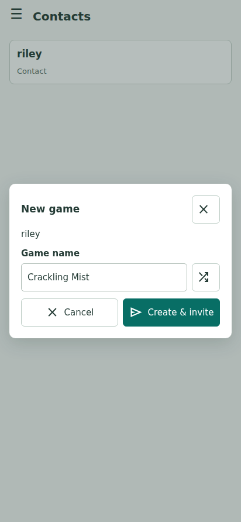
:::
::: {.landscape}
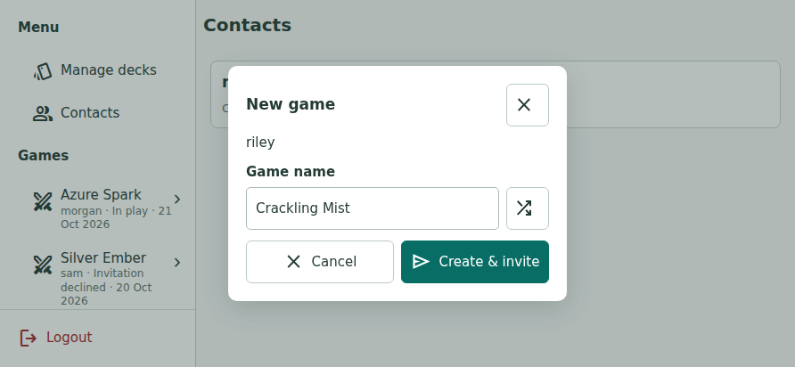
:::
:::

**Confirmed (D-294):** name every newly created game, offering procedural fantasy/
wizarding **adjective + thing** suggestions: Azure Spark, Crackling Mist, Silver
Ember. The pictured composition prefills an editable suggestion and offers a
shuffle/reroll icon. Accepting a nonblank generated name is sufficient; forced
typing is not required. Empty/whitespace-only input blocks creation. This state
follows selecting an added contact and pressing Invite; **Create & invite** alone
creates the named game and its first invitation atomically. Cancel/close/native
Back and reroll create nothing. Typing is optional additional interaction cost.

**D-295:** this is a bounded dialog over Contacts in both orientations, with one
title and top-right close. Touch/focus selects all current name text for immediate
replacement, including a generated suggestion; keyboard/accessibility focus gets
the equivalent selection. Selection does not reroll, submit or create a game.
Subsequent editing still supports normal text selection. The sources are inert:
the select-all requirement is annotated, not claimed as a working HTML gesture.

The server assigns the persistent game's creation instant on acceptance. Display
its date beside state in details and the name as the game/lobby/table title;
opponent identity remains available. The date/name survive acceptance, decline/
reinvite, starts and returned-lobby/fresh-play cycles, and synchronize across
participants/devices. Retry keeps original name/time/IDs, never generates a fresh
game. Names are labels, not unique identities. Local draft suggestions are not
gameplay RNG/history. No rename UI, archive or new expiry rule is inferred.
:::

::: {.screen-section}
## P03 — Long-press game context

::: {.screen-pair}
::: {.portrait}

:::
::: {.landscape}

:::
:::

**Confirmed (D-293):** long press a Games or navigation game row; do not also open
it. Active play offers icon + **Delete game**; setup instead offers icon + **Cancel
game**, retaining the existing L06 cancellation route. Dismiss/native Back/outside
tap leaves the game unchanged. No Reinvite in the list/context menu: open the
existing lobby for it. Equivalent explicit native accessibility actions are required.
Choosing active Delete only opens P04; the hold/menu choice alone sends no deletion.
:::

::: {.screen-section}
## P04 — Confirm active shared-game deletion

::: {.screen-pair}
::: {.portrait}

:::
::: {.landscape}

:::
:::

**Owner clarification:** active games also have Delete, with this **extra dialog**;
confirmed removal is for **both players**, not hide-for-me. Keep game/native Back
sends nothing. Confirm requests deletion of the captured game and active incarnation
through the server. Success removes listings/access for both and leaves for Games;
there is no result, reusable lobby, Undo or restore. This is separate from normal
cooperative result suggestion/acceptance. A stale confirmation after return/fresh
start fails rather than deleting a different incarnation. Retry recovers the same
outcome; a timeout is not proof of success. No instant disconnected-device erasure
or permanent server/backup destruction is promised. Scope warning is essential
decision copy, **not** an expendable tutorial paragraph.
:::

::: {.screen-section}
## P02 — Contacts and new game

::: {.screen-pair}
::: {.portrait}

:::
::: {.landscape}

:::
:::

**Layout:** Search usernames is a field; search magnifier is a supporting icon.
Search, Add contact and Invite are labeled text actions. Saved contacts and
search results remain separate collections, but **D-296 search results are inside
the same card as the search field**, not a second results card. Apply this to
every already-in-scope search, including its loading/empty/error feedback. No
email addresses or online-status dots.

**Interaction:** Search produces explicit username matches; Add contact saves a
contact directly with no friend-request approval. A newly saved contact gets
Invite in the contact list. D-294 Invite opens **P05 naming**, not an unnamed game.
Create & invite then creates one game plus first invitation and opens its lobby;
this required naming step supersedes the old immediate-create route, without an
additional confirm-the-confirmation or automatic recipient acceptance.
No results uses an inline “No matching usernames” notice, not a
missing-user substitution. Removing contacts is not invented by this pilot.

**Basis:** D-195, D-196, D-197, D-218. Exact search matching is not settled by
these example names or the placement of the Search button.
:::

::: {.screen-section}
## D01 — Saved decks

::: {.screen-pair}
::: {.portrait}

:::
::: {.landscape}

:::
:::

**Layout:** named deck rows/cards use cover placeholders and descriptive
mainboard/sideboard counts. Import deck is a labeled text action with a supporting
icon **fixed at the bottom**, below the scrolling list, not above it (D-293).
Opening a deck goes to D02. An empty collection keeps Import deck visible.

**Interaction:** collection names/lists/covers synchronize between the account's
devices. Saved card-list changes happen through import, not individual quantity
editors or a deck-builder search. No Export, legality badge, restore bin,
win-rate statistics or gameplay Undo for collection deletion. Missing artwork
uses the deck/card text fallback and does not prevent import or deck selection.

**Basis:** D-189, D-198, D-199, D-218, D-221, D-241, D-271.
:::

::: {.screen-section}
## D02 — Saved deck details

::: {.screen-pair}
::: {.portrait}

:::
::: {.landscape}

:::
:::

**Layout (D-293):** quantity → small art thumbnail → card name; a thumbnail/row
press opens D08 full inspection. The small visible art has a full-size touch target.
Mainboard/Sideboard tabs choose the read-only saved section, not in-game zones.
The capture shows **Edit expanded** with Rename, Choose cover, Import decklist
and Delete saved deck, all icon + label. This is not a quantity editor/card builder.
Title/hamburger, Edit and the right-corner Exit without saving share a row (D-294).
Exit discards unfinished input only; it does not undo already accepted metadata.

**Interaction:** proposed Rename opens a small name-field dialog with Save name
and Cancel; it cannot change card quantities. Choose cover opens D05. **Edit →
Import decklist** opens D07 bound to this deck; Delete opens D06.
Saving or deleting this collection entry never rewrites copies already selected
in a lobby/game. Card names and counts in the mockup are illustrative synthetic
data, not a real valid import or a required deck-size rule.

**Basis:** D-189, D-199, D-221. Rename's edit state is described but not separately
pictured; naming/duplicate policies are not inferred from the example.
:::

::: {.screen-section}
## D03 — Import with unresolved names

::: {.screen-pair}
::: {.portrait}

:::
::: {.landscape}

:::
:::

**Layout:** Deck list is a multiline text field, not a card builder. The error
identifies the unresolved line. Review import is unavailable while entries are
unresolved. Landscape uses an input/issues split; input and feedback must both
remain reachable rather than squeezing the text area into a one-line field.
The title is visible in **both orientations**, aligned with hamburger; Exit without
saving is at the far right. The action pair fills its row equally (D-294).

**Interaction:** accept ordinary quantity/name lists, common optional printing
suffixes and supported mainboard/sideboard separators. Correct the pasted text
or retry lookup; never silently choose an ambiguous card or save a partial list.
Nothing replaces a saved deck on lookup/transport failure. When all entries
resolve, Review import advances to D04. Art downloading and obtaining the newest
entire catalog are not save prerequisites. No separate Send/definition-upload UI.

**Basis:** D-198, D-271, D-289. The misspelled synthetic entry deliberately models
an error; these fake card names do not claim compatibility with a live catalog.
D04 uses a separate complete sample, not the computed count of this short list.
:::

::: {.screen-section}
## D04 — Resolved new import and save

::: {.screen-pair}
::: {.portrait}

:::
::: {.landscape}

:::
:::

**Layout (D-293):** section counts and read-only art/name/quantity preview accompany
a Deck name field. This **new-import** route has no Save-new/Replace selector or
existing-deck picker. Save deck and Edit pasted list use icons + labels.
Cover selection is optional later metadata, not a forced extra import step.
The title/exit row stays above scrolling content in portrait and landscape; the
Save/Edit pair fills its panel 50/50. Exit discards the unsaved import, never saves.

**Interaction:** Save deck creates a distinct saved entry. Existing-deck updates
instead start at D02 Edit → D07 Import decklist, with Overwrite/Merge toggle.
Neither route changes a lobby/game's selected copy. Save
requires fully resolved definitions and atomic server acceptance; failure retains
the previous valid saved deck and editable input. Success returns to D02 (or the
calling lobby deck picker when import was launched there). This ordinary form
save is not a gameplay Send gate or proof of format legality.

**Basis:** D-198, D-199, D-221, D-271, D-289. The two-step input/review presentation
is proposed and can be simplified during owner review.
:::

::: {.screen-section}
## D04b — Import review: save controls

::: {.screen-pair}
::: {.portrait}

:::
::: {.landscape}

:::
:::

**Same screen, bottom scroll position:** retain this continuation to check D04's
actions after content scrolling; short content may already fit. There is no generic
replacement selector. Existing-deck import is D07, not a required extra new-import
step or Send/upload action. No target shrinks to fit.
:::

::: {.screen-section}
## D07 — Edit → Import decklist

::: {.screen-pair}
::: {.portrait}

:::
::: {.landscape}

:::
:::

**Confirmed (D-293):** reach this through D02 **Edit → Import decklist**. The deck
target is already known and named; there is no generic “replace which deck?” picker.
A fresh invocation defaults to **Overwrite**. **Merge adds quantities** within each
section: existing 4 + imported 2 = 6, untouched cards remain, new cards are added.
Mainboard and Sideboard stay separate. An omitted sideboard becomes empty on
Overwrite and stays intact on Merge. These rules follow the owner's additive
answer, not a maximum-count/set-union interpretation.

Review import resolves every entry before showing the resulting list and Save deck.
That contextual review retains the target/mode and previews the **result**, not just
the incoming delta. Invalid input/failure leaves the prior saved deck unchanged;
server serialization/dedup prevents double Merge on retry. Save updates only this
collection entry; selected lobby/game copies survive. Cancel/Back leaves without
saving. Mode explanation belongs in these notes/accessibility help, not a permanent
paragraph beside an otherwise self-explanatory toggle. Resolution/save error and
Merge-result previews are described, not separately captured in this round.
:::

::: {.screen-section}
## D08 — Full card/art inspection

::: {.screen-pair}
::: {.portrait}

:::
::: {.landscape}

:::
:::

**Confirmed direction (D-293):** press the art thumbnail immediately after quantity,
or the card row, to open full inspection with the same card/art presentation used
during gameplay. Close/native Back dismisses without changing the deck, preparation
or history. Thumbnail art is visually small but its independent target remains
48 × 48; a row action provides a larger alternative. Synthetic locally authored
art stands in for lazy provider artwork; missing art falls back to card name/text
without blocking inspection, import or Ready. This is a presentation reference,
not an approved card-face style, full gesture implementation or permission to
ignore gameplay hidden-face/disclosure rules. Full card text, faces, image failure,
zoom/large-text and gameplay-specific states still need their own visual checks.
:::

::: {.screen-section}
## D05 — Choose a deck cover

::: {.screen-pair}
::: {.portrait}

:::
::: {.landscape}

:::
:::

**Layout:** card-name tiles are selectable thumbnails, not card-edit controls.
The selected tile has a **border only**, no additional checkbox/checkmark (D-294);
native selected semantics and its card name remain. **Use cover** confirms the
metadata choice; Cancel/Back leaves it unchanged. Landscape uses the short width
efficiently while allowing the grid to scroll.

**Interaction:** select one card already in this deck as its cover. No image
upload, crop tool, outside-catalog cover choice or mutation of that card. Text
fallback remains available while art is absent. The small selection/confirmation
step is a reviewable UI proposal, not a new game-action confirmation requirement.
Cover fallback after a later re-import is not decided by these example tiles.

**Basis:** D-199, D-271.
:::

::: {.screen-section}
## D06 — Delete a saved deck

::: {.screen-pair}
::: {.portrait}

:::
::: {.landscape}

:::
:::

**Layout:** a bounded modal over the collection, with Keep deck and Delete saved
deck as text buttons. The destructive button is distinguished by wording as well
as styling. Background rows are not interactive while the modal is open.
**D-294:** close X is top-right, actions are equal-width, and the explanation is
only **“Deletion cannot be undone.”** The longer copy-isolation/no-trash paragraphs
are removed from the dialog, not from the behavior contract.

**Interaction:** Keep deck/Back cancels this dialog without deleting anything.
Delete saved deck requests collection deletion and returns to D01 after success.
Selected game/lobby copies survive. No trash folder, gameplay Undo or misleading
“Undo deletion” snackbar is offered. A failed deletion reports its actual failure
without optimistically claiming permanent success. This one destructive-data
confirmation is a proposal, not a universal confirm-every-action policy.

**Basis:** D-221, D-241; exact confirmation presentation is UI design work.
:::

::: {.screen-section}
## L01 — Retained inviter lobby after decline

::: {.screen-pair}
::: {.portrait}

:::
::: {.landscape}

:::
:::

**Layout:** own deck/preparation, recipient invitation status, starter choice and
Ready are distinct. Ready is enabled because this example has an own selected
deck, even though riley has not accepted. D-293 now pictures the retained **declined**
state with Reinvite inside this same lobby. The pending variant omits Reinvite
and says Invitation pending; it is not a separate game. Cancel game is separate from Back.
Random is an illustrative selected value, not an approved universal default.
**D-294 layout:** game name **Crackling Mist** is the title; state/creation date
appear beneath. Hamburger shares the title row and Cancel is its top-right control.
Reinvite is **inside riley's opponent slot**, not the footer. Ready alone fills the
bottom; there is no leaving-lobby helper. No Back/home arrow.

**Interaction:** Change deck opens L03; Prepare deck opens L04. Ready can persist
before acceptance. The opponent's later acceptance opens this same lobby without
resetting the inviter's preparation or Ready. Decline retains it and permits
Reinvite through the existing-lobby path. Cancel game removes this pending invite
and its game; merely leaving the screen does neither. No host Start or expiry.

**Basis:** D-195, D-201, D-204–D-209, D-287.
:::

::: {.screen-section}
## L02 — Accepted lobby before own deck selection

::: {.screen-pair}
::: {.portrait}

:::
::: {.landscape}

:::
:::

**Layout:** Choose deck is the own-side primary action. Opponent Ready is an
explicit status with text/checkmark, not permission to start for them. Own Ready
is disabled with the visible reason “Select your deck.” Starter offers either
participant or Random; it is not a pre-start reroll.
Game-name title, creation date beside state, title-row Cancel and helper-free
bottom Ready follow L01/D-294. The visible disabled-Ready reason is retained.

**Interaction:** Accepting P01 did not select a deck, Ready or immediately start.
Select an existing saved deck through L03; no legality or size check is added.
After selection, Prepare deck and enabled Ready use L01/L05's layout with accepted
opponent status. Changes to own deck/preparation/starter clear only the changing
player's Ready. Late lobby edits after the game starts fail normally; the screen
must move to the actual active game rather than reopening the lobby.

**Basis:** D-190, D-191, D-195, D-201, D-204, D-205, D-274.
:::

::: {.screen-section}
## L03 — Select a game-local deck copy

::: {.screen-pair}
::: {.portrait}

:::
::: {.landscape}

:::
:::

**Layout (D-294):** named deck rows with cover/counts use a **selection border**,
no per-row Select buttons or checkboxes. The image shows a personal row selection
already made, not an automatic first-deck default. One **Use selected deck**
confirmation is fixed at the bottom beside bottom Import (equal widths).

**Interaction:** highlighting rows is personal draft UI; no prepared-copy request
or Ready clearing occurs yet. **Use selected deck** submits the chosen copy and
returns to lobby; no valid chosen source means confirmation is unavailable.
Acceptance clears own Ready without affecting the opponent's.
It does not edit the saved source, auto-ready or require another Send/confirmation
after this bottom confirmation. A stale/deleted source or started round fails
normally, not a substitute deck or a new lobby.
Deleting/editing the source later leaves this copy intact. Back cancels the picker
without changing selection. An empty collection uses the same Import route;
there is no automatic blank deck or silent substitute.

**Basis:** D-189, D-191, D-199, D-205, D-221.
:::

::: {.screen-section}
## L04 — Prepare mainboard and sideboard

::: {.screen-pair}
::: {.portrait}

:::
::: {.landscape}

:::
:::

**Layout (D-293/D-294 follow-ups):** Mainboard and Sideboard are separate panels.
Every quantity/art/name row has **two compact 24 px-wide tap buttons/drag origins**: **1** for
one copy and **∞** for all copies. D-294 removes the separate grip, prioritizing
scope and card-name space. Tap moves directly to the other section; drag remains
available. No select-row-then-Move-button bar. Portrait stacks panels; landscape uses columns;
long content scrolls. Ordinary buttons stay 48 px; the explicitly compact one/all
controls are an explicit exception with accessible alternatives, not overlapping
invisible targets. A **40 px plain-text feedback slot is always reserved** below
the title. The picture shows the latest move and resulting 59/16 counts.

**Interaction:** tap **1 / ∞** to move one/all copies to the other section, or drag
that same control to it. A recognized drag suppresses tap; control input must not
also open the inspector. Bind copies/identity at gesture start, not a changing row
index; all excludes later arrivals. No one-for-one/size enforcement. Cancel/outside
drop sends nothing. Transfers emit ordinary per-card preparation requests, not per-frame writes
or a new atomic bulk transaction. Show actual partial outcomes under normal guards.
Native accessibility provides equivalent one/all actions. Press the thumbnail/row
instead to inspect; the small count controls transfer. Completed transfers
automatically synchronize, clear only own Ready and leave the saved deck alone.
No Save preparation/Done-to-send is required. Back simply returns to the lobby.
On entering actual play, no Sideboard view/edit/move path exists. The shown
handle glyphs/drag feedback remain visual proposals, not a change to transfer scope.

**Latest-move feedback (F35):** e.g. **1× Meadow Sentinel → Sideboard**, fading over
about **1–2 seconds** (1.5 s proposed). New moves replace/restart the message.
Opacity changes never collapse/insert its space or move any headers/lists/buttons.
Show the actually displayed transfer promptly under normal provisional application;
it is not a server receipt. Correct partial/rejected outcomes normally, never
delay input for acknowledgement/animation or claim a move that did not occur.

**Disappearing rows (F36):** when a tap removes the last displayed copies, quickly
fade out that row while following rows slide upward into its space. A ~150–220 ms
combined transition is a timing proposal, not an exact approved interval. This
intentional transfer-driven list reflow is distinct from the fixed feedback slot.
Quantity-only changes retain their row. A fading visual ghost is not counted or
actionable game state; requests/count updates never wait for it. Rapid transfers/
reconciliation retarget current drawn geometry, never another row sliding under a
captured finger. Native reduced-motion/accessibility must retain clear identity/
feedback. These inert snapshots do **not** demonstrate an implemented animation.

**Basis:** D-189, D-191, D-202, D-203, D-259.
:::

::: {.screen-section}
## L04b — Latest-transfer text faded, layout unchanged

::: {.screen-pair}
::: {.portrait}
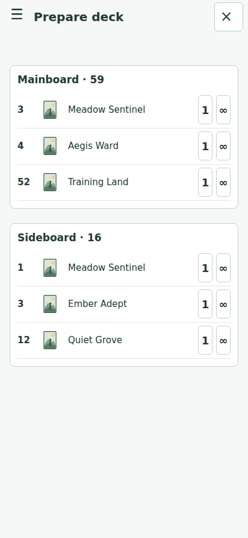
:::
::: {.landscape}
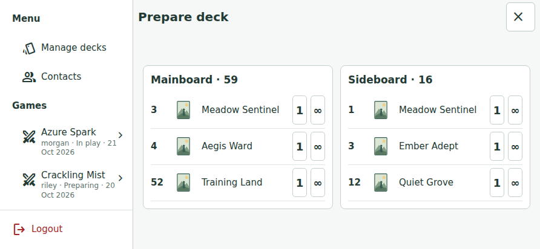
:::
:::

**Same preparation state as L04:** only the feedback opacity changes. The slot,
title, lists and controls keep exactly the same geometry. Captures freeze visible/
faded endpoints for review; the native app must fade over ~1–2 s. This is not a new
transfer, delayed publication or empty spacer added only after a tap. The separate
short disappearing-row transition is specified in L04, not functioning in this
static document. No extra app route or tap is required to reach this state.
:::

::: {.screen-section}
## L05 — Own Ready accepted

::: {.screen-pair}
::: {.portrait}

:::
::: {.landscape}

:::
:::

**Layout:** own Ready is a textual status/checkmark. Withdraw Ready is an explicit
action; Change deck/Prepare deck remain discoverable. No host Start button or
both-online indicator. Cancel game remains separate and applies only before start.
**D-294:** game-name title, creation-date/state details and upper-right Cancel;
Withdraw Ready fills the bottom, with no explanation about leaving below it.

**Interaction:** Ready persists after leaving/disconnection; it is not a liveness
lease. The second accepted Ready starts once, even while the first player is away.
Start shuffles both Libraries, sets life to 20, resolves a selected Random starter
and begins turn 1 at Untap, with **no automatic opening draw**. The extended packet
then uses G01. On returning after an accepted game ending, restore last prepared
decks, clear both Ready and use this lobby structure in its not-ready state;
both must ready again. Back alone never withdraws Ready or cancels the game.

**Basis:** D-190, D-200, D-204, D-205, D-213, D-274.
:::

::: {.screen-section}
## L06 — Cancel an unstarted game

::: {.screen-pair}
::: {.portrait}

:::
::: {.landscape}

:::
:::

**Layout:** proposed confirmation with Keep game / Cancel game text buttons. The
dimmed background is a lobby, not a live game. Back/close keeps the game.

**Interaction:** either participant can request cancellation before start without
the other player's approval. It removes the current listing and pending invite;
there is no trash/restore UI. Leaving the screen is different and preserves the
lobby/Ready. If start already won the normal server ordering race, do not cancel
or reset that started play; show the current game. Reinvitation must not revive
a cancelled lobby. This dialog is not the gameplay result-suggestion/acceptance
flow, which is intentionally excluded from the pilot.

**Basis:** D-205–D-209, D-241, D-287. The extra cancellation confirmation is a
reviewable UI proposal, not approval of an extra gameplay-ending confirmation.
:::

::: {.screen-section}
## U01 — Reconnecting and return to games

::: {.screen-pair}
::: {.portrait}

:::
::: {.landscape}

:::
:::

**Layout (D-295):** Reconnecting is a status dialog over a **real table**, not the
old empty pilot area. Its only button is **Back to games list**, icon plus text;
no Review downloaded data action or duplicate recovery explanation. Reconnection
continues automatically; returning to the list does not cancel already-sent work.

**Interaction:** shared actions stay blocked while disconnected, including Undo,
Ready, branch activation and new inspection requiring exposure logging. Downloaded
read-only navigation remains available. This does not create offline actions or
a manual-resend/recovery-center workflow. Same-process reconnect automatically
recovers actual already-sent outcomes with original identities. Process restart
instead syncs server state and may lose uncommitted local work. Unknown outcome
is not rejection; the UI must not invite duplicate submission as a fresh action.

**Basis:** D-182, D-215, D-216, D-241, D-246, D-252, D-278 and D-295. The table backdrop is a local inert derivative,
not functioning offline gameplay or a passed reconnect/accessibility test.
:::

::: {.screen-section}
## G01 — Live table and fixed hand

::: {.screen-pair}
::: {.portrait}

:::
::: {.landscape}

:::
:::

**Layout:** own battlefield below, opponent above, reflected top/bottom while
retaining x positions. Each has an outer darker one-row band and inner lighter
two-row band. These are **one generic battlefield per player**, not new land/
creature zones or type restrictions. All faces point toward the viewer; only
ordinary tapped cards rotate. **D-295:** own bands are green, opponent bands red;
there are no visible empty slots, battlefield row separators or area labels.
Logical snapping remains. Every card or ordinary pile has the **same horizontal
footprint**, containing its entire upright/tapped/mixed-pile envelope; rotating or
stacking does not change adjacent anchor spacing. The camera can pan beyond
occupied columns by a still-unspecified margin.

Borders identify **owner**, not location/controller or permissions. Own and
opponent colors remain on cards/tokens even on the opposite field; projections
derive their live source's owner. Creator/bringer is the default owner; Change
owner is explicit shared gameplay (G04/G06). P/T sits at the card's bottom-right.
Life is only a player-colored square with the number, without printed names or
“Life” text; accessible descriptions retain participant identity and meaning.
**D-296:** tap it for life/player-counter actions (G07). Counter rows sit below
special piles; portrait shows each player's row only when at least one counter
is nonempty/nonzero. Hiding a row never deletes zero values or removes menu access.

**Fixed versus movable:** in portrait the owner's Hand hovers below the land band
above bottom controls, independent of board panning. **D-297:** landscape own Hand
shares the bottom row with quick actions; the proposed covered opponent Hand moves
into the existing top control row, so neither hand covers the battlefield or takes
its vertical space. Portrait opponent Hand remains a covered top row. Both hands
use compact gaps and left/right pan when they overflow (G10), without changing card
scale, order, privacy or dispatching a move from navigation.
Both players' Library/Graveyard/Exile counts and proposed life
grouping occupy the central strip in portrait, a **left** sidebar in landscape.
Fixed dock anchors do not become shared placement. **D-296:** every card drawing
uses the same current zoom, across battlefield, combat, Stack, hands/backs, reveals
and special piles. These captures use **one 40 px card height**, in both
orientations and every area, not a selected final native minimum. There is no
row-height/zone-dependent shrinking. Landscape deliberately pans the table to a
middle framing; the full-height board remains navigable rather than being squeezed
into its viewport. Landscape hands occupy the existing top/bottom rows, clear of
field and history timeline; transport remains reachable. Dense/hit geometry still
needs device review. Visible player counter circles spread evenly over the whole
row (D-297), preserving the portrait visibility predicate. D-298 makes the circles
smaller and spans the **full middle strip** in portrait, including Stack-side width.
D-299 leaves absent player values **blank**, not dashes; stored zero stays 0.
Fitting Hand cards are centered; overflow remains pannable in both directions.

**Controls:** bottom-left tap Undo / hold Redo; bottom-center fixed quick strip;
bottom-right current mode. The proposed mode square opens explicit Normal /
Select / Ping choices. Select toggles membership editing without clearing the
selection when turned off; Ping consumes its taps. Phase tap opens the existing
tracking picker, not an automatic game action. History opens personal review.
Overflow exposes Redo and full **Table actions** (G12); a separate Chat button opens G09,
with an unread bubble when incoming messages remain unviewed. A generic Actions affordance
does not invent a phase shortcut or remove the full per-card action paths.
**D-298:** trial four positions: three contextual, one **tap Next step / hold End
turn**, with hold consuming tap and explicit End turn alternatives retained. The
full catalog below lists every situation/icon; no generic empty-context Actions
button is substituted. The phase indicator has exact-step icon/phase color only,
with turn-player border and separate numeric turn badge; G11 shows its picker.

**Gestures:** normal single tap opens captured-scope card Actions; double tap
performs one selection-aware tap/untap. Hold inspects; drag moves the captured
card/selection. Empty-space drag selects; two-finger pan/pinch navigates. These
are documented interactions, **not functioning gestures in these static files**.
Own/opponent hidden-face rules remain unchanged. No in-game Sideboard, Send,
presence, turn lock or inferred card rules.

**Basis:** D-267/D-281, D-259, D-291 and D-295/D-296; board/inspection contracts. Exact life placement,
top Hand and control shapes remain review proposals.
:::

::: {.screen-section}
## G02 — Live combat and populated Stack

::: {.screen-pair}
::: {.portrait}

:::
::: {.landscape}

:::
:::

**Layout (D-295):** portrait Stack sits to the right of the central Library controls.
The trial places combat **between** the opponent/own library rows, with Stack beside
it; this combat placement remains tentative. Combat pairs alone have faint vertical
dividers, with blockers above attackers; real sources remain on their battlefields.
Dashed owner-colored borders distinguish projections from real cards.

**D-296 landscape supersession:** Stack is in the **left side panel between
player-info blocks**, not beside central combat. Combat cards use exactly the
same card size as all other areas at this zoom. Portrait placement is retained.

**D-297:** pairs no longer stretch equally across the combat row: each fits the
wider attacker/blocker side plus tiny margins. The example's first pair has two
blockers and one attacker; the second is attacker-only. One-card-width empty
insertion targets remain visible before, between and after them, with both sides
addressable. An open empty area has one such target. They are drop affordances,
not saved empty pairs: merely rendering/cancelling creates nothing, and D-138
still removes fully empty semantic pairs. A valid drag creates/reuses/inserts only
the requested occurrences, never moves their real battlefield sources. Pan for
more pairs; no equal-width stretching or smaller combat cards.
**D-298:** those empty hit regions have **no drawn card boxes or + markers**;
only faded vertical dividers separate groups. The River combat projection is
tapped, as is its real source and live Stack projection. Gold relationship emphasis
connects those three views of the same stable source; it does not highlight the
unrelated same-name Hand card, change selection or select every occurrence for
an occurrence-removal action. Blue selection and owner borders remain distinct.
The selected Sentinel also emphasizes its related combat projection without
adding that occurrence to the actual selected-command targets.

Stack uses the same **diagonal corner-peek** presentation as ordinary piles, but
has **no gameplay item-count capacity**: show the top card plus at most two below
it, never a horizontal sequence of all entries. The pictured **27** is the full
mixed actual-card/projection count, not three items. Its contents action exposes
all entries in existing order, without dropping/reordering or conflating source
and occurrence actions. This is a rendering bound, not the ordinary visual-pile
membership limit, a new resolution rule or a promise of infinite memory.

The total **27** now appears in the same **top-left circular badge** as Library,
Graveyard and Exile, not a second count button below the pile. The whole pile/
badge affordance opens retained contents; counts do not reveal covered faces.

**Actions:** during Declare attackers with a selection, offer Declare + tap /
Without tap. The first composes occurrence entry and individual source taps;
the second preserves source orientation. The center quick-action strip can scroll
horizontally without moving Undo/mode controls. Full constituent paths remain
available outside the quick window. Neither rendering this state nor entering a
phase declares attackers, closes combat, resolves Stack or calculates damage.

Combat persists until explicit closure, including when empty. Ordinary phase
advancement does not close it. Moving a source out of Battlefield cleans up its
combat occurrences, not its independent Stack effects. Card-directed edits through
live projections affect the real source; occurrence removal is separate. Dense
combat may need board navigation rather than smaller fixed controls. Empty/open,
many-pair and frozen-token-effect visuals remain further review states.

**Basis:** D-112–D-158, D-176, D-242/D-253 and D-291.
:::

::: {.screen-section}
## H01 — Historical review paused at an exact event

::: {.screen-pair}
::: {.portrait}

:::
::: {.landscape}

:::
:::

**Layout:** the table/Hand show the selected historical boundary. Live editing
chrome is replaced with Previous / Play / Next at the bottom, and the path
timeline immediately above. **D-295:** dense 24 px event pitch replaces four widely
spaced dots; the node itself is its type icon. Different types have distinct icons,
repeated types reuse theirs. Selection outlines the icon without replacing it.
The strip scrolls/scrubs a window of the path, not a capped/aggregated event list;
accessible event details identify exact boundary, type, author and outcome.
**D-296:** icons use originating-player color, independent of the affected card's
owner. Faint vertical dividers mark effective group changes (not every event).
Selection outlines the icon without replacing its type or author color. The
exact X marker can lie inside a playback group.
**D-297:** that marker is **always at the timeline viewport's exact center**.
The selection square stays still while the path slides under it during scrub,
Previous/Next and playback. At the first/last event the unused half stays empty,
not edge-clamped or filled with invented events/line. H04/H05 show endpoints;
one-event paths leave both halves empty. Resize/fallback recenters the actual
selected boundary, without choosing a different event to fill the strip.
Diagonal branch stubs indicate retained alternatives, not a full expanded tree.
Off-path navigation needs a further branch-selection view; a stub is not itself
permission to activate, archive or delete anything.

**Interaction:** Previous/Next navigate groups; timeline drag selects individual
mutation boundaries and updates the board during the drag. Board animation uses
the displayed-to-selected endpoint, not a compulsory queue of every passed node.
Phase is read-only; gameplay edits, Undo/Redo, quick actions and mode input are
hidden. Permitted local inspection/navigation remains, but a hidden-information
request is not silently issued by browsing. Sync continues while paused, with
normal deleted-cursor ancestor fallback.

**Continue playing from here** is distinct from Play. It arms intent at the exact
selected event and exposes gameplay controls (H03), without creating a fork.
Back to live uses the existing catch-up/changed-path traversal toward the shared
continuation, not an unexplained snapshot jump; viewing a branch does not activate
it. Offline review never enables this gameplay continuation route.

**D-296 transport:** Play/Pause has icon **and text** and fills portrait space
between Previous/Next. Landscape keeps a similarly prominent center button with
Previous/Next attached directly, rather than at screen edges. **Hold Play while
paused** to perform the same explicit continuation as the top-corner button.
Recognition consumes the tap, never also starting playback. No tooltip or
explanation is printed for this shortcut; the top/accessibility route remains.

**Basis:** D-177/D-179, D-238/D-245, D-277 and D-291.
:::

::: {.screen-section}
## H02 — Grouped playback running

::: {.screen-pair}
::: {.portrait}

:::
::: {.landscape}

:::
:::

**Interaction:** Pause stops personal playback, not server sync. Touching/dragging
the timeline **pauses first, then scrubs** exact events. Continue playing from here
also pauses at the selected concrete boundary and arms intent; it is not the
transport Play action. Each playback group animates its net start-to-end board
change; separate groups remain staged even if downloaded together.

**Returning:** backgrounded games with unpresented updates enter this playback
flow from the last presented/reviewed context. Changed paths retain the specified
common-ancestor rollback before catch-up. Reaching the shared live boundary
returns to live; an expected own confirmation alone does not manufacture a replay.
No autoplay preference, speed default, finished-game archive or animation timing
is chosen by this mockup.

**Basis:** D-177/D-277 and D-291. Historical no-edit chrome matches H01.
:::

::: {.screen-section}
## H03 — Historical continuation armed before first action

::: {.screen-pair}
::: {.portrait}

:::
::: {.landscape}

:::
:::

**State (D-296):** the area looks like ordinary live play **at the selected
historical state**, with no Continuing from banner or extra explanation. The
example intentionally differs from the head's card arrangement. This is armed
personal intent, not a third authoritative game. The old future remains retained and active until a
successful explicit continuation mutation creates/activates the new line.
Cancel / Return to live before that action only leaves personal intent; there is
no empty branch to delete. Failure/no-change likewise does not create one.

**Undo clarification:** old `A → B → C`, new `A → X → Y`: eligible latest-own Undo
may remove Y and then X, including the first action immediately after the fork.
It leaves the current boundary at A without automatically returning to B→C.
The authoritative owner rule (2026-10-25) allows Undo/Redo iff every later event
on all retained continuations can apply with identical concerned-field
`(before, after)` tuples, including read/dependency fields as well as edits.
Only game state/events decide eligibility, never information gained or seen;
forks and work limits cannot independently refuse an otherwise matching edit.
Recompute after each accepted Undo, keeping latest-own targeting separate from
personal review. This addresses accidental branch creation under the **current rule**;
it is not unconditional cancellation of any action or recall of a sent request.

Undo availability/target remains based on shared current history, not the
personal historical cursor. When a server accepts a locally withdrawn request
later, its accepted effect still arrives normally. Cancel/Return remain through
normal contextual navigation/accessibility; no banner is required to carry them.
The selected intent and server boundary remain explicit internally, never silently
replaced with the live head just because they are not printed in a banner.

**Basis:** D-179, D-224/D-233/D-245, D-258/D-277 and D-291.
:::

::: {.screen-section}
## G03 — Explicit Redo and mode chooser routes

::: {.screen-pair}
::: {.portrait}

:::
::: {.landscape}

:::
:::

**Redo arbitration:** tap Undo invokes Undo only; recognizing a hold invokes Redo
only. No Undo on press-down, no Undo on release after a hold and no automatic
repeat is selected here. The controls menu exposes labeled Redo and native
accessibility must provide an equivalent explicit action, without requiring a
timed hold. Both routes use the same server-authoritative per-player game stack,
eligibility and retry rules. Exact hold interval/feedback is still UI work.

**Menus:** overflow is a proposed route to Table actions (G12), not a newly
invented settings suite. Table actions retain existing tracking, random,
token, combat and ending paths; this packet does not yet picture their complete
menus or editors. The separate bottom-right mode square opens Normal / Select /
Ping, rather than silently cycling modes. It does not open this overflow menu.
Choice-sheet layout remains unpictured; normal/Select/Ping tap semantics are
already specified. Close/Back dismisses without a shared edit.
Chat now has a separate direct button/panel (D-297), not an overflow-only route.

**Basis:** D-235/D-259, D-267/D-281 and D-291. No claim that an incidental
enabled/disabled color proves the complete eligibility computation.
:::

::: {.screen-section}
## G04 — Card context actions

::: {.screen-pair}
::: {.portrait}
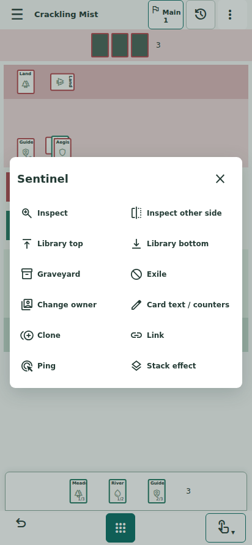
:::
::: {.landscape}
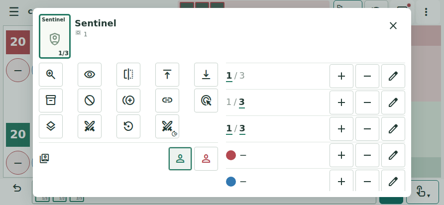
:::
:::

Normal single tap opens this card's Actions without rotating it. A selected card
binds the selected set; an unselected card binds only itself and preserves prior
selection. Grouped square **icon-only** buttons show Library top/bottom,
Graveyard/Exile, inspection and existing card tools, plus **inline owner choices**.
**D-298:** the card details occupy two stacked positions at top-left, with the
other buttons packed around them. There is **no title or close X**. The card itself
still identifies its permitted current state and captured scope/count. Landscape
puts these general actions left and field controls right; portrait stacks them.

P/T-like corner text has one seven-square row: **current value/Set, +/+, −/−,
•/+, •/−, +/•, −/•**. The dot is a small centered circle meaning “unchanged side.”
The Set square never widens; long values shrink/wrap within it, with full text in
accessibility/the editor and bounded truncation if unreadable. This is one string,
not separate P/T engine fields. Integer-only text uses Set/+1/−1; other text keeps
Set with arithmetic unavailable. All six counters use three rows of two triplets:
**colored current-value circle/Set, +, −**, divider between triplets. Absent values
remain directly editable. The **icon legend below** names every pictured symbol,
its group and conditional variants; no guessing from the pictures is required.
No Card text / Counters / Owner category submenu adds another tap. Inspect other side retains its logged
disclosure rule; opening a menu alone logs nothing. Orientation still uses normal
double tap, with explicit Tap/Untap commands in Select mode, not a new normal-mode
Tap button. This example is not every contextual/source/occurrence menu.

A dialog is the owner's accepted alternative to their initial floating-buttons
request. D-298 replaces its title band with compact card details in the grid.
G06 shows the details updated after retained edits. Opening/closing creates no
shared edit; outside tap and native Back dismiss without recalling earlier submitted requests. Completed
corner/counter +/−/Set keep the menu; successful Move to Graveyard closes it, as
already agreed. No universal close/stay rule is invented for all other actions.
Required Set editor/inspection/Link endpoint selection completes its chosen action,
not an intermediate action-category menu. Every icon retains an accessible name
and actual availability; hidden faces/names never leak into the preview.
**Basis:** D-54/D-61/D-63/D-67, D-248/D-252/D-267 and D-295/D-297.
:::

::: {.screen-section}
## G05 — Tokens, numbered pings and reveal placement

::: {.screen-pair}
::: {.portrait}
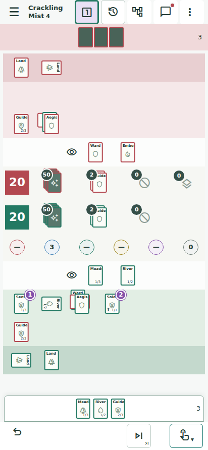
:::
::: {.landscape}
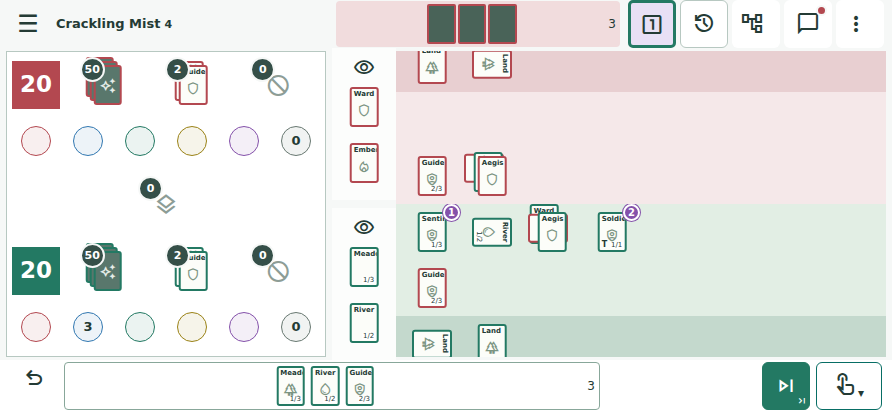
:::
:::

The Soldier is a token (small **T** badge), with the same owner-colored border and
equal battlefield footprint as a real card. P/T is bottom-right. A red-bordered
Guide on the green field explicitly demonstrates that placement is not ownership.
Tokens retain the existing disappearance rules, not an ordinary card's special-
zone destination behavior.

**1 / 2** use the same standard numbered ping marker in one event context; they
are not counters, target assignments, custom player styles or persistent overlays
on later events. Retained review of that event reproduces them. Markers follow
their captured source/destination rules and must not cover the bottom-right P/T.

Accepted reveal trays sit between each player's Library and battlefield: above/
below the central portrait dock, or in a gutter immediately right of landscape
libraries. This depicts already accepted fixed contents, not a new inspection
request, refill, altered audience or unlogged face exposure. Further contents/
dismissal/disclosure variants remain visual completion. **Basis:** existing token,
ping and View/Reveal contracts; D-295 placement.
:::

::: {.screen-section}
## G06 — Retained card actions after edits

::: {.screen-pair}
::: {.portrait}
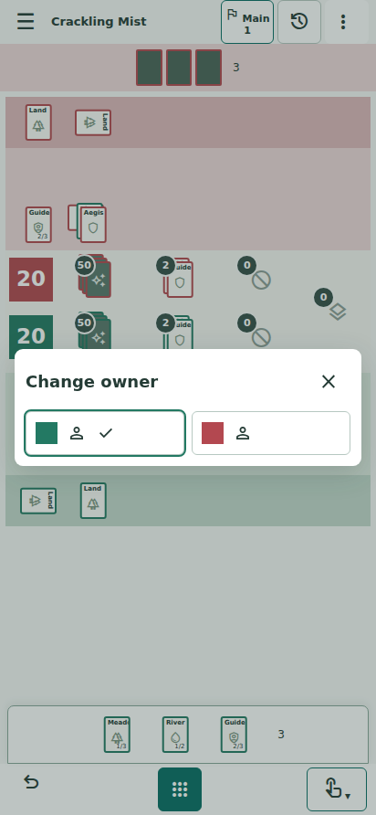
:::
::: {.landscape}
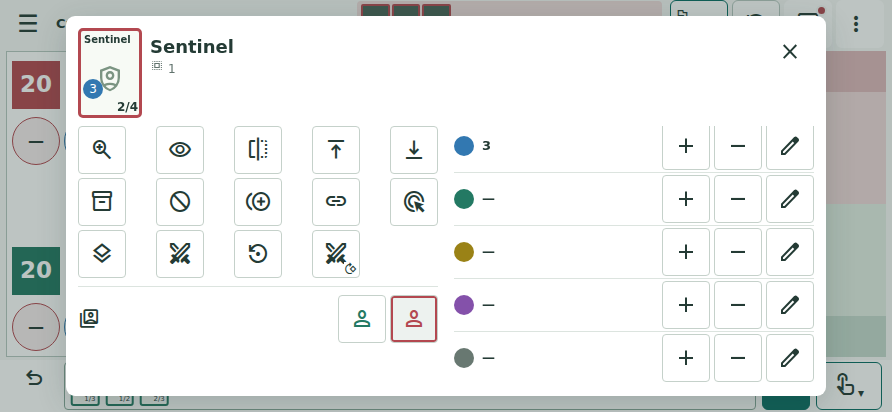
:::
:::

**D-297 supersedes the separate owner chooser:** the same action dialog stays open,
now with a red owner border, corner text **2/4** and blue counter **3**. This is a
static after-edit example, not a working sequence or one atomic multi-field edit.
D-298's compact layout fits all six colors in three paired rows; it does not need
the old tall scrolling value column or title band. +/−/Set retention does not
require reopening the menu between adjustments.

Inline owner choices use player colors without printed player names. Accessible labels
identify both participants, the card and current selection. Choosing the other
owner submits the ordinary connected shared card edit, with immediate prediction;
choosing the already-current value is a no-op. No additional Save/confirmation.
Owner starts as creator/bringer, is independent of field position and never
restricts either player's editing rights. The border updates on all live views/
projections, devices and historical boundaries under normal recovery/eligible
Undo rules. This does not add controller, permission or rules-engine semantics.
**Basis:** D-295/D-297; primary owner/field contracts in board-and-controls.md.
:::

::: {.screen-section}
## G07 — Life and player-counter context menu

::: {.screen-pair}
::: {.portrait}
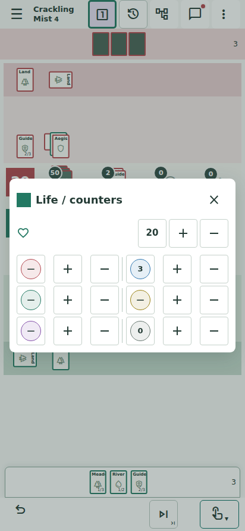
:::
::: {.landscape}
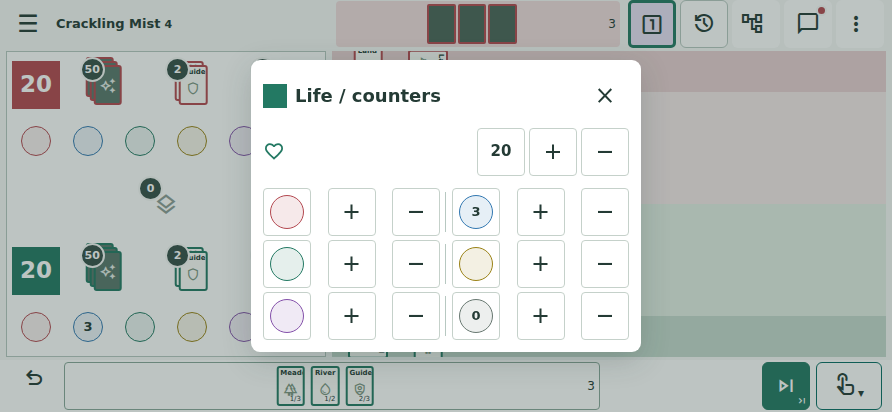
:::
:::

Tap either player's life square to open these controls for that player. Life and
each color expose -1/+1/Set; no initialization submenu. The example has Blue **3**
and Gray **0**; **D-299: absent player values are empty circles, not dashes**.
Zero still shows 0; drawing a blank does not initialize a stored zero. Set may enter
normal counter text; nonnumeric text disables arithmetic, not Set. Existing
retained-menu/trimmed-empty rules persist. Both participants may edit either
player. A hidden all-empty/zero portrait counter row is still reachable here.
This is a context-menu mock, not a functioning editor or completed keyboard state.
**D-298:** the life value square itself is Set, then +/−. Counter rows use the same
three paired color/value-Set,+,− triplets as the card panel, with dividers between
pairs. Here the title and top-right close remain. On-table circles are smaller
and portrait counter rows span the full middle strip, not just the library column.
**Basis:** D-58/D-61/D-67/D-68 and D-296.
:::

::: {.screen-section}
## G08 — Life drag: positive preview before release

::: {.screen-pair}
::: {.portrait}
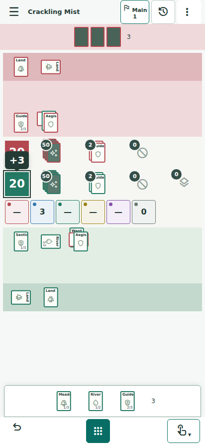
:::
::: {.landscape}
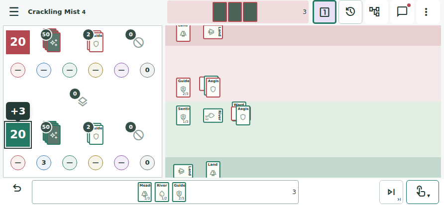
:::
:::

Drag up to increase or down to decrease the captured numeric life/counter field.
The floating **+3** is a local, uncommitted delta; life still reads **20**. A valid
release submits **one +3 relative edit**, not Set 23 or three +1 requests. Server
arithmetic uses its then-current value, so compatible concurrent changes survive.
Only after release does normal request prediction begin. Cancel or release at
zero emits nothing; a recognized drag cannot also open the life menu.

Incoming sync is not paused, preview never moves to a different participant/color,
and disconnected release cannot create offline work. Menu/accessibility -/+ /Set
remain alternatives; exact distance/step/slop is geometry to review. **Basis:**
D-186/D-187/D-259 and D-296. Inert snapshot, not an executed gesture.
:::

::: {.screen-section}
## G08b — Player-counter drag: negative preview

::: {.screen-pair}
::: {.portrait}
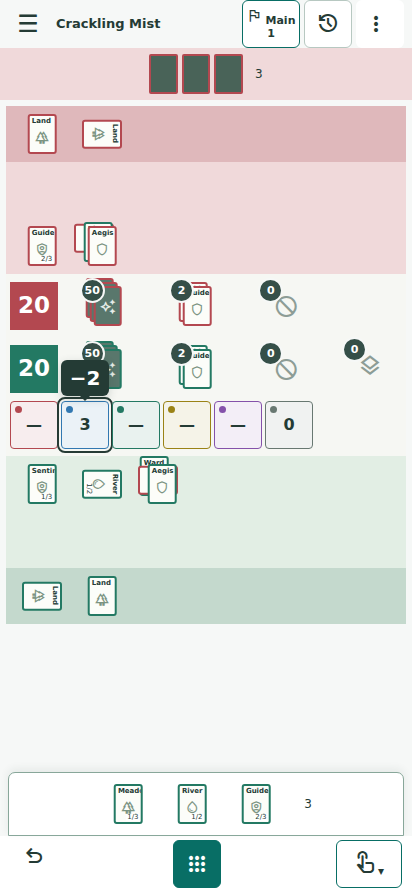
:::
::: {.landscape}
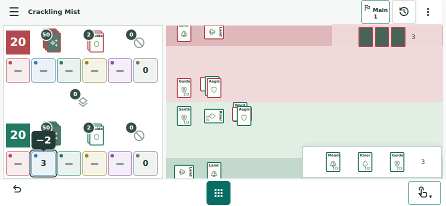
:::
:::

Same gesture family as G08, now dragging Blue downward: **−2**, while its current
text remains **3**. Release sends one relative −2 edit. This is a separate frozen
example, not simultaneous life/counter drags. Nonnumeric text is not coerced into
a number; absent-counter arithmetic retains its zero starting-point rule. The
active Blue value makes this player's portrait row visible; the opponent's all-
empty/zero row stays hidden. No authoritative intermediate edit is created.
:::

::: {.screen-section}
## G09 — Direct game-chat panel

::: {.screen-pair}
::: {.portrait}
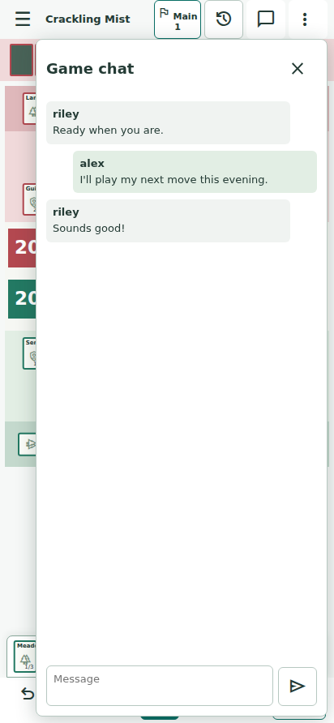
:::
::: {.landscape}
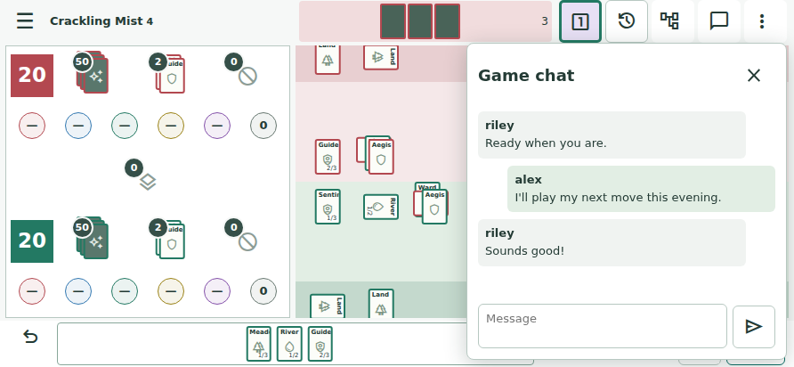
:::
:::

The separate top Chat button opens this panel directly. Closed-panel table/history
examples show its unread bubble; this example has presented all three messages,
so the bubble is absent. Incoming messages remain unread until actually presented
in the panel, not merely because it opened while they were offscreen. Own echoes
do not create incoming unread. Viewing is personal UI, not a read receipt,
presence signal, gameplay mutation or history activation/fork. Game-wide chat is
not filtered to the selected event/branch; event comments stay separate.

Close/native Back dismisses the panel. Sending the completed message uses the
existing connected chat request; no gameplay Send, automatic posting of drafts,
sent-message Edit/Delete/Undo or new alert category. Keyboard/large-text variants
still need visual review. **Basis:** D-94/D-240/D-259 and D-297.
:::

::: {.screen-section}
## G10 — Compact overflowing hands

::: {.screen-pair}
::: {.portrait}
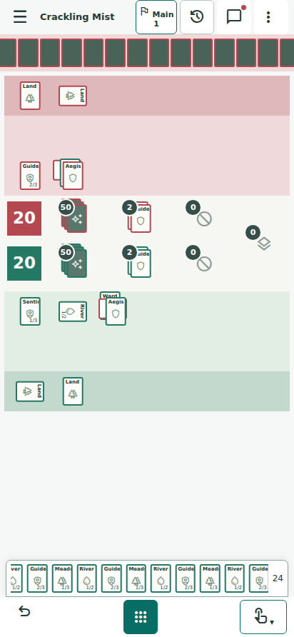
:::
::: {.landscape}
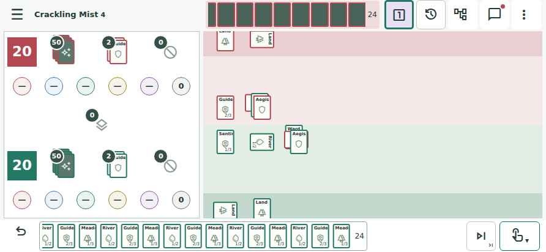
:::
:::

Both example hands contain **24 cards** at the same 40 px table scale, with small
gaps instead of battlefield-sized empty footprints. Captures show a static mid-pan
position, not a functioning swipe. Every first/last card remains reachable by
left/right pan and native accessible navigation; the count is total membership,
not only visible cards. Covered opponent cards disclose no names/art. Landscape
own Hand occupies the quick-action row, while opponent Hand is trialed in the
existing top row, leaving the battlefield free. Pan and actual card dragging must
remain distinct, with no request from navigation/cancel or retargeting on sync.
**Basis:** D-267 scene/input, D-296 uniform scale and D-297.
:::

::: {.screen-section}
## H04 — First event stays centered

::: {.screen-pair}
::: {.portrait}
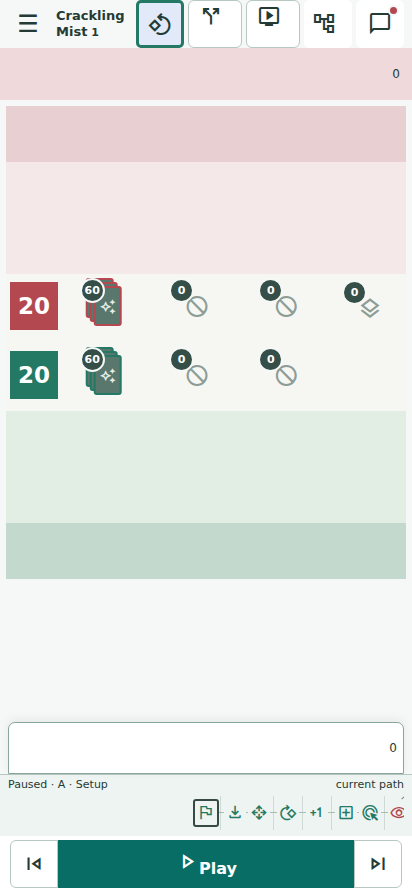
:::
::: {.landscape}
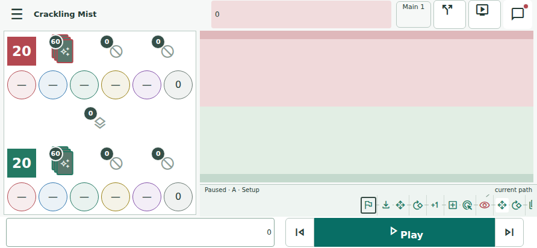
:::
:::

The path starts at the selection square in the exact center; there are no earlier
nodes or continuing path line in the left half. This setup example has full
libraries and no automatically drawn Hand/battlefield cards. The retained future
extends right; its existence does not activate it. The fixed square uses the same
viewport anchor as H01/H02/H05. **Basis:** D-297; existing exact-boundary playback.
:::

::: {.screen-section}
## H05 — Final event stays centered

::: {.screen-pair}
::: {.portrait}
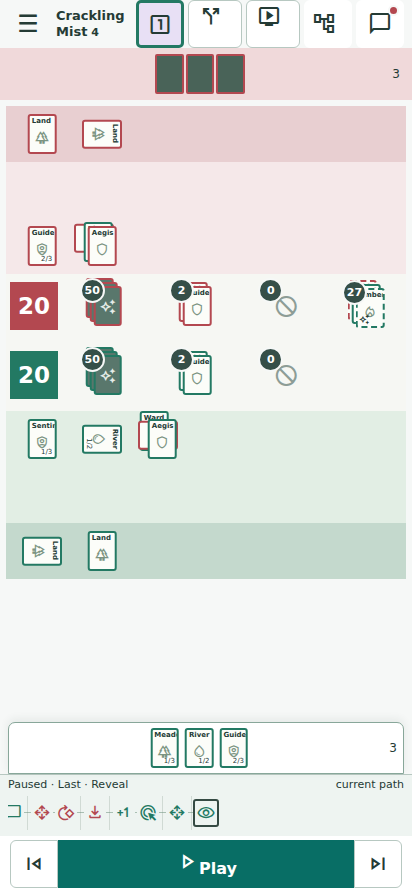
:::
::: {.landscape}

:::
:::

The final selected event does not slide to the right edge. The path lies left of
the fixed center square; the unused right half stays empty. First/last examples
illustrate anchoring, not a complete executable game/replay trace. An only-event
path leaves both halves empty. Normal live-boundary catch-up, branch navigation,
deleted-cursor fallback and sync rules remain unchanged; filling empty space must
never choose another boundary or fabricate events. **Basis:** D-297.
:::

::: {.screen-section}
## G11 — Phase/step picker and active-player emphasis

::: {.screen-pair}
::: {.portrait}
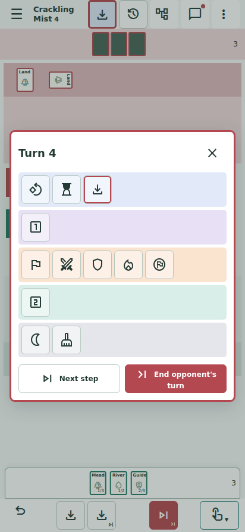
:::
::: {.landscape}
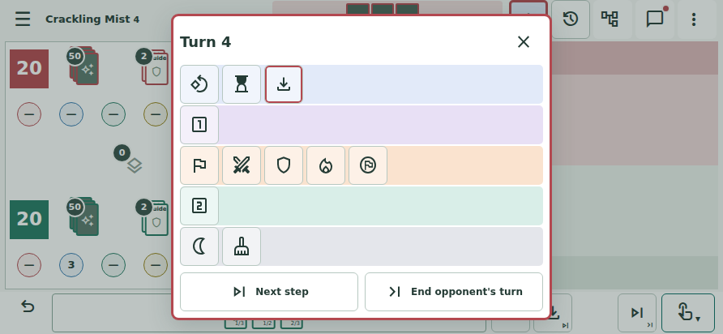
:::
:::

The table indicator contains only the exact step icon and phase background color,
with the tracked turn player's border; the separate small number is the turn
number. No phase/step text or priority indicator. The picker has one row for each
fixed phase and horizontally arranged steps, using the legend below. All steps
within a phase share its color. Current step is selected without obscuring its
icon; every icon has an accessible exact name.

Tapping a step changes **phase/step only**, preserving turn player/number and
executing no intermediate Untap/Draw/etc. “Set the turn” here is tracking selection,
not a new player/count editor. **End opponent's turn** uses ordinary End turn:
other player, turn number +1, Beginning/Untap; no automatic draw/untap or game ending.
Either player may invoke it. Next step remains explicitly available in the picker.
D-299 fills End turn / End opponent's turn controls, including the combined quick
square, with the **ending player's color**, not the requester or next player.

**Latest follow-up:** one quick square combines **tap Next step / hold End turn**.
Hold consumes tap, with no preceding step advance or second release action; cancel
sends nothing. Explicit End turn in this picker/Table actions and accessibility
avoids requiring a timed hold. “Pass” is not a new priority/pass feature. D-298
supersedes D-107's separate one-tap End turn placement, not its no-confirmation rule.

This screenshot trials the opponent's turn: red surrounds the picker/indicator,
opponent field backgrounds are stronger and own backgrounds quieter. Only the
background shades change, not readable card content, owner colors, permissions or
visibility. Exact brightness/palette remains reviewable. **Basis:** D-96–D-111,
D-253 and D-298.
:::

::: {.screen-section}
## G12 — What “Table actions” contains

::: {.screen-pair}
::: {.portrait}
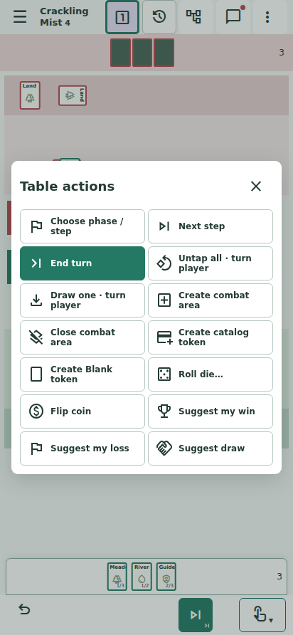
:::
::: {.landscape}
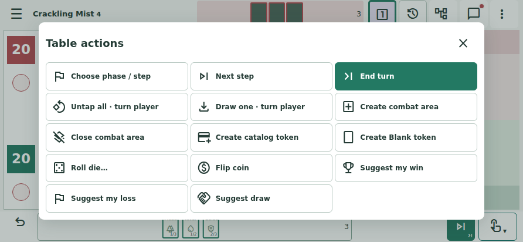
:::
:::

The old **Game actions** label meant the full table-level controls, not a second
rules engine or settings suite. It is now **Table actions** in G03. The panel
contains phase/step choice, Next step/End turn, standalone turn-player Untap all/
Draw one, Create/Close combat area, catalog/Blank token creation, die/coin and
win/loss/draw suggestion. When a result suggestion is pending, its applicable
Accept route is shown instead of incompatible new suggestions. Accepted ending
returns both players to lobby; End turn does not end the game.

Untap/Draw use the **tracked turn player's configured field/Library/Hand**, not
automatically the viewer's. Required die parameters and token catalog search are
actual action inputs, not a new generic confirmation. These full controls remain
available outside their quick windows, with ordinary structural/connection checks.
Library contents/Draw N/View/Reveal/Shuffle/mulligans remain directly on each
Library; per-card tools remain on cards. Chat/tree have their own direct buttons;
Redo remains explicit in G03. No priority, extra-turn scheduler, turn-number editor,
custom tracker/area authoring, in-game Sideboard or automatic resolution is added.
**Basis:** current action catalog and D-121/D-241/D-253; icon geometry is proposed.
:::

::: {.screen-section}
## H06 — Compact pannable group tree

::: {.screen-pair}
::: {.portrait}
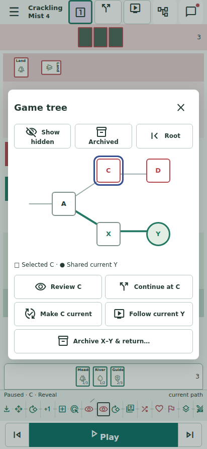
:::
::: {.landscape}
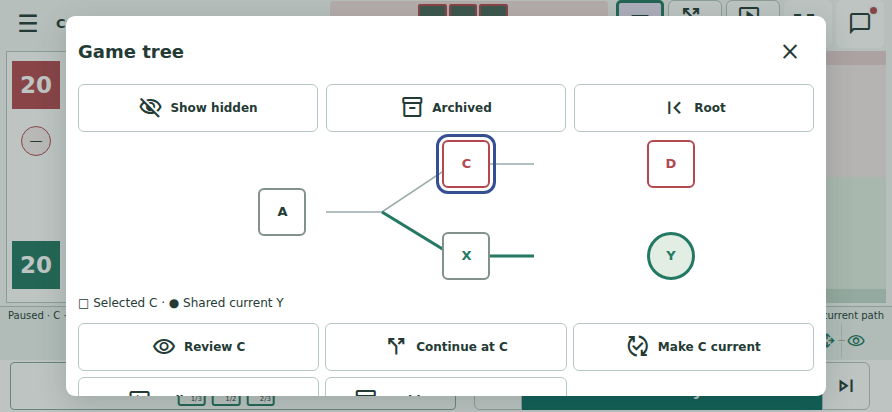
:::
:::

**D-299 replaces the oversized prior composition.** The small popover contains a
two-direction pannable graph, not an individual-event list. Each normal vertex is
an effective **playback group**, using its most significant event's own icon under
the R1 ordering below. Initial state has a separate neutral flag. Green path/ring
marks shared active history/current position; the square marks personal selection.
Icon color remains the author, not card owner. No event-letter labels or large
Review/Continue/Follow/Root/filter/archive button toolbar.

Tap a group to review its **last mutation** locally, then use the single **Make
current** action to activate that exact boundary. The selected eye group contains
Reveal **C1** followed by Comment **C2**: its glyph is Reveal, but its selected
state/activation target is **C2**, not C1. Current is the other path's Move group
ending **Y2**. Panning/selecting/holding for a name tooltip never activates anything.
Close/outside/native Back dismisses; a real explicit shared switch clears both
Redo queues, as before, without a vote or automatic branch deletion.

Root/earlier groups are reached by panning; the small view-title menu retains
framing and **Show hidden** options without filling the graph with buttons. Exact
mutation review remains in the timeline/details. Opening the graph from such an
exact boundary preserves it inside its group; a new group tap selects its end.
Real forks remain junctions, splitting only rendered group ranges if necessary,
not changing automatic groups or collapsing distinct continuations. An internal
current pointer is marked within its group, never falsely moved to its end.
Selecting a fork-split range targets its last included mutation, never a later
range across that junction; this changes no playback group boundary.

Hold a selected target stable through group growth/reranking/sync; do not silently
activate a newer end. Continue here/return-to-live remain existing history routes,
not extra graph buttons. Normal hidden-path rules, ancestor fallback, complete
tree download and offline read-only review remain. **Basis:** D-179/D-222/D-223/
D-238/D-258/D-276 and D-299. This is an inert composition, not a working graph.

**Why archive/return was confusing:** it was an older reversible branch-hiding/
recovery flow, **not required to switch branches**. H07's proposed dialog is now
withdrawn from the current review. Select an old group/node and Make current;
both continuations remain intact. This UI cleanup does not delete the older
archive product/protocol contract without an explicit scope decision. Its prior
[portrait](images/gameplay-archive-return-portrait.png) and
[landscape](images/gameplay-archive-return-landscape.png) captures remain provenance,
not current navigation designs.
:::

::: {.screen-section}
## G13 — Short action-name tooltip

::: {.screen-pair}
::: {.portrait}
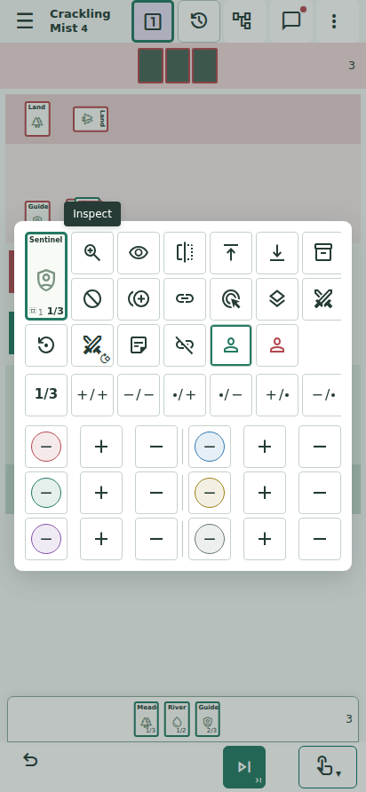
:::
::: {.landscape}
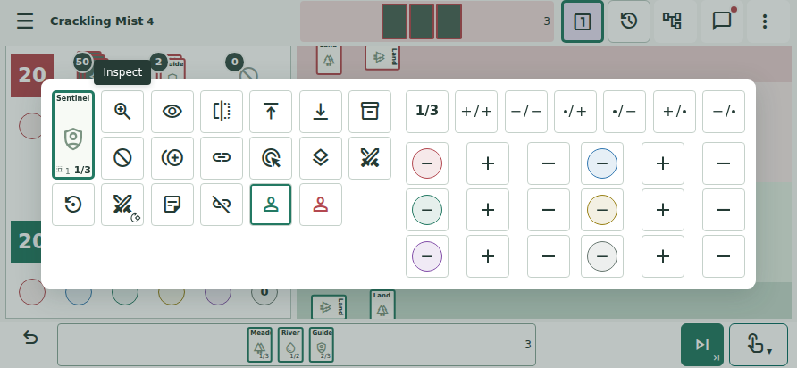
:::
:::

For icon-only buttons **without a hold action**, holding shows only the short
action name the button would have as text: **Inspect**, **Library top**, **Set red
counter**, **Choose step**. Value-only action squares follow the same principle.
Not a tutorial, long explanation or hidden-card detail. The tooltip stays within
visible bounds and is local UI only.

Recognizing the tooltip consumes tap: releasing must not also execute Inspect,
move a card, change a counter or log hidden-side viewing. Movement/cancel dismisses
it; normal drag/pan behavior keeps its own gesture. **Assigned holds win instead**:
Undo→Redo, progression→End turn, paused Play→continue and game-row context actions
must never also show a tooltip or trigger a release click. Card hold inspection is
not a button tooltip. Accessible names remain available without timing a hold.

This is a frozen **Inspect** tooltip example, not a working hold recognizer. The
new name rule supersedes earlier blanket no-tooltip wording, not the ban on
shortcut tutorials. **Basis:** D-299; Android/gesture and existing disclosure rules.
:::

# Quick-action catalog and icon legends

These are the complete **currently specified** offerings, not permission to add
rules inference or a roadmap for unapproved controls. Icons/composition are
review proposals unless directly selected by the owner. The glyphs below are the
same local icon font as the captures, not unexplained font-ligature names.

## Four-slot quick strip: every situation

**Trial layout:** three contextual squares + one fixed progression square. Blank
positions keep their space but draw no fake button. Contextual offerings beyond
three pan in the same reserved rail; they do not move Hand/Undo/mode or hide the
progression square. G02 is the positioning example; a separate layout for every
combination is unnecessary. Within the rail, phase offerings precede an explicitly
targeted Stack offering. There is no automatic top-of-Stack target.

| Situation | Icon / action | Scope and full route |
| --- | --- | --- |
| Every live/armed-play phase/step | <span class="legend-icon">skip_next</span> tap **Next step**; small <span class="legend-icon">last_page</span> hold badge = **End turn** | Fixed fourth position. Tap advances one step only; hold performs End turn only, consumes tap and never double-dispatches. Cleanup's ordinary Next step already starts the next turn. Explicit picker/Table actions/accessibility End turn remains. No history-edit controls during plain historical review. |
| Untap, any turn | <span class="legend-icon">rotate_90_degrees_ccw</span> **Untap all** | Tracked turn player's battlefield; no inferred skip flags. Standalone full Table action remains elsewhere. |
| Untap, any turn | <span class="legend-icon">rotate_90_degrees_ccw</span> + small <span class="legend-icon">skip_next</span> **Untap all + next** | Same captured turn-player scope, then Upkeep, even if no orientation changes. Not automatic on entering Untap. Individual Untap/Next full paths remain outside the quick window. |
| **Turn 1 Untap only**, additionally | <span class="legend-icon">shuffle</span> + <span class="legend-icon">download</span> **Return Hand → Shuffle → Draw N** | N picker defaults seven; same Library's configured Hand. Full Library-context action remains at other steps. These four total Untap offerings pan in three visible contextual positions. |
| **Turn 1 Untap only**, additionally | <span class="legend-icon">shuffle</span> + <span class="legend-icon">exposure_neg_1</span> **Return Hand → Shuffle → Draw previous Hand size −1** | Uses the existing captured pre-return-size semantics/clamp, not seven-minus-one or a rules-driven mulligan gate. Full Library-context action remains. |
| Draw step | <span class="legend-icon">download</span> **Draw one** | Turn player's Library → Hand; standalone leaves tracking unchanged. Full Table/Library path remains. |
| Draw step | <span class="legend-icon">download</span> + small <span class="legend-icon">skip_next</span> **Draw one + next** | Then Precombat main; an empty Library still advances without a fabricated draw/loss. Individual Draw/Next remain full paths elsewhere. |
| Declare attackers, **Select mode with captured multiselection** | <span class="legend-icon">swords</span> + small <span class="legend-icon">rotate_90_degrees_cw</span> **Declare + tap** | Selected applicable battlefield sources; create/reuse occurrences, leave real positions, then tap sources. Separate mutations/ordinary partial outcomes. Full targeted card path remains outside this quick window. |
| Same Declare attackers condition | <span class="legend-icon">swords</span> **Declare without tapping** | Preserve orientation, including already-tapped sources; not an implicit untap. No new single-card, Beginning-of-combat or damage-step declaration quick offering is inferred. |
| End of combat | <span class="legend-icon">layers_clear</span> + small <span class="legend-icon">skip_next</span> **Advance + close combat** | Advance to Postcombat main and close combat occurrences/links, not sources or Stack effects. Quick-only combination under D-253; separate advance/close remain elsewhere. Ordinary Next/End turn never silently closes combat. |
| An **explicitly targeted actual instant/sorcery Stack card**, any phase | <span class="legend-icon">inventory_2</span> **Move to Graveyard** | Captured actual card and configured destination; normal reset/token rules. Not an automatic resolver or reinterpretation of unknown category. Full targeted card move remains. |
| An **explicitly targeted actual permanent Stack card**, any phase | <span class="legend-icon">table_rows</span> **Move to Battlefield** | Captured actual card/configured battlefield routing, not the source of a separate effect. Normal move guards. Full targeted move remains. |
| An **explicitly targeted Stack projection**, any phase | <span class="legend-icon">layers_clear</span> **Remove this effect** | Only that occurrence, never its source or the other effects from the same source. Frozen disappeared-token effects still support occurrence removal. Full occurrence path remains. |
| Upkeep, main phases, other combat steps, Ending/Cleanup, or no contextual target | No extra inferred operation | Three contextual positions stay blank unless an explicit Stack target applies. Progression remains. Card context, Library menu, life menu, token/random/ending tools, Undo/Redo and chat/tree retain their own routes, not invented phase quick buttons. |

Source: D-99–D-111, D-114/D-121/D-128/D-147/D-193/D-194/D-253 and existing
operation-composition/Stack guards. Contextual Stack placement in this rail and
the fixed three-plus-one allocation are reviewable UI composition choices; the
underlying actions/visibility conditions above are not new policy votes.

## Card-action legend and grouping

G04/G06 use this packed reading order: **inspection/presentation → moves →
clone/links/ping/effect/declaration → reset/note/owner**, then corner text and
counters. Row wrapping around the two-position card preview is layout, not a
category menu. The legend makes overlap/useless icons and missing group members
reviewable. Conditional variants below are not all simultaneously applicable in
the single sample; disabled/inapplicable state must remain meaningful/accessibly named.

| Group | Pictured glyph / meaning | Important distinction |
| --- | --- | --- |
| Inspect | <span class="legend-icon">zoom_in</span> **Inspect** | Permitted visible/local own-area content; not a move/flip. |
| Inspect | <span class="legend-icon">visibility</span> **Inspect other side** | Explicit logged hidden-side viewing; does not uncover/rotate. |
| Presentation | <span class="legend-icon">flip</span> **Turn face down** | Sample shows the cover action. Face-up counterpart: <span class="legend-icon">flip_to_front</span>. Defined printed-face switch uses <span class="legend-icon">flip_camera_android</span> separately and only for multiple playable faces. |
| Move | <span class="legend-icon">vertical_align_top</span> **Library top** · <span class="legend-icon">vertical_align_bottom</span> **Library bottom** | Two exact ordered destinations, not a reorder editor or two-sided inspection. |
| Move | <span class="legend-icon">inventory_2</span> **Graveyard** · <span class="legend-icon">block</span> **Exile** | Unordered destinations; resets/token disappearance follow existing rules. Successful context Graveyard move dismisses. |
| Copy | <span class="legend-icon">control_point_duplicate</span> **Clone** | New real instance, not a projection; not automatically linked/highlight-equivalent. |
| Link | <span class="legend-icon">link</span> **Link** · <span class="legend-icon">link_off</span> **Unlink** | Choose required endpoint/existing link, not all links or an Attach/follow tool. No submenu before choosing the actual target. |
| Communicate | <span class="legend-icon">ads_click</span> **Ping/Unping** | Event-scoped toggle; selected-set scope follows context trigger, not a new selection/target meaning. |
| Effect | <span class="legend-icon">layers</span> **Add Stack effect** | Source stays in place; multiple independent effects allowed, normal Stack guard. |
| Combat | <span class="legend-icon">swords</span> **Declare without tap** · same glyph + small <span class="legend-icon">rotate_90_degrees_cw</span> **Declare + tap** | Full targeted paths, unlike phase-restricted quick offering. No inferred legality or forced untap. |
| Text | <span class="legend-icon">settings_backup_restore</span> **Reset corner** | Database default of current printed face; not counter reset or whole-card reset. |
| Text | <span class="legend-icon">sticky_note_2</span> **Edit card note** | Plain multiline note, not event comment/chat or a rules text editor. |
| Owner | <span class="legend-icon legend-own">person</span> **Owner alex** · <span class="legend-icon legend-opponent">person</span> **Owner riley** | Direct explicit field choices with selected border. No extra Change owner category button, controller or permission change. |
| Corner row | Current **1/3** square = **Set**; <span class="legend-pair">+/+</span>, <span class="legend-pair">−/−</span>, <span class="legend-pair"><i class="legend-dot"></i>/+</span>, <span class="legend-pair"><i class="legend-dot"></i>/−</span>, <span class="legend-pair">+/<i class="legend-dot"></i></span>, <span class="legend-pair">−/<i class="legend-dot"></i></span> | Exact seven-button order. Dots mean unchanged component; relative +/− rewrites the same corner string and retains the panel. Set is the current-value button, not an eighth pencil button. |
| Counter triplet | Colored **current value** circle = **Set**, <span class="legend-icon">add</span>, <span class="legend-icon">remove</span> | Red/Blue on row 1, Green/Yellow row 2, Purple/Gray row 3. Divider separates the two triplets. Card-counter dash = absent, not stored zero. Player menu uses equivalent value-Set,+,−, but absent player values are blank (D-299). |
| Conditional orientation | <span class="legend-icon">rotate_90_degrees_cw</span> **Tap** · <span class="legend-icon">rotate_90_degrees_ccw</span> **Untap** | Explicit Select/accessibility path; normal double-tap mapping is unchanged, not a new ordinary single-tap rotation button. |
| Conditional occurrence | <span class="legend-icon">layers_clear</span> **Remove Stack effect** · <span class="legend-icon">remove_circle_outline</span> **Remove from combat** | Captured occurrence only; never a generic real-card delete. Expose when the context is that occurrence. |
| Conditional token | <span class="legend-icon">delete</span> **Remove token** | Token-only. No Remove action for ordinary non-token real cards. |

## Phase/step legend

The **background color identifies the phase**, not the active player. The **border
identifies the tracked turn player**, not card owner or whose input is allowed.
Exact colors remain a trial, and accessibility always exposes the full meaning.
No phase/step words are printed on the table indicator.

| Phase / trial color | Step icons in order |
| --- | --- |
| Beginning · pale blue | <span class="legend-icon">rotate_90_degrees_ccw</span> **Untap** · <span class="legend-icon">hourglass_top</span> **Upkeep** · <span class="legend-icon">download</span> **Draw** |
| Precombat main · pale violet | <span class="legend-icon">looks_one</span> **Precombat main** |
| Combat · pale orange | <span class="legend-icon">flag</span> **Beginning of combat** · <span class="legend-icon">swords</span> **Declare attackers** · <span class="legend-icon">shield</span> **Declare blockers** · <span class="legend-icon">local_fire_department</span> **Combat damage** · <span class="legend-icon">flag_circle</span> **End of combat** |
| Postcombat main · pale mint | <span class="legend-icon">looks_two</span> **Postcombat main** |
| Ending · pale gray | <span class="legend-icon">nightlight</span> **End step** · <span class="legend-icon">cleaning_services</span> **Cleanup** |

All **12 currently specified positions** are manual tracking. No extra first-strike
step is invented by the mockup; players can repeat Combat damage manually through
the existing picker. The app does not calculate damage, execute cleanup/discard or
infer triggered effects. Entering any step alone performs no card operation.

## R1 group-icon significance order

The owner delegates this initial choice. **Use the actual most significant event's
icon**, not a synthetic icon for an inferred spell/effect. First consider real
anchors; use the companion table only if no anchor has arrived. Lower rank wins;
ties pick the **first effective event on that path**. This is the chosen R1
presentation order, not a change to groups, event types or chronological order.

| Anchor rank | Literal event/context |
| --- | --- |
| 10 | Ending suggestion (already a strict singleton) |
| 20 | Stack entry or explicit Stack removal |
| 30 | Explicit Inspect/View/Reveal opening |
| 40 | Token or Clone creation |
| 50 | Combat membership: declaration/entry, role change or occurrence removal |
| 60 | Empty combat-area creation |
| 70 | Actual cross-zone movement, including a recorded Draw |
| 80 | Shuffle |
| 90 | Explicit token removal |
| 100 | Face/cover edit |
| 110 | Life or player-counter edit |
| 120 | Card corner/counter edit |
| 130 | Card owner edit |
| 140 | Persistent link edit |
| 150 | Card text/note edit |
| 160 | Combat layout/order change |
| 170 | Stack layout/order change |
| 180 | Same-zone placement/rearrangement |

With **no anchor**, choose in this order: **combat closure → View/Reveal dismissal
→ die/coin result → tap/untap → turn transition → phase/step tracking → event comment
→ ping**. Use the first tied event, not the last bookkeeping change. The initial
state is a separate flag, with no invented event.

Examples using the agreed grouping rules:

- **Tap → Tap → Stack entry → Ping → Next step:** <span class="legend-icon">layers</span>
  Stack entry, not rotation/ping/phase. Before the entry arrives the tap-only prefix
  correctly shows <span class="legend-icon">rotate_90_degrees_cw</span> orientation.
- **Create token → corner/counter/owner customization:** <span class="legend-icon">add_box</span>
  creation, not the final small edit. Multiple tied creations keep the first icon.
- **Reveal → Comment:** <span class="legend-icon">visibility</span> Reveal, while the
  group's selected **end state includes the comment**. The icon is not the target ID.
- **Card counter → Life edit:** <span class="legend-icon">favorite</span> the actual
  life event. No damage or importance-from-number-size inference.
- Closure/random runs take their following actual anchor once present, rather
  than permanently hiding it behind a closure/die icon. Tap/ping-only groups keep
  their orientation icon. Ending suggestions remain singleton; author boundaries
  and recorded ping scopes never change to satisfy a prettier glyph.

Recompute the representative from current effective events after growth, Undo,
Redo or recovery; never borrow a future event or retain a removed winner. Keep the
selected exact boundary fixed if its group's icon/end changes. Real forks remain
junctions; split only rendered group ranges when necessary, not the grouping rules.
Do not merge alternatives or snap an internal current pointer to a group end.

The [primary grouping contract](../../03-contracts/history-grouping.md) owns the
exact ranking, and [checked literal fixtures](group-icon-order.json) supply the
H06 examples and every-prefix/tie checks used by documentation capture. These are
not app/runtime configuration or proof that native grouping/navigation is tested.

# Copy audit — suggested further deletions

**Cumulative copy audit, both orientations.** Round 2's table
is retained cumulatively; D-294–D-299 dispositions below mark selected/superseded items
without turning all earlier suggestions into approvals. This table is
owner-review advice, **not a new approval list for already confirmed outcomes**.
“Suggest” items are deliberately **not all removed** from the mockups yet. Existing
F06/F13/F15 and the confirmed route changes already remove the obvious superseded
mode descriptions, “With” prefixes and gameplay button tutorials; behavior remains
in the specification notes. No blanket deletion of labels, errors or lifecycle state.

| Screen(s) | Suggested deletion / shortening | Keep / reason |
| --- | --- | --- |
| A01 | No additional explanation deletion suggested. | Exact selected brand/subtitle, field labels and credential error are intentional. |
| A02 / A02b | Delete “Create your player account”, “Your username is visible to players”, “Your email stays private”, and “Already have an account?”. Keep just Sign in link. | Username/Email/Password labels, validation and submit action. Privacy policy stays in specs; no repeated on-form tutorial needed. |
| A03 | No further helper paragraph to remove. | Neutral submitted reset outcome avoids account-existence disclosure; it is necessary feedback, not instruction. |
| A04 | No further explanation to remove. | New password label, eye, submit and Sign in route; invalid-link outcomes still required. |
| N01 / N02 | No additional text deletion suggested after F09/F13. | Logo, destinations, fixed Logout and compact meaningful game statuses. No icon tutorial. |
| P01 / P03 | Round 2 suggested “Active game” → “In play” and omitting “pending” beside the invitation count. D-294 now shows In play and named games; count wording suggestion otherwise persists. | Required game name, opponent metadata, state/date and Accept/Decline. P03 uses top-right X to dismiss. |
| P05 | No extra naming tutorial paragraph on the screen. | Required Game name, recipient, reroll and Create & invite; nonblank generated names can be accepted. |
| P04 | **Do not delete** the short both-players/no-restore warning. | Essential scope information before a newly added destructive shared action. |
| P02 | Delete “Invite creates a waiting game lobby.” Consider deleting redundant “Find player” heading above Search usernames. | Search field label, result/contact headings and empty/error feedback. |
| D01 | Delete duplicated right-side “60 / 15” pills when the same main/side counts are already beside the deck name. | One labeled count pair, deck name/cover and bottom Import. |
| D02 | No further helper deletion in revised composition. Old saved-copy-isolation banner is no longer pictured; keep that rule in notes. | Name, section/count tabs, Edit actions, quantities and art. Expanded Edit heading identifies the shown menu state. |
| D03 | Delete “Correct the pasted text; nothing has been saved.” if the unresolved-line error remains specific. | Line number/name and “could not be resolved”; unavailable Review import remains clear. Transport failure still needs its actual error. |
| D04 / D04b | Old “All imported entries resolved to definitions”, save-mode descriptions and saved-copy banner are removed with the superseded mode selector. No further deletion suggested. | Section counts, name field, result preview and Save/Edit actions. |
| D07 | No paragraph explaining Overwrite/Merge on the screen. None is pictured. | Deck target, mode labels/selection, Deck list label and validation. Semantic help remains available non-permanently/accessibly. |
| D08 | No instructional text to delete. | Card name/art/text and Close; do not remove card content as if it were UI filler. |
| D05 | Delete “Choose one card from this deck to display as its cover artwork” and “Selected for Training deck. Only updates cover artwork; does not edit deck cards.” Remove “[ Grayscale art ]” placeholder captions from eventual real-art cells. | Deck identity, selection mark, card names, preview and confirmation. The bracketed text is mockup provenance, not app copy. |
| D06 | Round 2 suggested shortening no-trash/copy scope. **D-294 selects “Deletion cannot be undone” only**; the longer dialog explanations are removed. Background “Tap row…”/duplicate-count suggestions persist. | Deck identity, destructive label, right-corner X and equal action pair; copy isolation remains in behavior notes, not dialog copy. |
| L01 | Delete “Leaving this screen keeps the lobby”; remove parenthetical “(Inviter)”, “(Opponent)” and “(Example)” where identity/state already conveys them. | Opponent identity, actual decline/pending state, selected deck/counts, starter/Ready/Reinvite. No presence pulse should imply online status. |
| L02 | Delete “Accepting the invitation did not ready you. Choose your deck to proceed” and redundant “Select a saved deck” below No deck selected. Remove redundant starter captions “You first / Opponent / 50 / 50”. | Choose deck and a concise disabled-Ready reason. The false “deck … locked for this match” claim is corrected now, not preserved as a policy or pending suggestion. |
| L03 | No explanatory paragraphs to remove. D-294 supersedes per-row Select with bordered draft selection and one bottom confirmation. | Deck name/counts, bottom Import/Use selected deck and contextual Close/native Back; no app arrow. |
| L04 / L04b | Old size/selected-row/sync helpers are absent. No tap/drag tutorial paragraph. F35's fixed fading result is **necessary action feedback**, not explanatory clutter. | Mainboard/Sideboard/counts, tappable/draggable 1/∞, art/name/quantity and latest actual move in reserved space. F36 list reflow is caused by transfer, never by text fade. |
| L05 | Delete “riley has joined the lobby and is selecting their deck” and the full footer “Your Ready stays set … both players are ready.” Shorten “You are ready. Waiting for riley to ready up” to “Waiting for riley”. Remove redundant starter captions. | Own Ready/check, opponent Not ready, Withdraw Ready and setup controls. |
| L06 | Delete “Leaving the lobby normally does not cancel it” plus the background leaving-lobby helper. | Dialog must still say it removes the unstarted game and pending invitation. Keep/Cancel names stay explicit. |
| Retired G00 | Round 2 suggested shrinking/moving pilot explanations. **D-294 removes the whole obsolete mockup from the current review**. | Raw source/older captures remain provenance outside the current packet, not an empty gameplay design. |
| U01 | D-295 selects no offline-review button or redundant recovery helper. | Reconnecting, concise restriction and Back to games list only; never claim an unknown request failed. |
| G01 / G02 | D-295 selects removal of area/row labels, names and Life text; fixed-Hand/covered tutorial copy is absent. | Hand count, phase, selection, colored life number, zone/Stack counts, projection distinction. Identity remains accessible. |
| H01 / H02 | D-295 removes diagram labels and scrub tutorials; type icons replace sparse generic dots. | Paused/Playing, exact boundary/type/branch context, transport and Continue/Return actions. |
| G04 / G06 | D-298 removes the title and close X, not current-state card details. No instructional paragraph. | Permitted card state, captured scope, direct icons/current-value Set, owner/current selection and accessible names; outside/native Back dismiss. |
| G05 | No Battlefield/Reveal/player-name headings. | Revealed card contents, token badge, numbered pings, owner borders and P/T. |
| H03 | **D-296 supersedes the earlier keep-banner proposal: no Continuing from banner at all.** | Internal captured boundary/intent, normal play controls and contextual Cancel/Return remain; arming alone does not fork. |
| G07 / G08 / G08b | No drag tutorial, extra confirmation or shortcut tooltip on the table. | Menu field/color/value controls, signed delta preview and accessible meanings; values remain unchanged before release. |
| G03 | Delete “Hold Undo for Redo, or choose Redo here. Ordinary eligibility applies.” and inherited diagram labels. | Explicit labeled Redo/**Table actions** entries and actual availability; G12/full inventory explains the former generic Game actions. Chat/tree have direct buttons. |
| G09 / G10 / H04 / H05 | No swipe, unread or endpoint tutorials printed on the screen. | Actual messages/composer, total hand counts, exact timeline boundary/type and normal transport; semantics stay in notes/accessibility. |

No layout-driven explanation deletion here changes the server rules, retry/Ready
semantics or accessibility help. If accepted later, apply the named suggestions as
a new cumulative feedback round and recapture/rebuild the full same-URL packet.

# Whole-journey interaction budgets

These are draft counts for the proposed route, not measured Android tests. A
“tap” means one explicit activation; typing/pasting, scrolling and keyboard
dismissal are additional interaction cost, not hidden zero-cost steps.

| Starting state → goal | Proposed route and explicit activations | Additional work |
| --- | --- | --- |
| Main menu → existing active game | Games → Open: **2 taps**, or a visible landscape navigation game row: **1 tap**. | Portrait drawer → game: **2 taps**; list scrolling if needed. |
| Main menu → accept a visible invite | Games → Accept: **2 taps**, arriving in the same lobby, not Ready. | Invitations follows Games; scrolling if needed. |
| Main menu → invite a saved contact | Contacts → Invite → Create & invite: **3 taps**, accepting the suggested nonblank name and arriving in lobby. | Custom name/reroll adds work; contact-list scrolling if needed. |
| Main menu → search, add and invite | Contacts → Search field → Search → Add contact → Invite → Create & invite: **6 taps**. | Type username; optional custom game name/reroll and keyboard/scroll add cost. |
| Main menu → save a new imported list | Manage decks → Import → list field → Review import → name field → Save deck: **6 taps**. | Paste/type list and name; correction/keyboard/scroll cost. |
| Accepted lobby without a deck → Ready | Choose deck → highlight row → Use selected deck → Ready: **4 taps**. | Row highlight is personal; only bottom confirmation changes preparation. No legality/size confirmation. |
| Preparation open → transfer one/all copies | Tap **1 / ∞**: **1 tap**, or drag the control to the other panel: **1 drag**. | One gesture sends once; fixed fading latest-move feedback. Emptied rows quickly fade/collapse and following rows slide up; no Send or acknowledgement wait. |
| Existing deck → update card list | Edit → Import decklist → list field → Review import → Save deck: **5 taps**. | Paste/type; default Overwrite, optional Merge toggle adds 1 tap. No target picker. |
| Games row → delete active game | Long press → Delete game → confirm Delete game: **1 hold + 2 taps**. | Confirmation explicitly says both players; dismissing sends nothing. |
| Ready lobby → leave without withdrawing | Android native Back: **1 system action**. | No app Back/home arrow, cancellation or publication prompt. Hamburger destination is an alternative. |
| Saved-deck details → delete collection entry | Delete saved deck → confirm deletion: **2 taps**. | Copies selected in games survive. |
| Live → exact history → armed continuation | History → drag timeline → Continue playing from here: **2 taps + 1 drag**. | If playback is running, dragging itself pauses before scrubbing; no separate Pause tap. First gameplay mutation is additional and alone creates/activates continuation. |
| Live → eligible Redo | Hold Undo: **1 hold**, or overflow → Redo: **2 taps**. | No earlier Undo emitted; hold timing/native accessibility still need validation. |
| Live → next step / end turn | Tap combined progression square: **1 tap** Next step; hold it: **1 hold** End turn. | Hold consumes tap, never emits both. Explicit phase picker → End turn is **2 taps**; native accessibility has a named End turn action. No priority/pass or routine confirmation. |
| Live → review another branch / activate it | Tree → group: **2 taps** to local end-state review; Make current: **1 additional tap**. | Pan if needed. Close reveals the selected board without activation; historical continuation remains outside this compact graph. Make current is a distinct shared switch, not arming or merely viewing. |
| Live → game chat | Chat: **1 tap**. | Read existing messages; typing/send is additional. No overflow detour or shared read receipt. |
| Card → repeated field adjustment / owner edit | Card → direct icon: **2 taps** initially; next +/− is **1 tap** while retained. Owner choice likewise **2 taps** from the table, no chooser submenu. | Set needs actual text editing/completion; Link needs endpoint selection. Scroll direct controls when necessary; ordinary 48 px buttons are not reduced. |

The import review split, cover confirmation and cancellation dialog are intentional
pilot proposals whose interaction cost should be reviewed, not silently declared
optimal. Reaching a visible button may require scrolling in short landscape or
with a keyboard; the later large-text/keyboard review must count that cost too.

# Coverage and limits

**Pictured:** 45 primary screen/state drafts (26 original Stitch-derived states,
some locally recomposed, plus N02, P03–P05, D07/D08, G04–G13 and H04–H06), two
scrolled continuations, L04b's faded feedback and G08b's negative preview:
**49 states / 98 captures**.
These include the shared navigation,
inline sign-in error, submitted reset request, unresolved import, two import save
modes in contextual D07 (Overwrite selected), collection-deletion modal, declined
inviter lobby with Reinvite, game context/active-delete confirmation, full card
inspection, mandatory named creation, no-own-deck
lobby, preparation, accepted Ready, cancellation modal and reconnect dialog,
plus nineteen primary gameplay states and the G08b continuation: live, populated Stack/combat, paused exact history,
running playback, armed continuation, explicit Redo menu, card actions, token/
ping/reveal presentation, retained updated actions, player-value context, signed
drag previews, game-chat panel, overflow hands, both timeline endpoints, phase
picker, explicit Table actions, compact grouped tree and short action-name tooltip.
H07's withdrawn archive/return captures remain linked provenance, not current states.

**Described but not separately pictured:** clean authentication forms, network
and field errors, invalid reset link, empty/loading/search-no-results lists,
rename field editor, import lookup-in-progress/save failure, Merge-selected preview,
returned-lobby not-ready state and successful reconnect. These still need visual
state completion before claiming that every non-gameplay state is designed.
Gameplay expansions still needed include alternate Hand expansion and mode choice sheet,
remaining card/zone action menus, gameplay-specific inspector/disclosure states
(D08 pictures inspection in a deck context), further View/Reveal variants, dense/empty
combat variants, further tree/detail/filter states, advanced archive presentation
(the previous H07 proposal is withdrawn), chat/comments and ending
dialogs, plus selected/conflict/reconnect/large-text/gesture variants over the real
board. Static examples do not settle all camera bounds, hit regions or timings.

**Not claimed:** final visual style, full keyboard/large-text/tablet/foldable
coverage, touch/accessibility usability validation, live Android behavior,
exhaustive state/concurrency testing or a passed UI/review gate. Platform
notification permission dialogs/settings belong to Android; this revision removes
their old main-menu shortcut, not OS authority or notification behavior. No custom
mute/settings screen or replacement shortcut is invented.

Behavior and UI discrepancies found during review are documentation/design work,
not permission to add features or start application implementation.

# Provenance and review artifacts

The layouts were requested from Google Stitch in the private design project
**6617750535460836476** on 2026-10-21. Static HTML exports, generation briefs and
the screen manifest are retained with this packet. Each responsive source is
captured at both fixed viewports; no portrait screenshot is stretched to make a
landscape image. Review captures, not Stitch's default large canvas preview,
are the images embedded here.

**D-292 owner revision:** all sources/captures now apply the cumulative
[feedback](feedback.md): fullscreen, current branding, same-card sign-in,
reset-copy removal, shared Menu/Games navigation and combined games-before-invites
browser. N02 is an additional locally composed state; these revisions were made
to local inert derivatives, not claimed as new cloud edits. Historical generation
briefs/raw sources are retained unchanged as provenance, not current instructions.

**D-293 owner revision:** auth top-Back removal, provisional local ATW hat logo,
matching icons, bare game names/chevrons, contextual reinvite/long-press/shared
deletion, bottom new-import/contextual Overwrite–Merge, drag preparation and art
inspection. D02/D04/L04 use new local compositions; their prior derivatives and raw
cloud exports are retained as provenance. P03/P04/D07/D08 are four new local states,
not Stitch generations. The full-screen copy audit above distinguishes suggested
future deletions from this round's confirmed removals. All earlier feedback persists
except explicitly recorded supersessions. No new cloud or application work claimed.

**D-294 owner revision:** named games with procedural suggestions and persistent
creation dates; no app Back/home arrows; shared title/hamburger/exit or Cancel row;
equal button pairs; right-corner dialog close; border-only cover choice and shorter
deck-deletion warning; opponent-slot Reinvite; draft deck selection plus bottom
confirmation; narrow **1 / ∞** markers. P05 replaces the retired G00 in current
coverage. Follow-ups add L04b: **35 states / 70 captures**. U01 uses a real table. Prior local
sources and retired G00 raw/capture provenance are retained, not embedded as
current screens. F23–F36 record explicit supersessions, including direct 1/all
tap transfer, fixed fading result text and short fading/sliding row removal; earlier feedback and
unselected copy suggestions continue. This remains inert documentation, not app
implementation, a new cloud generation, final UI approval or a passed gate.

**D-295 owner revision:** F37–F47 add the naming dialog/select-all contract, one
deck-delete title, games-list-only reconnect escape, unruled/equal-footprint
fields, red opponent area, owner borders/action, compact life squares, bottom-right
P/T, bounded corner-peek Stack rendering, trial combat placement/dividers, reveal
trays and dense type-icon history. G04/G05/G06 are new local inert states. One
shared `table-round4.html`/CSS composition is captured with a static variant
attribute set by documentation tooling, not executable app logic. Previous local
sources/cloud exports are retained. Full edition: **38 states / 76 captures**;
earlier edition counts below/above are historical, not coverage deletion.

**D-296 owner revision:** F48–F57 merge search/results, move landscape Stack between
side-panel player info, enforce one card zoom across areas/orientations, color
timeline types by author with effective-group dividers, standardize top-left total
circles and add conditional player-counter rows, life menu and release-only drag
previews. History transport has text/attached buttons and paused-hold continuation;
the top route stays and H03 loses its banner. G07/G08/G08b add three inert states:
**41 states / 82 captures**. `table-round5.css` overrides prior geometry; inert
templates are materialized by documentation capture only, with a static landscape
camera and Stack relocation. No executable application interactions/cloud edit.

**D-297 owner revision:** F58–F68 add the login logo, subordinate search labels,
readiness icons, compact pannable hands in existing landscape control rows,
content-width combat/insertion targets, evenly spread circular player counters,
fixed-center timeline/endpoints, separate chat button/unread panel and direct
square icon card actions with retained title-corner preview. The follow-up accepts
a dialog instead of the initial floating-only preference. G06 is now a retained
updated action dialog, not an owner submenu. G09/G10/H04/H05 add four local inert
states: **45 states / 90 captures**. `table-round6.css` retains earlier direction
except explicit supersessions; static repetition/scroll/center offsets are document
tooling, not executable application interactions or a new cloud revision.

**D-298 owner revision:** F69–F82 center hands, reserve the four-position quick
strip/full situation+icon catalog, remove drawn empty combat boxes, show tapped
source/projection relationships, reduce player circles and span portrait full
strip, add exact-step/phase-color/turn-border indicators, phase picker/tree/Table
actions and compact titleless card controls with seven P/T squares and paired
counter triplets. Latest follow-up supersedes D-107: **tap Next step / hold End
turn share one slot**, leaving three contextual positions. H06/H07/G11/G12 add
four local states: **49 states / 98 captures**. `table-round7.css` and inert capture
composition retain earlier unsuperseded feedback; local font legends are review
reference, not hidden app labels. No new cloud edit or executable app behavior.

**D-299 owner revision:** F83–F88 make absent player counters blank, fill End
controls with the ending player's color and give unassigned icon-button holds
short action-name tooltips without release clicks. Existing hold commands win.
H06 is now a compact pannable **group** graph with current path/node and one Make
current action. The owner-delegated R1 representative-icon ranking is documented
above and in the grouping contract; checked document fixtures cover prefixes/ties.
Representative and exact activation target are distinct. Withdraw the confusing
H07 archive/return UI, retain its captures/source revision, and add G13's tooltip:
totals remain **49 states / 98 captures**. `table-round8.css` and inert composition
retain all earlier unsuperseded feedback. No application or new cloud work.

See [generation briefs](generation-briefs.md) and [source manifest](manifest.json).
The exported HTML is design material with executable interactions removed, not
production frontend/application scaffolding. Any documented normalization or
repair of generated presentation is recorded in the manifest/build notes rather
than silently attributed to Stitch.

**Gameplay source distinction:** six new designs exist in the same Stitch project.
Their raw `.stitch.html.txt` outputs are retained, but the packet captures
**substantially locally recomposed inert derivatives**, not pixel-identical cloud
exports. The derivatives harmonize G01's gray/teal abstract-card vocabulary across
all six states, fit both battlefield halves into the sparse initial framing,
restore clipped history controls, separate fixed docks from the board camera and
remove invented Pass/concession/Declare Action wording. H01/H02 use a sparse
closed-combat historical boundary; G02 illustrates populated combat separately.
The repaired reference HTML/CSS was then sent back to Stitch's edit operation,
creating **six corrected editable cloud revisions** in the same project. Initial
and revised raw outputs and their resource IDs are retained in the manifest; a
cloud revision does not prove pixel identity with the local derivative. Use this
packet for the checked portrait/landscape comparison, and Stitch for the editable
originals/revisions; neither is an approved implementation or final geometry.

Review repairs included removing Stitch-invented 60/15-card size restrictions
from lobby/preparation wording, describing definition resolution rather than
catalog authenticity, restoring a clipped landscape Back target and widening a
landscape reset form that had accidentally retained its portrait width limit.
The minimum-target normalization also makes some short landscape panels scroll;
it must not be mistaken for a completed native accessibility review.

The [UI draft index](README.md) explains rebuild and private hosting. HTML and
PDF are compiled from this same Markdown and use the same embedded image files.
Review progress is not a separate source of game behavior.
